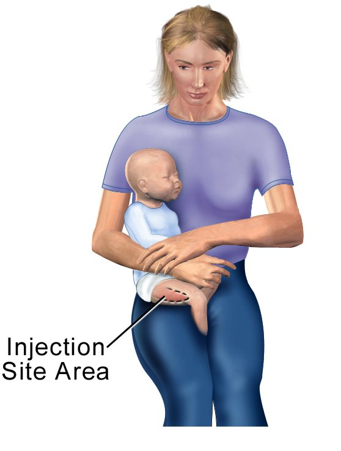

# Routes, doses and combination vaccines

**Prerequisites:** [Types of vaccines](02-types-of-vaccines.md); [Immunological memory](../../07-immunological-memory.md)

*Medical illustration of the intramuscular injection site on a child's thigh, where most infant vaccines are given. Credit: BruceBlaus. License: [CC BY-SA 4.0](https://creativecommons.org/licenses/by-sa/4.0). Source: [File:Injection Sites Intramuscular Thigh Child.png](https://commons.wikimedia.org/wiki/File:Injection_Sites_Intramuscular_Thigh_Child.png).*

## Routes of administration

How a vaccine enters the body affects the immune response and the side effects:

| Route | Where | Examples |
|---|---|---|
| **Intramuscular (IM)** | Thigh (infants) or deltoid (older children, adults) | Most non-live vaccines: DTaP, hepatitis B, HPV, pneumococcal, flu, COVID-19 |
| **Subcutaneous (SC)** | Fatty layer under skin | MMR, varicella (in some countries), yellow fever |
| **Intradermal (ID)** | Into the skin | BCG; dose-sparing rabies and polio regimens; the 2022 mpox dose-sparing strategy |
| **Oral** | Swallowed | Rotavirus, oral polio, oral cholera, oral typhoid |
| **Intranasal** | Sprayed in nose | Live attenuated influenza (FluMist) |
| **Scarification** | Skin scratched with bifurcated needle | Smallpox (vaccinia), historically |

Adjuvanted vaccines are given into muscle because injecting them under the skin causes more local reactions. Mucosal routes (oral, nasal) can generate IgA at the surfaces where many pathogens enter, which injected vaccines do less well. One claimed concern, that injection bypasses the "natural" mucosal route, is partly true for immune response type; whether it matters depends on the disease.

## Doses, intervals and boosters

Schedules specify a **primary series** (the doses needed to establish immunity) and **boosters** (later doses to restore waning protection). Rules underlying them include:

- **Minimum ages**: some vaccines do not work well in very young infants because of maternal antibody or immature responses; others (like hepatitis B) work from birth.
- **Minimum intervals**: doses given too close together may produce weaker responses; a dose given too early may need to be repeated.
- **No maximum interval** for most vaccines: "restart the series" is rarely needed; a delayed series is simply continued.
- **Spacing of live vaccines**: two injected live vaccines are given on the same day or at least four weeks apart.

Longer intervals between doses often produce higher and more durable responses. During the COVID-19 rollout, Canada and the UK extended the interval between doses partly for supply reasons; later studies suggested longer intervals also gave stronger responses and possibly lower myocarditis risk.

## Simultaneous administration

Children often receive several vaccines at one visit. National advisory committees recommend this because studies have found that giving the routine vaccines together does not reduce their effectiveness or meaningfully increase serious side effects, and it reduces missed opportunities and visits. Some parents prefer spacing them out ("alternative schedules"). The evidence and arguments on both sides, including the Institute of Medicine's 2013 review of the schedule as a whole ([Institute of Medicine, *The Childhood Immunization Schedule and Safety* (2013)](https://doi.org/10.17226/13563)), are in [[too-many-too-soon|too many, too soon]] and [alternative and delayed schedules](../05-schedules/10-alternative-and-delayed-schedules.md).

## Combination vaccines

Combination vaccines put several antigens in one injection:

- **MMR** (measles, mumps, rubella), 1971; **MMRV** adds varicella (2005 in the US).
- **DTaP-IPV-Hib** (Pentacel in the US; Pediacel and Pentacel in Canada), and **hexavalent** vaccines adding hepatitis B (Infanrix hexa, Vaxelis), widely used in Europe and Canada.
- **Pentavalent** DTwP-HepB-Hib, the workhorse of low-income countries' programmes.
- **Hepatitis A + B** (Twinrix).

Benefits: fewer injections, fewer visits, better coverage. Challenges: combining antigens can alter immune responses to individual components (for example, some combinations produce lower Hib antibody levels), so each combination must be tested. Combinations can also change side-effect profiles: MMRV in toddlers roughly doubles the risk of febrile seizures compared with MMR and varicella given separately on the same day ([Klein et al., *Pediatrics* 2010](https://doi.org/10.1542/peds.2010-0665)), so the US and Canada recommend separate MMR and varicella for the first dose (in September 2025, ACIP voted against MMRV for children under 4 altogether).

## Separate monovalent vaccines?

During the MMR scare, Andrew Wakefield recommended separate measles, mumps and rubella vaccines given a year apart. The UK government refused, arguing there was no evidence for it and that spacing would leave children unprotected for longer. Monovalent measles, mumps and rubella vaccines are no longer available in the US or Canada; Merck stopped producing them in 2009. The episode is described in [MMR and autism](../07-controversies/01-mmr-and-autism.md).

## Key ideas

- Most non-live vaccines are given intramuscularly; some live vaccines are subcutaneous or oral; mucosal routes generate local IgA.
- Schedules set minimum ages, minimum intervals and boosters; delayed series are usually continued, not restarted.
- Giving several vaccines at once is recommended because studies show no loss of effectiveness and fewer missed opportunities.
- Combination vaccines reduce injections but must be tested as combinations; MMRV raises febrile seizure risk in toddlers.

## Where this leads

- Next section: [Development, trials and regulation](../02-development-and-regulation/01-development-pipeline.md).
- Related: [how schedules are built](../05-schedules/01-how-schedules-are-built.md).
