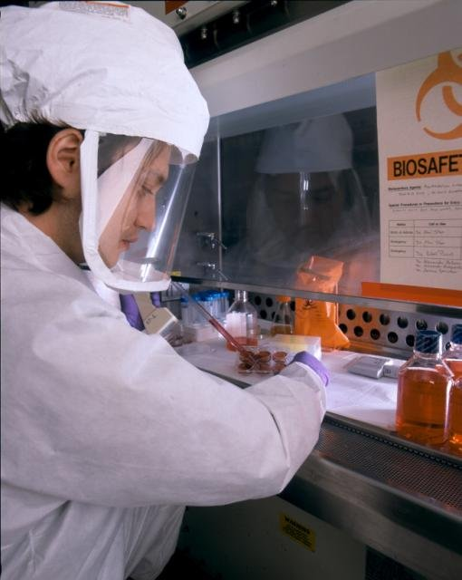

# The development pipeline

**Prerequisites:** [How vaccines work](../01-how-vaccines-work/01-how-vaccines-work.md); [Randomised controlled trials](../../../epidemiology/07-randomised-controlled-trials.md)

*A scientist at work in a vaccine research laboratory. Credit: NIAID. License: Public domain. Source: [File:West Nile Vaccine Research in BSL-3 Lab.jpg](https://commons.wikimedia.org/wiki/File:West_Nile_Vaccine_Research_in_BSL-3_Lab.jpg).*

## From idea to licensed product

Developing a vaccine traditionally takes 10 to 15 years and costs hundreds of millions to over a billion dollars, and most candidates fail. The process moves through stages, each designed to answer a question before more people are exposed.

```mermaid
flowchart LR
  E[Exploratory research:<br/>pathogen biology,<br/>protective antigen] --> P[Preclinical:<br/>cell and animal studies,<br/>toxicology]
  P --> IND[Regulator authorises<br/>human trials<br/>US: IND; Canada: CTA]
  IND --> P1[Phase 1:<br/>tens of people,<br/>safety, dose]
  P1 --> P2[Phase 2:<br/>hundreds,<br/>immune response, dose, schedule]
  P2 --> P3[Phase 3:<br/>thousands to tens of thousands,<br/>efficacy and safety]
  P3 --> L[Licensing review:<br/>FDA, Health Canada, EMA]
  L --> R[Recommendation:<br/>ACIP, NACI, JCVI]
  R --> P4[Phase 4:<br/>post-marketing<br/>surveillance and studies]
```

## Exploratory and preclinical work

Researchers first need to understand the pathogen: how it causes disease, which immune responses correlate with protection, and which antigens to target. Preclinical work tests candidates in cell cultures and animals (mice, ferrets for flu, non-human primates for many viral vaccines) for immunogenicity, protection against challenge, and toxicity. Animal results do not always predict human results: several HIV vaccine candidates that protected monkeys failed in people.

Before testing in humans, the developer must file an application with the regulator, such as an **Investigational New Drug (IND)** application with the FDA or a **Clinical Trial Application (CTA)** with Health Canada, containing manufacturing details and preclinical data. Trials must also be approved by research ethics boards, and participants give informed consent.

## Clinical phases

The clinical phases are explained in [their own lesson](02-clinical-trial-phases.md). In outline: phase 1 tests safety in a small group of healthy adults; phase 2 refines dose and schedule and looks at immune responses in the target population; phase 3 measures efficacy against disease (or, where a correlate of protection exists, immune responses) and safety in large numbers.

## Why so many fail

Candidates fail because they do not produce strong enough immunity, protection is too short, side effects are unacceptable, they cannot be manufactured consistently, or the disease is too rare to run an efficacy trial. Some pathogens defeated decades of effort: HIV (many large trials, no licensed vaccine), RSV (from the 1960s until 2023), and malaria (first partial success only recommended in 2021).

## Faster pathways

Regulators have several tools to speed development without, in principle, lowering the evidence bar:

- **Immunobridging**: if a correlate of protection exists, new versions can be approved on immune response rather than clinical efficacy (common for flu strain updates and new combination vaccines).
- **Accelerated approval** based on a surrogate endpoint, with confirmatory studies required.
- **Emergency Use Authorization (EUA)** in the US, or Interim Orders in Canada, during declared emergencies, allowing use on less complete data.
- **Parallel processes**: overlapping phases and manufacturing at financial risk before results, as in [[covid-19-vaccines-and-operation-warp-speed|Operation Warp Speed]].

Speed is a recurring source of distrust. Critics argued that COVID-19 vaccines were "rushed" and that long-term effects were unknown. Defenders replied that no phase was skipped, that most serious vaccine side effects historically appear within weeks to a few months of a dose, and that hundreds of millions of doses were subsequently monitored. Both statements contain truth: the trials were large and followed normal phases, but follow-up was months rather than years, and some rare effects (myocarditis, VITT) were found only after rollout. The 2025 FDA framework published by Vinay Prasad and Marty Makary moved in the opposite direction, requiring new placebo-controlled trials before updated COVID-19 vaccines could be licensed for healthy people under 65 ([Prasad & Makary, *NEJM* 2025, "An Evidence-Based Approach to Covid-19 Vaccination"](https://doi.org/10.1056/NEJMsb2506929)).

## Who pays

Most late-stage development is funded by manufacturers, often with public money for early research (NIH, universities) and sometimes for development and purchase (BARDA, CEPI, Gavi). Industry funding raises legitimate questions about conflicts of interest; see [[conflicts-of-interest-and-funding|conflicts of interest and funding]].

## Key ideas

- Development moves from exploratory research and animal studies through phase 1–3 human trials to licensing, recommendation and post-marketing surveillance.
- Most candidates fail; some diseases resisted vaccines for decades.
- Faster pathways (immunobridging, EUA, parallel processes) trade time for some certainty, and are a recurring source of distrust.
- Funding comes from both public and industry sources.

## Where this leads

- Next: [Clinical trial phases](02-clinical-trial-phases.md).
