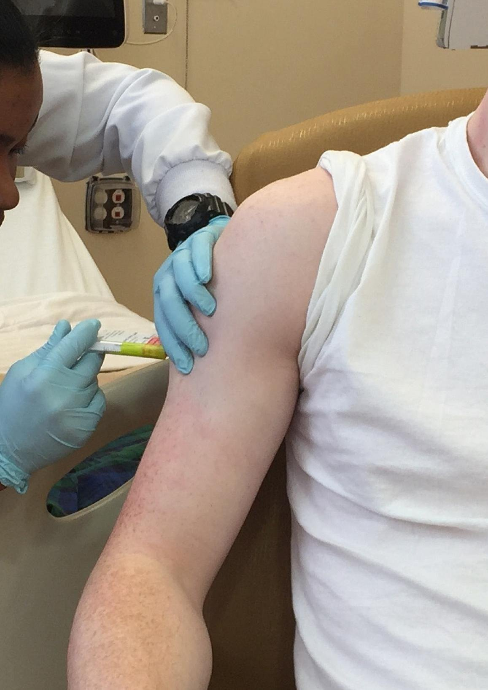
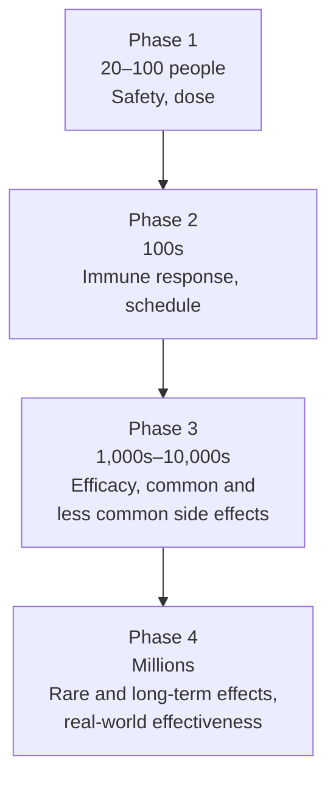

# Clinical trial phases

**Prerequisites:** [The development pipeline](01-development-pipeline.md); [Randomised controlled trials](../../../epidemiology/07-randomised-controlled-trials.md)

*A clinical trial in progress. Credit: NIAID. License: [CC BY 2.0](https://creativecommons.org/licenses/by/2.0). Source: [File:Clinical_Trial_Participant_Receives_Injection_(34033294061).jpg](https://commons.wikimedia.org/wiki/File:Clinical_Trial_Participant_Receives_Injection_%2834033294061%29.jpg).*

## Phase 1: is it safe enough to continue?

- **Who**: usually 20–100 healthy adult volunteers (for childhood vaccines, adults first, then stepping down in age).
- **What**: safety and reactogenicity at different doses; early immune responses.
- **Design**: often open-label or with a small placebo group; dose escalation.

## Phase 2: what dose and schedule?

- **Who**: hundreds of people, increasingly resembling the target population (age, risk group).
- **What**: immune responses at different doses and schedules; more safety data; sometimes early signals of efficacy.
- **Design**: usually randomised and controlled.

## Phase 3: does it work, and is it safe in large numbers?

- **Who**: thousands to tens of thousands of people. Examples: Pfizer–BioNTech COVID-19, about 44,000; the REST rotavirus trial of RotaTeq, about 70,000 infants, sized specifically to rule out the intussusception risk seen with an earlier vaccine ([Vesikari et al., *NEJM* 2006 (RotaTeq trial)](https://doi.org/10.1056/NEJMoa052664)); FUTURE II for Gardasil, about 12,000 women ([FUTURE II Study Group, *NEJM* 2007](https://doi.org/10.1056/NEJMoa061741)).
- **What**: efficacy against a clinical endpoint (or immunogenicity where a correlate of protection is accepted), and safety including less common adverse events.
- **Design**: randomised, controlled, ideally double-blind, with pre-specified endpoints and an independent **data and safety monitoring board (DSMB)** that can stop the trial for harm, futility or overwhelming benefit.

## Phase 4: after licensing

Post-licensure ("phase 4") studies and surveillance look for rare adverse events, measure effectiveness in real populations and subgroups, and assess duration of protection. Regulators may require specific post-marketing studies as a condition of approval. See [post-market surveillance](07-post-market-surveillance.md).

## Statistical power and rare events

A useful rule of thumb, the **"rule of three"**: if no event is seen among *n* people, the upper 95% confidence limit on its rate is about 3/*n*. A trial with 30,000 vaccinated people that sees no cases of a particular serious event can only conclude the true rate is probably below about 1 in 10,000. Events at 1 in 100,000 (like VITT) or concentrated in a subgroup (like myocarditis in young males) are effectively invisible in pre-licensure trials. This is why post-marketing surveillance is essential, not optional.

## Common criticisms of vaccine trials

Critics raise several points; some are well founded, some disputed:

- **Control groups.** Many trials used active comparators or adjuvant-containing controls rather than saline. See [the placebo controls debate](03-placebo-controls-debate.md).
- **Short follow-up.** Solicited adverse events are often recorded for 7 days and unsolicited ones for about 28 days to 6 months after each dose, though serious adverse events are usually collected for longer. Critics argue this misses delayed effects; defenders note that serious adverse events are tracked longer and that biologically plausible vaccine reactions occur within weeks.
- **Exclusions.** Pregnant women, people with chronic conditions and the very old are often excluded, leaving gaps.
- **Reanalyses.** In 2022 Joseph Fraiman, Peter Doshi and colleagues reanalysed serious adverse events in the Pfizer and Moderna trials and reported an excess risk of serious adverse events of special interest of about 1 in 800 in vaccine recipients ([Fraiman et al., *Vaccine* 2022](https://doi.org/10.1016/j.vaccine.2022.08.036)). Others criticised the method (counting events rather than people, and the selection of events). The paper is an example of independent scrutiny using published trial data, and of how contested such reanalyses can be.
- **Data access.** Participant-level data from industry trials are often not public. Groups including the BMJ have called for full data release; Pfizer's COVID-19 trial documents were released by court order in the US after a FOIA lawsuit by a group of medical professionals (Public Health and Medical Professionals for Transparency) in 2022.

## Key ideas

- Phase 1 tests safety and dose; phase 2 refines dose and schedule; phase 3 measures efficacy and safety at scale; phase 4 follows millions after licensing.
- Independent monitoring boards oversee large trials.
- Trials cannot reliably detect events rarer than about 3 divided by the number vaccinated.
- Control groups, follow-up length, exclusions and data access are legitimate subjects of debate.

## Where this leads

- Next: [The placebo controls debate](03-placebo-controls-debate.md).
