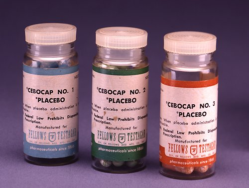

# The placebo controls debate

**Prerequisites:** [Clinical trial phases](02-clinical-trial-phases.md); [Randomised controlled trials](../../../epidemiology/07-randomised-controlled-trials.md)

*Placebo pills; in vaccine trials a placebo is usually a saline injection. Credit: NIH, objects donated by Elaine and Arthur Shapiro. License: Public domain. Source: [File:Cebocap.jpg](https://commons.wikimedia.org/wiki/File:Cebocap.jpg).*

## The claim

A long-standing criticism of vaccine regulation is that many vaccines, particularly on the childhood schedule, were licensed without trials comparing them with an **inert placebo** such as saline. Instead, control groups often received another vaccine, or a "placebo" that contained the adjuvant and other ingredients but not the antigen. Critics argue that without an inert control, the true rate of adverse events caused by the vaccine (including the adjuvant) cannot be known.

## Who makes it and why

The argument has been pressed for years by vaccine-safety advocacy groups such as the National Vaccine Information Center and the Informed Consent Action Network (ICAN), whose lawyer Aaron Siri has used it in litigation and petitions. Robert F. Kennedy Jr. made it a central theme before and after becoming US Secretary of Health and Human Services in 2025. In May 2025 HHS stated that all new vaccines would require placebo-controlled trials, and the FDA's COVID-19 framework called for saline-controlled trials in healthy people under 65 ([Prasad & Makary, *NEJM* 2025, "An Evidence-Based Approach to Covid-19 Vaccination"](https://doi.org/10.1056/NEJMsb2506929)). The January 2026 HHS schedule decision promised "double-blind placebo controlled randomized trials" of vaccines and the schedule ([HHS fact sheet, "CDC Childhood Immunization Recommendations" (January 2026)](https://www.hhs.gov/press-room/fact-sheet-cdc-childhood-immunization-recommendations.html)).

Some mainstream researchers share part of the concern. The Cochrane HPV review controversy turned partly on the use of aluminium-adjuvant controls ([Jørgensen, Gøtzsche & Jefferson, *BMJ Evidence-Based Medicine* 2018](https://doi.org/10.1136/bmjebm-2018-111012)), and Peter Doshi and others have argued that adjuvant controls make it harder to detect adjuvant-related harms.

## The evidence and facts

- **Saline-controlled trials do exist for many vaccines**, including the 1954 Salk polio trial, rotavirus vaccine trials, the original Pfizer and Moderna COVID-19 trials, many influenza vaccine trials, the Shingrix trials, RSV vaccine trials and the Moderna mRNA RSV trial.
- **Active or adjuvant controls were used in others.** In Gardasil's pivotal trials, most control participants received an aluminium adjuvant; a smaller group received saline. Many new childhood combination vaccines were compared with already-licensed vaccines, and some older vaccines (such as the original DTP and MMR) were licensed decades ago under different standards.
- **The ethical rationale.** International research ethics (the Declaration of Helsinki, CIOMS guidelines) restrict giving a placebo when an effective intervention exists and withholding it risks serious harm. Once a vaccine protecting against, say, Hib meningitis exists, giving infants saline instead means some will get meningitis. Defenders of current practice argue that the question for a new vaccine is usually "is it better or safer than what we have?", which an active comparator answers.
- **The scientific rationale for adjuvant controls.** Using an adjuvant-only control isolates the effect of the antigen and preserves blinding (adjuvants cause sore arms, saline does not). Critics answer that this masks any harms caused by the adjuvant itself.
- **Supplementary evidence.** Post-licensure observational studies compare vaccinated with unvaccinated people, though with the confounding problems in [bias and confounding](../../../epidemiology/10-bias-and-confounding.md).

## What major reviews concluded

The Institute of Medicine's 2013 review of the childhood schedule ([Institute of Medicine, *The Childhood Immunization Schedule and Safety* (2013)](https://doi.org/10.17226/13563)) found no evidence that the schedule as a whole was unsafe but acknowledged that studies of the entire schedule, including comparisons with unvaccinated children, were limited. It judged a new randomised trial of the full schedule versus no vaccines (or a delayed schedule) to be unethical, and recommended using existing data systems such as the Vaccine Safety Datalink to study the schedule's safety.

## Open questions

- How much additional safety information would inert-placebo trials of existing vaccines add, compared with large observational studies?
- Can ethical designs be found, such as trials of a *delayed* schedule, of vaccines without strong existing recommendations (for example, boosters in low-risk groups), or in settings where a vaccine is not yet available?
- Who should run and fund such trials so that results are trusted by both sides?

This is one of the genuinely open debates in vaccine policy, though both sides often overstate their case: it is not true that "no vaccine was ever tested against a placebo", and it is not true that existing trials leave no gaps.

## Key ideas

- Critics argue that active and adjuvant controls obscure vaccines' true adverse-event rates.
- Many vaccines have had saline-controlled trials; many others used active or adjuvant controls for ethical or scientific reasons.
- Research ethics restrict withholding effective vaccines; adjuvant controls preserve blinding but can mask adjuvant harms.
- Since 2025, US federal health agencies have adopted the call for more placebo-controlled trials; how to do so ethically is unresolved.

## Where this leads

- Next: [Trial ethics and human challenge studies](04-trial-ethics-and-human-challenge-studies.md).
- Related: [[aluminium-adjuvants|aluminium adjuvants]], [[too-many-too-soon|too many, too soon]].
