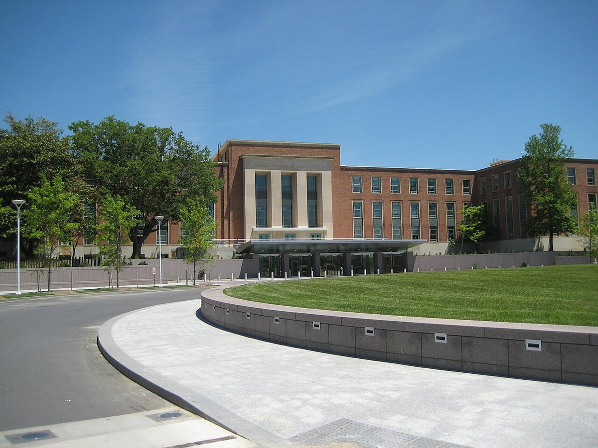

# Licensing and regulators

**Prerequisites:** [Clinical trial phases](02-clinical-trial-phases.md)

*The main entrance of Building 1 at the FDA's White Oak campus in Silver Spring, Maryland, which houses the Commissioner's office. Credit: The U.S. Food and Drug Administration. License: Public domain. Source: [File:FDA Bldg 1 - Exterior With Circle (5161374950).jpg](https://commons.wikimedia.org/wiki/File:FDA_Bldg_1_-_Exterior_With_Circle_%285161374950%29.jpg).*

## Two separate decisions

In most countries, two different bodies make two different decisions:

1. **Licensing (authorisation)**: a regulator decides whether a vaccine is safe, effective and well made enough to be sold. This is a decision about the *product*.
2. **Recommendation**: an advisory committee and the health ministry decide *who should get it* and whether it goes on the public schedule. See [advisory committees](06-advisory-committees-acip-naci-and-jcvi.md).

A vaccine can be licensed but not recommended for routine use, or recommended only for some groups.

## United States: FDA, CBER and VRBPAC

The **Food and Drug Administration** regulates vaccines as biologics through its **Center for Biologics Evaluation and Research (CBER)**. A manufacturer submits a **Biologics License Application (BLA)** with trial data and detailed manufacturing information; the FDA inspects facilities and reviews every lot's release testing. The **Vaccines and Related Biological Products Advisory Committee (VRBPAC)**, made up of outside experts, holds public meetings and votes on applications and each year's influenza strains, but its votes are advisory.

During a declared emergency, the FDA can issue an **Emergency Use Authorization (EUA)**, as it did for COVID-19 vaccines in December 2020, before full licensure in 2021 (Pfizer–BioNTech's Comirnaty in August 2021).

FDA vaccine leadership changed sharply in 2025. CBER director Peter Marks resigned in March 2025 under pressure from HHS, and Vinay Prasad, a haematologist-oncologist and prominent critic of COVID-19 policy, was appointed. In May 2025 Prasad and FDA Commissioner Marty Makary announced the narrower COVID-19 framework requiring randomised trials for healthy people under 65 ([Prasad & Makary, *NEJM* 2025, "An Evidence-Based Approach to Covid-19 Vaccination"](https://doi.org/10.1056/NEJMsb2506929)).

## Canada: Health Canada

**Health Canada**'s Biologic and Radiopharmaceutical Drugs Directorate reviews vaccines and issues a Notice of Compliance; it also tests lots before release. During COVID-19 it used Interim Orders for faster authorisation. Recommendations come separately from NACI, and each province and territory decides what it funds.

## European Union: EMA

The **European Medicines Agency** reviews vaccines through a centralised procedure; its Committee for Medicinal Products for Human Use (CHMP) gives an opinion, and the European Commission grants the authorisation, valid across the EU. Its Pharmacovigilance Risk Assessment Committee (PRAC) evaluates safety signals. During COVID-19, EMA used "conditional marketing authorisation", which requires further data after approval. National bodies (in the UK, since Brexit, the MHRA) license separately.

## WHO prequalification

Many low- and middle-income countries lack the capacity to review every vaccine. **WHO prequalification**, running since 1987, assesses vaccines for quality, safety and efficacy so that UN agencies such as UNICEF and Gavi can buy them. A vaccine's prequalification often determines whether it reaches the world's poorest children. WHO also issues **Emergency Use Listings**.

## Manufacturing oversight

Licensing covers the factory as much as the product: Good Manufacturing Practice, facility inspections and lot release testing. The importance of manufacturing was shown by the 1955 [[salk-sabin-and-the-cutter-incident|Cutter incident]], when incompletely inactivated polio vaccine paralysed children, which led to stronger federal oversight.

## Criticisms of regulators

- **User fees.** Since 1992 (PDUFA), the FDA has been funded partly by fees paid by companies whose products it reviews. Critics argue this creates dependence on industry; defenders say fees fund reviewers and speed reviews without buying outcomes. See [[conflicts-of-interest-and-funding|conflicts of interest and funding]].
- **Revolving door.** Some senior regulators later work for manufacturers. Scott Gottlieb, FDA commissioner 2017–2019, joined Pfizer's board in 2019.
- **Political pressure.** Concerns about political interference were raised under the first Trump administration's push for fast COVID-19 approvals and again, from a different direction, after the 2025 changes at HHS and FDA.

## Key ideas

- Licensing (is the product good enough to sell?) is separate from recommendation (who should get it?).
- The FDA (CBER, advised by VRBPAC), Health Canada, EMA and others license vaccines; WHO prequalification enables UN purchase.
- Emergency pathways allow use on less complete data during crises.
- User fees, the revolving door and political pressure are recurring criticisms.

## Where this leads

- Next: [Advisory committees: ACIP, NACI and JCVI](06-advisory-committees-acip-naci-and-jcvi.md).
