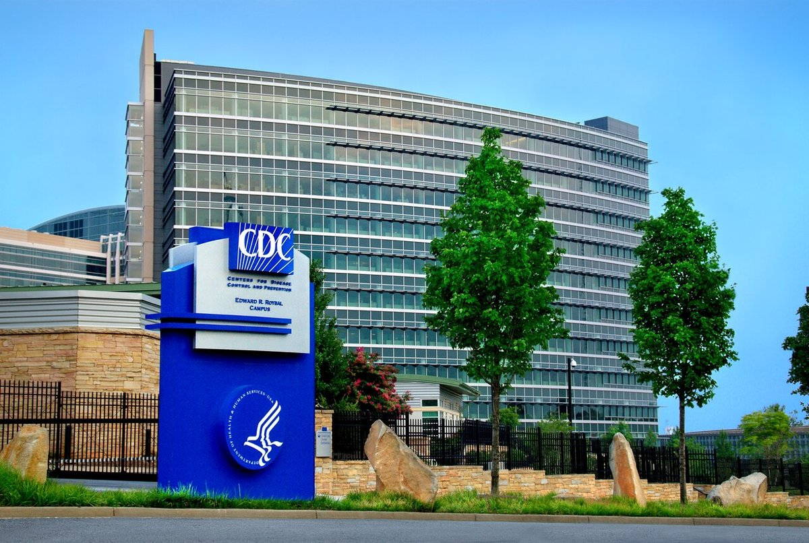

# Advisory committees: ACIP, NACI and JCVI

**Prerequisites:** [Licensing and regulators](05-licensing-and-regulators.md)

*The CDC's Roybal campus in Atlanta, where ACIP has traditionally met. Credit: James Gathany, Centers for Disease Control and Prevention. License: Public domain. Source: [File:CDC Headquarters PHIL 10693.tif](https://commons.wikimedia.org/wiki/File:CDC_Headquarters_PHIL_10693.tif).*

## What they do

Once a vaccine is licensed, an expert committee weighs the disease burden, vaccine efficacy and safety, cost-effectiveness, feasibility and equity, and recommends who should receive it. In most countries these recommendations drive the public schedule and funding.

| Country | Committee | Founded | Advises |
|---|---|---|---|
| United States | Advisory Committee on Immunization Practices (ACIP) | 1964 | CDC director |
| Canada | National Advisory Committee on Immunization (NACI) | 1964 | Public Health Agency of Canada |
| United Kingdom | Joint Committee on Vaccination and Immunisation (JCVI) | 1963 | Health departments |
| Germany | Standing Committee on Vaccination (STIKO) | 1972 | Robert Koch Institute |
| Global | Strategic Advisory Group of Experts on Immunization (SAGE) | 1999 | WHO |

## ACIP and why it matters

ACIP recommendations, once adopted by the CDC director, set the US immunisation schedule. They have legal and financial effects: under the Affordable Care Act most private insurers must cover ACIP-recommended vaccines without cost-sharing; the **Vaccines for Children** program buys vaccines for about half of US children based on ACIP votes; and vaccines recommended for routine use in children or pregnant women are covered by the [[vaccine-injury-compensation-program|Vaccine Injury Compensation Program]] once Congress applies the excise tax. ACIP has used the GRADE framework and an "Evidence to Recommendations" process since 2010.

## ACIP in 2025–2026

On 9 June 2025, HHS Secretary Robert F. Kennedy Jr. removed all 17 ACIP members, saying the committee had been plagued by conflicts of interest and had become a "rubber stamp". He appointed new members, including Martin Kulldorff (chair), Retsef Levi, Robert Malone and Cody Meissner, and later others; several new members had criticised COVID-19 vaccine policy or vaccine safety more broadly ([CDC newsroom, ACIP June 2025 meeting votes](https://www.cdc.gov/media/releases/2025/2025-cdcs-advisory-committee-on-immunization-concludes-meeting-with-joint-statement.html)). Kulldorff left in December 2025 for an HHS post and Kirk Milhoan, a paediatric cardiologist, became chair ([CDC, "ACIP Committee Members"](https://www.cdc.gov/acip/membership/index.html)). Votes by the reconstituted committee included preferring thimerosal-free flu vaccines (June 2025), moving COVID-19 vaccination to individual decision-making and advising against MMRV under age 4 (September 2025), and ending the universal hepatitis B birth-dose recommendation for infants of HBsAg-negative mothers (December 2025) ([CDC newsroom, ACIP hepatitis B birth-dose vote (5 December 2025)](https://www.cdc.gov/media/releases/2025/2025-acip-recommends-individual-based-decision-making-for-hepatitis-b-vaccine-for-infants-born-to-women.html)). Further members were appointed in early 2026 ([CDC newsroom, two new ACIP appointments (27 February 2026)](https://www.cdc.gov/media/releases/2026/2026-secretary-kennedy-appoints-two-physicians-to-cdcs-advisory-committee-on-immunization-practices.html)).

Supporters argued the old committee was too close to industry and too quick to expand the schedule. Critics, including the American Academy of Pediatrics, many former members and medical societies, argued the new members lacked relevant expertise, that votes bypassed the usual evidence review, and that the purge politicised the process. Several medical organisations began issuing their own schedules. In January 2026 HHS cut the routine childhood schedule (see [the US schedule](../05-schedules/02-the-us-schedule.md)); in March 2026 a federal court preliminarily blocked that overhaul and the reconstituted committee's operation in *American Academy of Pediatrics v. Kennedy*, a ruling under appeal at the time of writing ([*American Academy of Pediatrics v. Kennedy*, First Circuit docket 26-1503 (CourtListener)](https://www.courtlistener.com/docket/73286021/american-academy-of-pediatrics-v-kennedy/)).

## NACI and provincial decisions

NACI issues national recommendations, but in Canada's federation each province and territory decides its own funded schedule, informed by provincial bodies such as Ontario's Public Health Ontario and Quebec's Comité sur l'immunisation du Québec. This is why schedules differ between provinces. See [Canada's schedule](../05-schedules/03-canadas-schedule.md).

## JCVI

JCVI's advice in England is linked to cost-effectiveness: the government is legally required to implement JCVI recommendations that are cost-effective. It is notable for sometimes choosing *not* to recommend vaccines used elsewhere; for example, the UK long declined routine chickenpox vaccination because of concern that it could shift infection to adults and increase shingles. JCVI changed its advice in November 2023, and MMRV replaced MMR in the UK childhood programme on 1 January 2026 ([UKHSA, "MMRV vaccination: information for healthcare professionals"](https://www.gov.uk/government/publications/mmrv-programme-information-for-healthcare-practitioners/mmrv-vaccination-information-for-healthcare-professionals)). See [the UK schedule](../05-schedules/04-the-uk-schedule.md).

## Conflicts of interest on committees

Members must declare financial interests; ACIP members with conflicts are supposed to recuse from related votes. A 2000 US House Government Reform Committee report (chaired by Dan Burton) criticised conflicts on ACIP and VRBPAC, including around the rotavirus vaccine. The 2009 HHS Inspector General found CDC's ethics oversight of its advisory committee members inadequate. Both reports are often cited by critics. See [[conflicts-of-interest-and-funding|conflicts of interest and funding]].

## Key ideas

- Advisory committees decide who should receive licensed vaccines; their recommendations drive schedules, funding and insurance coverage.
- ACIP was replaced wholesale in June 2025, then voted to narrow several recommendations; the resulting schedule overhaul was blocked in court in 2026.
- In Canada, NACI advises nationally but provinces decide; in England, JCVI's advice is tied to cost-effectiveness.
- Conflicts of interest on committees are a long-standing concern.

## Where this leads

- Next: [Post-market surveillance](07-post-market-surveillance.md).
