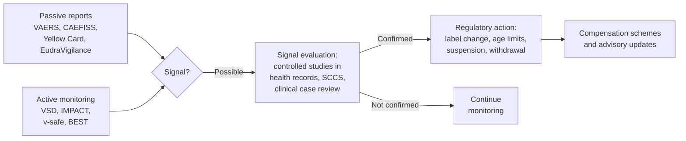

# Post-market surveillance

**Prerequisites:** [Clinical trial phases](02-clinical-trial-phases.md); [Surveillance: passive and active](../../../epidemiology/12-surveillance-passive-and-active.md)

## Why surveillance never stops

As [the trials lesson](02-clinical-trial-phases.md) explained, pre-licensure trials of tens of thousands cannot detect events rarer than about 1 in 10,000, or effects confined to subgroups not well represented in trials. Once a vaccine is given to millions, rare problems can emerge. Post-market surveillance has two stages: **detecting signals** (a possible problem worth investigating) and **evaluating signals** (testing whether the vaccine really causes it).

## Detecting signals

- **Passive (spontaneous) reporting** systems collect reports from anyone: health workers, manufacturers, patients. They are cheap, broad and fast, and can pick up unexpected events, but they cannot establish causation or rates. See [reading VAERS correctly](08-reading-vaers-correctly.md) and [surveillance outside the US](10-surveillance-outside-the-us.md).
- **Active surveillance** systems monitor defined populations, often through electronic health records, comparing observed events with expected rates. See [active surveillance systems](09-active-surveillance-systems.md).
- **Statistical data mining** of large report databases looks for disproportionate reporting (an event reported more often with one vaccine than with others).

## Evaluating signals

A signal is a hypothesis. Evaluating it requires controlled studies: cohort studies in health-record databases, [self-controlled case series](../../../epidemiology/09-self-controlled-designs.md) comparing risk windows after vaccination with other periods in the same people, case-control studies, and clinical review of individual cases against standard case definitions such as those of the Brighton Collaboration ([Bonhoeffer et al., *Vaccine* 2002 (Brighton Collaboration)](https://doi.org/10.1016/s0264-410x(02)00449-8)). Biological mechanism and consistency across countries are also weighed; see [causality assessment](../06-adverse-events/13-causality-assessment.md).

## Who runs it

In the US, surveillance is split among the CDC (VAERS with FDA, the Vaccine Safety Datalink, the Clinical Immunization Safety Assessment project), the FDA (BEST and Medicare data) and others such as the Department of Defense and Veterans Affairs. Canada relies on CAEFISS, run by the Public Health Agency of Canada with the provinces, plus the hospital-based IMPACT network. The UK's MHRA runs the Yellow Card scheme, the EU's EMA runs EudraVigilance, and WHO's Uppsala Monitoring Centre pools reports from more than 150 countries in VigiBase. Manufacturers are legally required to report adverse events they learn about and to submit periodic safety reports.

## The system's track record

Examples show both successes and limits:

- **RotaShield and intussusception (1999).** VAERS reports of intussusception after the first rotavirus vaccine prompted investigation; controlled studies confirmed the risk ([Murphy et al., *NEJM* 2001](https://doi.org/10.1056/NEJM200102223440804)) and the vaccine was withdrawn within about a year of licensure. See [intussusception and rotavirus vaccines](../06-adverse-events/05-intussusception-and-rotavirus-vaccines.md).
- **MMRV and febrile seizures.** The Vaccine Safety Datalink found about one extra febrile seizure per 2,300 doses when MMRV was given as the first dose at 12–23 months, compared with separate MMR and varicella ([Klein et al., *Pediatrics* 2010](https://doi.org/10.1542/peds.2010-0665)), leading to a preference for separate vaccines for the first dose in the US.
- **Pandemrix and narcolepsy (2010).** Detected first by clinicians and national systems in Finland and Sweden, not by routine signal detection ([Nohynek et al., *PLoS One* 2012](https://doi.org/10.1371/journal.pone.0033536)). See [narcolepsy and Pandemrix](../06-adverse-events/07-narcolepsy-and-pandemrix.md).
- **VITT and myocarditis (2021).** Rare clotting with adenovirus-vector COVID-19 vaccines was identified within weeks of mass rollout in Europe; myocarditis after mRNA vaccines was identified first in Israel and the US military, then confirmed in active systems ([Klein et al., *JAMA* 2021](https://doi.org/10.1001/jama.2021.15072); [Mevorach et al., *NEJM* 2021](https://doi.org/10.1056/NEJMoa2109730)).

Critics point out that the systems are run by the same agencies that recommend vaccines, which they see as a conflict, and that some signals (Pandemrix) were missed by formal systems. Defenders note that each of these signals was found, confirmed and acted on.

## Key ideas

- Post-market surveillance detects rare or subgroup-specific harms that trials cannot.
- Passive systems generate signals; active systems and controlled studies test them.
- Signals have led to withdrawals, label changes and age restrictions (RotaShield, MMRV, Pandemrix, adenovirus-vector and mRNA COVID-19 vaccines).
- Agency independence is a recurring point of debate.

## Where this leads

- Next: [Reading VAERS correctly](08-reading-vaers-correctly.md).
