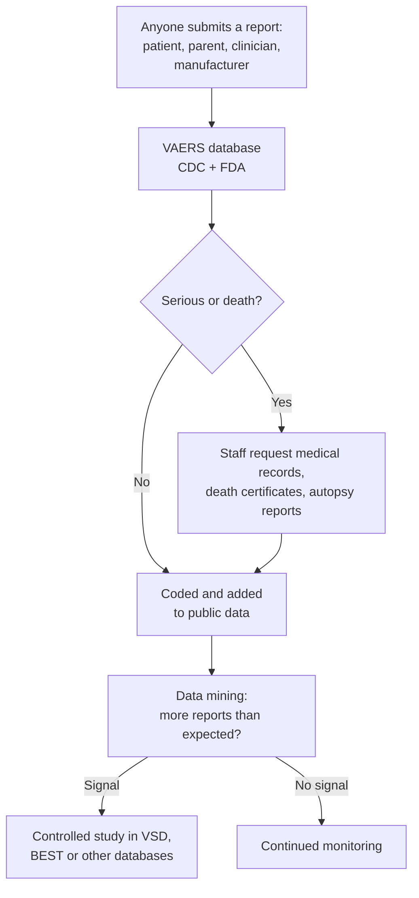

# Reading VAERS correctly

**Prerequisites:** [Post-market surveillance](07-post-market-surveillance.md); [Base rates and coincidence](../../../epidemiology/11-base-rates-and-coincidence.md)

## What VAERS is

The **Vaccine Adverse Event Reporting System** was established in 1990, under the National Childhood Vaccine Injury Act of 1986, and is run jointly by the CDC and FDA. Anyone (patients, parents, doctors, pharmacists, manufacturers) can submit a report of any health problem after any vaccine. Health providers are required to report certain events, and manufacturers must report adverse events they learn about. The data, minus personal identifiers, are publicly searchable online ([Shimabukuro et al., *Vaccine* 2015 (VAERS)](https://doi.org/10.1016/j.vaccine.2015.07.035)).

## What VAERS is good for

VAERS is an **early warning system**. It is good at detecting unusual patterns quickly: new kinds of events, clusters by vaccine lot, or more reports than expected. It flagged intussusception after RotaShield in 1999 and contributed to early detection of clotting with the Johnson & Johnson COVID-19 vaccine and anaphylaxis after mRNA vaccines ([Shimabukuro & Nair, *JAMA* 2021](https://doi.org/10.1001/jama.2021.0600)).

## What VAERS cannot do

Every VAERS search page carries a disclaimer: a report does not mean the vaccine caused the event. The limitations follow from how the data are gathered:

1. **No proof of cause.** A report means only that something happened after a vaccine. Some events would have happened anyway ([base rates](../../../epidemiology/11-base-rates-and-coincidence.md)). With millions of doses, many heart attacks, strokes and deaths will occur within days of vaccination by chance alone, especially among older people.
2. **Under-reporting.** A 2010 project at Harvard Pilgrim Health Care using automated detection in health records estimated that fewer than 1% of vaccine adverse events were reported to VAERS ([Lazarus et al., *Electronic Support for Public Health–VAERS* final report to AHRQ (2010)](https://digital.ahrq.gov/sites/default/files/docs/publication/r18hs017045-lazarus-final-report-2011.pdf)). Serious events are reported far more completely than mild ones.
3. **Stimulated reporting.** Publicity, litigation and campaigns increase reports. In 2006, Goodman and Nordin showed that many VAERS reports of autism, "mental retardation" and thimerosal-related problems in the early 2000s were linked to litigation ([Goodman & Nordin, *Pediatrics* 2006](https://doi.org/10.1542/peds.2004-2687)).
4. **Variable quality.** Reports may be incomplete, duplicated or unverified. Deliberately false reports are possible (submitting one is a federal crime). Serious reports and deaths are followed up by CDC and FDA staff who request medical records.
5. **No denominator.** VAERS does not know how many people were vaccinated, so counts cannot be turned into rates without external data, and comparisons between vaccines with different numbers of doses or different publicity are misleading.

## A worked example

Suppose 10 million older adults are vaccinated in a month, and (as a round illustrative figure) 3% of people in their age group die each year. Then roughly 25,000 of them would be expected to die in any given month from all causes, vaccine or no vaccine. If even a small fraction of those deaths are reported because they happened shortly after vaccination, VAERS will contain thousands of death reports. The question is not "are there death reports?" but "are there *more* deaths, or *particular kinds* of deaths, than expected?", which requires comparison with background rates and controlled studies.

## COVID-19 and VAERS

COVID-19 vaccination generated an unprecedented volume of VAERS reports, reflecting the size and speed of the programme, intense publicity, and a requirement under the Emergency Use Authorizations that providers report deaths and serious adverse events after vaccination regardless of suspected cause. Counts of death reports were widely shared as evidence of mass harm. Statements from CDC and FDA stressed that reports are not causal findings, while confirming specific harms such as deaths from VITT.

Active systems with denominators address the question better. A 2021 Vaccine Safety Datalink study covering millions of people found that non-COVID-19 death rates were *lower* among vaccinated than unvaccinated people of similar age and sex ([Xu et al., *MMWR* 2021](https://doi.org/10.15585/mmwr.mm7043e2)). The authors themselves noted that this almost certainly reflects a **healthy vaccinee effect** (people who are very ill or near death are less likely to get vaccinated) rather than vaccines preventing non-COVID deaths, a reminder that observational comparisons have biases in both directions. Critics argue that VAERS under-reporting means true harms exceed what is reported; defenders reply that under-reporting does not turn coincidental reports into causal ones. Both points underline that VAERS alone cannot answer the question.

## How to read VAERS honestly

- Treat it as a source of hypotheses.
- Ask for a denominator and the expected background rate.
- Check whether reports were followed up and whether controlled studies have tested the signal.
- Remember that both "VAERS proves harm" and "VAERS proves safety" misuse the system.

## Key ideas

- VAERS is a passive, open, early-warning system run by CDC and FDA since 1990.
- Reports are not proof of causation; they are affected by under-reporting, stimulated reporting and variable quality, and have no denominator.
- Signals from VAERS must be tested in controlled studies with background rates.

## Where this leads

- Next: [Active surveillance systems](09-active-surveillance-systems.md).
- For the general method, see [passive surveillance and pharmacovigilance](../../../../science/research-methods/reading-research/03-study-designs/13-passive-surveillance-and-pharmacovigilance.md) in the reading-research course.
