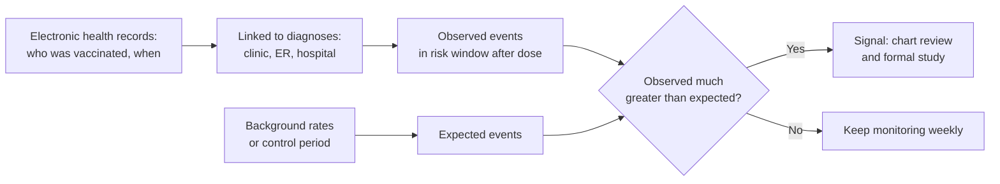

# Active surveillance systems

**Prerequisites:** [Post-market surveillance](07-post-market-surveillance.md); [Self-controlled designs](../../../epidemiology/09-self-controlled-designs.md)

## The idea

Passive systems wait for reports. **Active** systems go looking: they monitor a defined population whose vaccinations and health outcomes are recorded, so they know both the numerator (events) and the denominator (people vaccinated), and can compare vaccinated with unvaccinated people, or risk periods with control periods in the same people.

## The Vaccine Safety Datalink (US)

The **VSD**, started in 1990, is a collaboration between the CDC and integrated health-care organisations (such as Kaiser Permanente regions) that link vaccination records with diagnoses from clinic visits, emergency departments and hospitals ([McNeil et al., *Vaccine* 2014 (VSD)](https://doi.org/10.1016/j.vaccine.2014.07.073)). It covers several million people a year.

- **Rapid cycle analysis** monitors newly introduced vaccines weekly against pre-specified outcomes, comparing observed with expected counts. During COVID-19 it tracked 23 outcomes after mRNA vaccination and confirmed the myocarditis signal in young males while finding no increased risk for most other outcomes ([Klein et al., *JAMA* 2021](https://doi.org/10.1001/jama.2021.15072)).
- **Studies** using VSD data examined MMRV and febrile seizures ([Klein et al., *Pediatrics* 2010](https://doi.org/10.1542/peds.2010-0665)), thimerosal and neuropsychological outcomes ([Thompson et al., *NEJM* 2007](https://doi.org/10.1056/NEJMoa071434)), thimerosal and autism ([Price et al., *Pediatrics* 2010](https://doi.org/10.1542/peds.2010-0309)), antigen exposure and autism ([DeStefano, Price & Weintraub, *J Pediatrics* 2013](https://doi.org/10.1016/j.jpeds.2013.02.001)), and the childhood schedule.

**Criticisms.** VSD data are not public, for privacy reasons; outside researchers must apply and often work on-site. Critics, including the Geiers in the early 2000s and later advocacy groups, complained of restricted access and called for independent analysis. The 2013 IOM report recommended VSD as the best existing tool to study the schedule's safety, and in 2025 HHS brought in David Geier, whose earlier access to VSD data in the 2000s had ended in a dispute with the CDC, to re-examine VSD data, a move criticised by many scientists and defended by Secretary Kennedy as a check on the CDC's earlier work ([NBC News, "The little-known database at the heart of Kennedy's vaccine conspiracy theory" (2025)](https://www.nbcnews.com/health/health-news/kennedy-vaccine-safety-datalink-conspiracy-theory-rcna203411)).

## Clinical Immunization Safety Assessment (CISA)

Established in 2001, **CISA** is a network of vaccine-safety experts at academic medical centres who consult on individual complex cases, such as whether a patient with a previous reaction can safely receive more doses, and conduct clinical research ([Williams et al., *Vaccine* 2011 (CISA)](https://doi.org/10.1016/j.vaccine.2011.07.044)).

## v-safe

Launched for COVID-19 in December 2020, **v-safe** was a smartphone-based system in which vaccinated people voluntarily received text check-ins about symptoms. Millions enrolled; analyses described the frequency of local and systemic reactions ([Rosenblum et al., *Lancet Infect Dis* 2022](https://doi.org/10.1016/s1473-3099(22)00054-8)). It also fed a pregnancy registry. Because enrolment was voluntary and there was no unvaccinated comparison, v-safe described reactions but could not by itself establish causation for serious events. The Informed Consent Action Network obtained the free-text and check-box data through a lawsuit, and its release in 2022 prompted new disputes about interpretation.

## FDA BEST and other US systems

The FDA's **Biologics Effectiveness and Safety (BEST)** initiative, begun in 2017, uses large insurance-claims and health-record databases, including Medicare data for people over 65, to study vaccine safety. The Department of Defense and Veterans Affairs run their own systems; myocarditis after mRNA vaccines was described early in US military personnel.

## Canada: IMPACT and CANVAS

The **Immunization Monitoring Program ACTive (IMPACT)**, running since 1991, has nurses at paediatric hospitals across Canada who search admissions for conditions possibly related to vaccines (such as seizures, encephalopathy and intussusception) and report them ([Bettinger et al., *CCDR* 2014 (IMPACT)](https://doi.org/10.14745/ccdr.v40is3a06)). The **Canadian National Vaccine Safety (CANVAS)** network surveys vaccinated people after seasonal flu and COVID-19 vaccines to collect symptom data.

## Strengths and limits

| Feature | Passive (VAERS) | Active (VSD) |
|---|---|---|
| Denominator | No | Yes |
| Comparison group | No | Yes |
| Catches unexpected events | Good | Limited to measured outcomes |
| Speed | Fast | Fast for pre-specified outcomes |
| Public data | Yes | No |
| Population | Whole country | Members of participating health plans |

Active systems are not free of bias: the healthy vaccinee effect, differences between people who do and do not vaccinate, and coding errors all matter, and self-controlled designs help with some but not all of these ([Xu et al., *MMWR* 2021](https://doi.org/10.15585/mmwr.mm7043e2)).

## Key ideas

- Active systems know who was vaccinated and can compare rates, which passive systems cannot.
- The VSD is the main US active system; CISA consults on individual cases; v-safe gathered self-reported symptoms during COVID-19; BEST uses claims data.
- Canada's IMPACT has monitored paediatric hospital admissions since 1991.
- Restricted data access is the most common criticism.

## Where this leads

- Next: [Surveillance outside the US](10-surveillance-outside-the-us.md).
