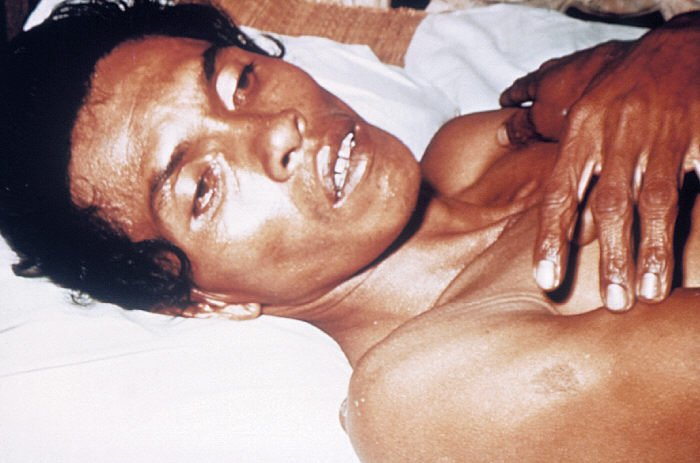

# Cholera

**Prerequisites:** [Bacteria](../../../microbiology/02-bacteria.md); [Toxins and toxin-mediated disease](../../../microbiology/04-toxins-and-toxin-mediated-disease.md)

*An adult cholera patient showing "washer woman's hand", wrinkled skin caused by severe dehydration. Credit: CDC. License: Public domain. Source: [File:Adult_cholera_patient.jpg](https://commons.wikimedia.org/wiki/File:Adult_cholera_patient.jpg).*

## The disease

Cholera is caused by toxin-producing *Vibrio cholerae* in contaminated water or food. The cholera toxin makes the intestine pour out fluid, causing profuse watery diarrhoea that can kill through dehydration within hours. Most infected people have mild or no symptoms, and with prompt oral rehydration solution (or intravenous fluids for severe cases) death is rare ([WHO cholera fact sheet](https://www.who.int/news-room/fact-sheets/detail/cholera)). Researchers estimate 1.3 to 4 million cases and 21,000 to 143,000 deaths a year ([WHO cholera fact sheet](https://www.who.int/news-room/fact-sheets/detail/cholera)).

Cholera is a disease of poverty and crisis: it spreads where safe water and sanitation are lacking, after disasters and in conflicts. John Snow's 1854 investigation of the Broad Street pump in London is a founding story of epidemiology; see [what epidemiology is](../../../epidemiology/01-what-epidemiology-is.md). After the 2010 earthquake, cholera was introduced into Haiti by UN peacekeepers from Nepal, causing more than 800,000 cases and nearly 10,000 deaths; the UN acknowledged its role in 2016.

## The vaccines

Early injectable cholera vaccines from the 1880s onwards gave weak, short-lived protection and are no longer recommended. Modern **oral cholera vaccines (OCV)** contain killed bacteria (with or without a toxin subunit). WHO-prequalified OCVs include Dukoral, Euvichol-Plus and Euvichol-S; all are considered safe in pregnancy ([WHO cholera fact sheet](https://www.who.int/news-room/fact-sheets/detail/cholera)). Protection is highest in the first months after two doses and wanes over a few years; estimates vary widely between vaccines, settings and ages, and protection is lower in young children. A live oral vaccine, Vaxchora, licensed in the US in 2016 for travellers, was approved partly on the basis of a human challenge trial.

A **global OCV stockpile**, supported by Gavi, supplies vaccines for outbreaks and humanitarian emergencies. Demand has outstripped supply: since October 2022, because of a global shortage, only one-dose campaigns have been used ([WHO cholera fact sheet](https://www.who.int/news-room/fact-sheets/detail/cholera)). Vaccination is a supplement to water, sanitation and treatment, not a substitute.

## Why it matters for the wider debate

Cholera is often cited by people who argue that sanitation, not vaccines, conquered infectious disease. For cholera and typhoid that argument is largely right: both disappeared from Europe and North America through clean water and sewers, long before effective vaccines. The same is not true of measles, Hib or pertussis, which spread through the air and did not decline in the same way until vaccines arrived. See [the historical mortality decline argument](../07-controversies/12-historical-mortality-decline-argument.md).

## Key ideas

- Cholera can kill within hours by dehydration but is easily treated with rehydration.
- It thrives where water and sanitation fail; the Haiti epidemic was introduced by UN peacekeepers.
- Oral vaccines give moderate protection and are used in outbreak campaigns from a global stockpile, now in short supply.

## Where this leads

- [Typhoid](typhoid.md); [human challenge studies](../02-development-and-regulation/04-trial-ethics-and-human-challenge-studies.md); [global immunisation programmes](../09-public-health-and-ethics/03-global-immunisation-programmes.md).
