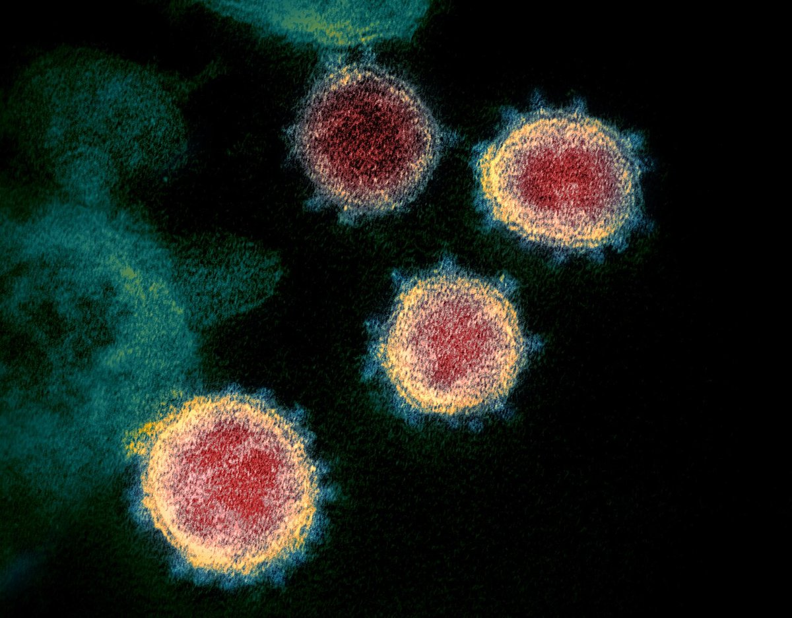

# COVID-19

**Prerequisites:** [Viruses](../../../microbiology/03-viruses.md); [mRNA vaccines](../01-how-vaccines-work/09-mrna-vaccines.md); [Viral vector vaccines](../01-how-vaccines-work/08-viral-vector-vaccines.md)

*Colourised transmission electron micrograph of SARS-CoV-2 virus particles. Credit: NIAID-RML (https://www.niaid.nih.gov/ &amp; https://www.niaid.nih.gov/about/rocky-mountain-laboratories). License: [CC BY 2.0](https://creativecommons.org/licenses/by/2.0). Source: [File:Novel_Coronavirus_SARS-CoV-2.jpg](https://commons.wikimedia.org/wiki/File:Novel_Coronavirus_SARS-CoV-2.jpg).*

## The disease

COVID-19 is caused by the coronavirus SARS-CoV-2, first identified in Wuhan, China, in December 2019. It spreads mainly through the air. Illness ranges from none to fatal pneumonia, blood clots and multi-organ failure; risk rises steeply with age and with conditions such as obesity, diabetes and immune suppression. Some people have persistent symptoms ("long COVID"). Nearly 780 million cases and more than 7.1 million deaths have been reported to WHO since December 2019, but true numbers are higher ([WHO COVID-19 fact sheet](https://www.who.int/news-room/fact-sheets/detail/coronavirus-disease-(covid-19))). WHO estimated about 14.9 million excess deaths in 2020–2021 alone ([Msemburi et al., *Nature* 2023](https://doi.org/10.1038/s41586-022-05522-2)).

## The vaccines

Vaccines were developed at unprecedented speed, building on years of research on coronavirus spike proteins and on mRNA and adenovirus-vector platforms. See [COVID-19 vaccines and Operation Warp Speed](../04-history/13-covid-19-vaccines-and-operation-warp-speed.md).

- **mRNA** (Pfizer–BioNTech, Moderna): phase 3 trials found about 95% and 94% efficacy against symptomatic disease over the first few months ([Polack et al., *NEJM* 2020 (BNT162b2 trial)](https://doi.org/10.1056/NEJMoa2034577); [Baden et al., *NEJM* 2021 (mRNA-1273 trial)](https://doi.org/10.1056/NEJMoa2035389)).
- **Adenovirus vector** (Oxford–AstraZeneca, Johnson & Johnson/Janssen, Sputnik V): Oxford–AstraZeneca showed about 70% efficacy in pooled interim analyses ([Voysey et al., *Lancet* 2021 (ChAdOx1 trials)](https://doi.org/10.1016/S0140-6736(20)32661-1)).
- **Protein subunit** (Novavax) and **inactivated** vaccines (Sinovac, Sinopharm, widely used in China and lower-income countries).

A modelling study estimated vaccines prevented about 14.4 million deaths worldwide in their first year (19.8 million including excess deaths) ([Watson et al., *Lancet Infectious Diseases* 2022](https://doi.org/10.1016/S1473-3099(22)00320-6)). Such estimates rely on assumptions and have been criticised by sceptics, but they are consistent with large observational studies.

Protection against infection waned within months and was reduced by the Omicron variant from late 2021, so vaccines did not stop transmission as hoped. Protection against severe disease and death held up better, especially with boosters. Vaccines are updated to newer variants, similar to flu.

## Safety

Rare serious harms were identified after rollout:

- **Myocarditis** after mRNA vaccines, mainly in young males after the second dose ([Oster et al., *JAMA* 2022](https://doi.org/10.1001/jama.2021.24110); [Patone et al., *Circulation* 2022](https://doi.org/10.1161/CIRCULATIONAHA.122.059970)); see [[myocarditis-and-mrna-vaccines|myocarditis and mRNA vaccines]].
- **Vaccine-induced immune thrombotic thrombocytopenia (VITT)** after adenovirus-vector vaccines ([Greinacher et al., *NEJM* 2021](https://doi.org/10.1056/NEJMoa2104840); [Schultz et al., *NEJM* 2021](https://doi.org/10.1056/NEJMoa2104882)), leading many countries to restrict or stop them; see [[vitt-and-adenovirus-vector-vaccines|VITT]].
- **Guillain-Barré syndrome** with adenovirus-vector vaccines, and **anaphylaxis** (a few cases per million doses).

The National Academies' 2024 review confirmed myocarditis with mRNA vaccines and favoured causal links between the Janssen vaccine and TTS and GBS ([NASEM, *Evidence Review of the Adverse Effects of COVID-19 Vaccination* (2024)](https://doi.org/10.17226/27746)).

## Policy and controversy

COVID-19 vaccines were the most politically divisive in modern history: mandates and passports, debates over vaccinating children and people who had recovered from infection, and the speed of development. By 2025 policy diverged sharply: the FDA required new trials for healthy people under 65 ([Prasad & Makary, *NEJM* 2025, "An Evidence-Based Approach to Covid-19 Vaccination"](https://doi.org/10.1056/NEJMsb2506929)), ACIP moved COVID-19 vaccination to individual decision-making, and HHS ended BARDA funding for mRNA projects ([HHS press release, "HHS Winds Down mRNA Vaccine Development Under BARDA" (5 August 2025)](https://www.hhs.gov/press-room/hhs-winds-down-mrna-development-under-barda.html)). WHO recommends vaccination using a risk-based approach ([WHO COVID-19 fact sheet](https://www.who.int/news-room/fact-sheets/detail/coronavirus-disease-(covid-19))). See [[covid-19-vaccines-mandates-and-mortality|COVID-19 vaccines, mandates and mortality]] and [[natural-versus-vaccine-immunity|natural versus vaccine immunity]].

## Key ideas

- COVID-19 caused millions of deaths; vaccines were developed in under a year.
- mRNA vaccines showed about 95% efficacy against symptomatic disease early on; protection against infection waned, against severe disease less so.
- Rare harms included myocarditis (mRNA) and VITT (adenovirus vectors).
- Policy became deeply polarised and diverged by country.

## Where this leads

- [Operation Warp Speed](../04-history/13-covid-19-vaccines-and-operation-warp-speed.md); [[covid-19-vaccines-mandates-and-mortality|mandates and mortality]]; [[covid-19-litigation|COVID-19 litigation]].
