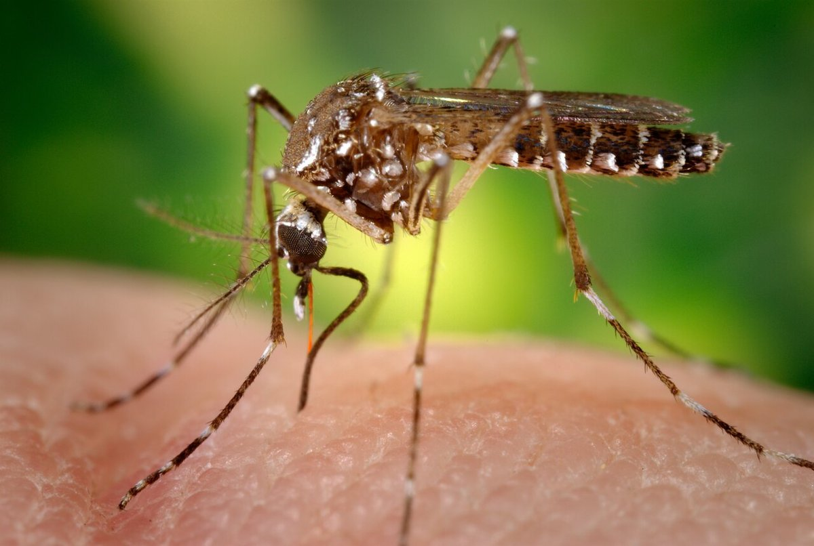

# Dengue

**Prerequisites:** [Viruses](../../../microbiology/03-viruses.md); [B cells and antibodies](../../05-b-cells-and-antibodies.md)

*A female *Aedes aegypti* mosquito taking a blood meal; this species is the main vector of dengue. Credit: James Gathany. License: Public domain. Source: [File:Aedes aegypti CDC9177.tif](https://commons.wikimedia.org/wiki/File:Aedes_aegypti_CDC9177.tif).*

## The disease

Dengue is caused by four related flaviviruses (serotypes DENV-1 to 4), spread by *Aedes aegypti* and *Aedes albopictus* mosquitoes, which bite by day and breed in water containers in towns and cities. About half the world's population is at risk, with an estimated 100–400 million infections a year ([WHO dengue fact sheet](https://www.who.int/news-room/fact-sheets/detail/dengue-and-severe-dengue)). Most infections are mild or symptomless; others cause high fever, severe headache, pain behind the eyes and muscle and joint pain ("break-bone fever"). A small proportion develop **severe dengue**, with plasma leakage, shock and bleeding, which can be fatal without good hospital care. Cases have risen sharply with urbanisation and climate change; 2023 and 2024 saw record numbers, particularly in the Americas.

## The antibody problem

Infection with one serotype gives lasting immunity to that serotype but only brief protection against the others. A second infection with a different serotype carries a *higher* risk of severe dengue, partly because of **antibody-dependent enhancement**: antibodies from the first infection bind the new virus without neutralising it and help it enter immune cells. This makes dengue vaccines unusually difficult, because a vaccine that acts like a first infection could, in principle, increase the risk of severe disease on a later natural infection.

## The vaccines

- **Dengvaxia** (Sanofi Pasteur, licensed from 2015) was the first. Long-term trial data showed that in people who had never had dengue (seronegative), it increased the risk of hospitalisation and severe dengue when they were later infected ([Sridhar et al., *NEJM* 2018](https://doi.org/10.1056/NEJMoa1800820)). It is now recommended only for people with confirmed previous infection. Its earlier use in a mass school programme in the Philippines led to a national scandal, criminal charges and a collapse in vaccine confidence. See [Dengvaxia in the Philippines](../07-controversies/16-dengvaxia-in-the-philippines.md).
- **Qdenga** (TAK-003, Takeda) showed about 80% efficacy against virologically confirmed dengue in children in its first year ([Biswal et al., *NEJM* 2019](https://doi.org/10.1056/NEJMoa1903869)) and was recommended by WHO for children aged 6–16 in high-burden settings in 2023, with uncertainty about protection against some serotypes in seronegative people.
- **Butantan-DV**, a single-dose vaccine from Brazil's Butantan Institute, was approved by Brazil's regulator in November 2025 ([Instituto Butantan, Anvisa approval of Butantan-DV (November 2025)](https://www.butantan.gov.br/noticias/vacina-da-dengue-do-instituto-butantan-primeira-do-mundo-em-dose-unica-e-aprovada-pela-anvisa)). In June 2026 Brazil's health ministry temporarily halted its use after 42 rare cases with warning signs, including three severe cases and two deaths, among about 500,000 doses, pending investigation of whether the vaccine was responsible ([Brazil Ministry of Health, temporary discontinuation of Butantan-DV vaccination (8 June 2026)](https://www.gov.br/saude/pt-br/assuntos/noticias/2026/junho/ministerio-da-saude-descontinua-temporariamente-estrategia-atual-de-vacinacao-do-butantan-contra-dengue)).

## Key ideas

- Dengue has four serotypes; a second infection with a different serotype is more likely to be severe.
- This makes vaccines risky for people never infected, as Dengvaxia showed.
- Qdenga is recommended in high-burden settings; Brazil's single-dose Butantan-DV was paused in 2026 to investigate a safety signal.

## Where this leads

- [Dengvaxia in the Philippines](../07-controversies/16-dengvaxia-in-the-philippines.md); [Yellow fever](yellow-fever.md); [post-market surveillance](../02-development-and-regulation/07-post-market-surveillance.md).
