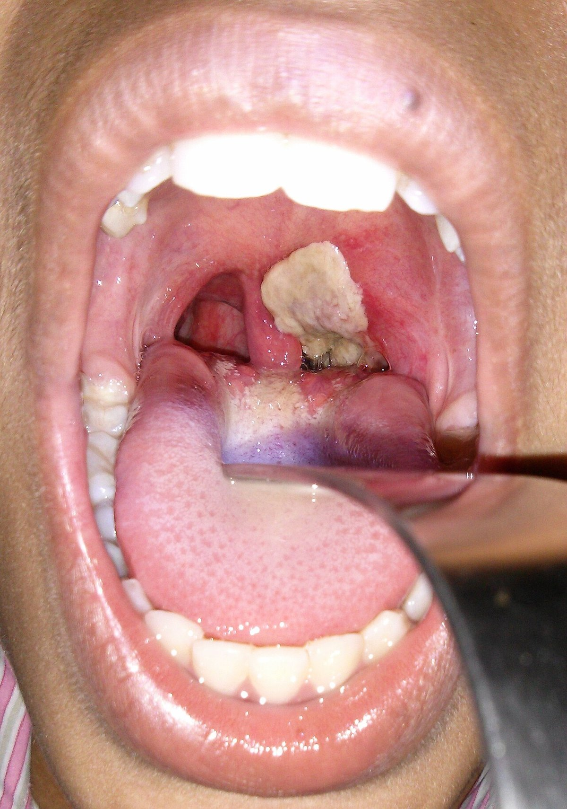

# Diphtheria

**Prerequisites:** [Bacteria](../../../microbiology/02-bacteria.md); [Toxins and toxin-mediated disease](../../../microbiology/04-toxins-and-toxin-mediated-disease.md); [Toxoid vaccines](../01-how-vaccines-work/05-toxoid-vaccines.md)

*The dirty white pseudomembrane in the throat that is characteristic of diphtheria. Credit: User:Dileepunnikri. License: [CC BY-SA 3.0](https://creativecommons.org/licenses/by-sa/3.0). Source: [File:Dirty_white_pseudomembrane_classically_seen_in_diphtheria_2013-07-06_11-07.jpg](https://commons.wikimedia.org/wiki/File:Dirty_white_pseudomembrane_classically_seen_in_diphtheria_2013-07-06_11-07.jpg).*

## The disease

Diphtheria is caused by toxin-producing strains of the bacterium *Corynebacterium diphtheriae*, spread by respiratory droplets and, for skin infections, by contact. In the throat, the bacteria form a thick grey **pseudomembrane** that can block the airway; the old name "strangling angel of children" describes this. The **diphtheria toxin** enters the bloodstream and damages the heart (myocarditis) and nerves. Without treatment, about 30% of unvaccinated people with diphtheria die, with young children at highest risk ([WHO diphtheria fact sheet](https://www.who.int/news-room/fact-sheets/detail/diphtheria)). Treatment is diphtheria antitoxin plus antibiotics; antitoxin is in short supply worldwide.

## History and burden

Diphtheria was a leading killer of children in the 19th century. In 1890 Emil von Behring and Shibasaburo Kitasato showed that serum from immunised animals neutralised the toxin, leading to antitoxin treatment and the first Nobel Prize in Physiology or Medicine (Behring, 1901). In the 1920s Gaston Ramon in France produced **toxoid**, toxin inactivated with formaldehyde, which became the vaccine. In the US in 1921 there were about 206,000 reported cases and 15,520 deaths ([CDC, *Epidemiology and Prevention of Vaccine-Preventable Diseases* ("Pink Book")](https://www.cdc.gov/pinkbook/hcp/table-of-contents/index.html)); there have been only a handful of cases in recent decades.

Diphtheria returns quickly when vaccination falters. After the breakdown of the Soviet Union, an epidemic across its successor states in the 1990s caused more than 150,000 cases and thousands of deaths. Outbreaks occurred among Rohingya refugees in Bangladesh in 2017 and in Yemen, and a large outbreak in Nigeria began in 2022. WHO estimates that in 2025, 85% of infants received three doses of diphtheria-containing vaccine, leaving nearly 20 million without full coverage, and that many countries lack recommended boosters ([WHO diphtheria fact sheet](https://www.who.int/news-room/fact-sheets/detail/diphtheria)).

## The vaccine

Diphtheria toxoid is given in combination with tetanus toxoid and pertussis antigens: **DTaP** for young children, **Tdap** or **Td** (with lower diphtheria content, marked by the lower-case "d") for older children and adults. The vaccine prevents the toxin's effects rather than infection, so vaccinated people can still carry the bacterium. Immunity wanes, which is why boosters are given in adolescence and, in some countries, every ten years in adulthood. Some experts argue antibody levels last long enough that adult boosters could be spaced more widely ([Hammarlund et al., *Clinical Infectious Diseases* 2016](https://doi.org/10.1093/cid/ciw066)); the UK does not give routine adult boosters after five childhood doses.

Side effects of the toxoid are mainly local: sore arm, redness and swelling, which become more common with repeated doses.

## Key ideas

- Diphtheria's toxin damages the heart and nerves; untreated, about 30% of unvaccinated cases die.
- Toxoid vaccines, developed in the 1920s, made it rare in high-coverage countries.
- It returns rapidly when coverage falls, as in the former Soviet Union in the 1990s.
- Countries disagree on how often adults need boosters.

## Where this leads

- [Tetanus](tetanus.md); [Pertussis](pertussis.md); [[early-vaccines-toxoids-and-bcg|Early vaccines: toxoids and BCG]].
