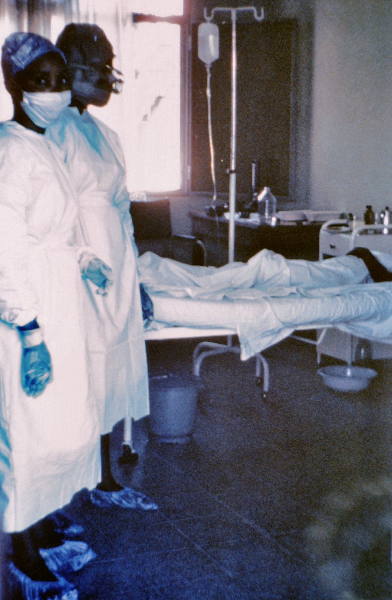

# Ebola

**Prerequisites:** [Viruses](../../../microbiology/03-viruses.md); [Viral vector vaccines](../01-how-vaccines-work/08-viral-vector-vaccines.md)

*Two nurses with Ebola patient number 3 at Ngaliema Hospital, Kinshasa, during the first recognised outbreak in 1976; the patient later died. Credit: Photo Credit: Content Providers(s): CDC/Dr. Lyle Conrad. License: Public domain. Source: [File:7042_lores-Ebola-Zaire-CDC_Photo.jpg](https://commons.wikimedia.org/wiki/File:7042_lores-Ebola-Zaire-CDC_Photo.jpg).*

## The disease

Ebola disease is caused by viruses of the genus *Orthoebolavirus*, of which Ebola virus (formerly Zaire ebolavirus), Sudan virus and Bundibugyo virus cause large outbreaks ([WHO Ebola disease fact sheet](https://www.who.int/news-room/fact-sheets/detail/ebola-disease)). Fruit bats are thought to be the natural reservoir. The virus spreads between people through direct contact with blood and body fluids of sick or dead people, which is why caregivers, health workers and funeral rituals that involve touching the body drive transmission. After 2 to 21 days, it causes fever, weakness and pain, then vomiting, diarrhoea and in some cases bleeding. The average case fatality rate is about 50%, ranging from 25% to 90% in past outbreaks ([WHO Ebola disease fact sheet](https://www.who.int/news-room/fact-sheets/detail/ebola-disease)). Early supportive care improves survival, and two monoclonal antibody treatments are approved for Ebola virus disease.

## Outbreaks

Ebola was first identified in 1976 in outbreaks in what are now the Democratic Republic of the Congo and South Sudan. The 2014–2016 West African epidemic, centred on Guinea, Liberia and Sierra Leone, was by far the largest, with more than 28,000 cases and more than 11,000 deaths, and spread to cities for the first time. The 2018–2020 outbreak in eastern DRC, the second largest, occurred in a conflict zone where attacks on health workers hindered the response.

## The vaccines

**rVSV-ZEBOV** (Ervebo, Merck) is a live recombinant vesicular stomatitis virus engineered to carry an Ebola surface protein. Developed initially by the Public Health Agency of Canada's National Microbiology Laboratory in Winnipeg and licensed to companies, it was tested during the West African epidemic in a **ring vaccination trial** in Guinea ("Ebola ça suffit"), in which contacts of cases were vaccinated immediately or after a delay. No cases occurred among those vaccinated immediately from ten days after vaccination ([Henao-Restrepo et al., *Lancet* 2017](https://doi.org/10.1016/S0140-6736(16)32621-6)). Critics noted that the delayed arm was dropped partway through and that the trial was small, but the results were judged strong enough for use. The vaccine was used under protocols in the DRC from 2018, where more than 300,000 people were vaccinated, and was licensed by the EMA and FDA in 2019. WHO recommends it as part of outbreak response ([WHO Ebola disease fact sheet](https://www.who.int/news-room/fact-sheets/detail/ebola-disease)).

A second regimen, Johnson & Johnson's two-dose **Ad26.ZEBOV/MVA-BN-Filo** (Zabdeno/Mvabea), was authorised in Europe in 2020 for preventive use. No licensed vaccines yet exist for Sudan or Bundibugyo viruses ([WHO Ebola disease fact sheet](https://www.who.int/news-room/fact-sheets/detail/ebola-disease)); candidate vaccines were tested during a 2022 Sudan virus outbreak in Uganda.

Side effects of rVSV-ZEBOV include fever, headache and joint pain, sometimes arthritis, and the vaccine virus can briefly cause skin lesions.

## Key ideas

- Ebola spreads through contact with body fluids and kills about half of those infected on average.
- The 2014–2016 West African epidemic killed more than 11,000 people.
- rVSV-ZEBOV, developed in Canada, proved highly effective in a ring vaccination trial and is now used in outbreaks.

## Where this leads

- [trial ethics](../02-development-and-regulation/04-trial-ethics-and-human-challenge-studies.md); [global immunisation programmes](../09-public-health-and-ethics/03-global-immunisation-programmes.md).
