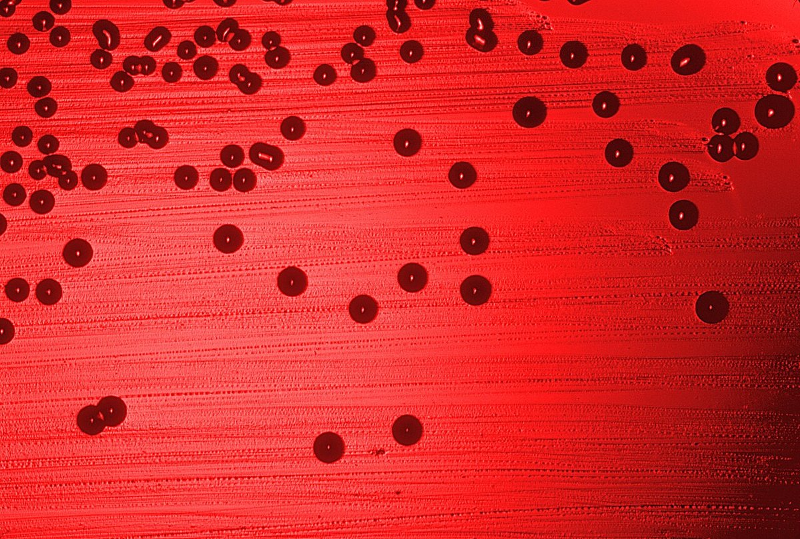

# Haemophilus influenzae type b (Hib)

**Prerequisites:** [Bacteria](../../../microbiology/02-bacteria.md); [Conjugate vaccines](../01-how-vaccines-work/07-conjugate-vaccines.md)

**Haemophilus influenzae* bacteria cultured on a blood agar plate. Credit: CDC/Dr. W.A. Clark (PHIL #1617), 1977. License: Public domain. Source: [File:Haemophilus influenzae 01.jpg](https://commons.wikimedia.org/wiki/File:Haemophilus_influenzae_01.jpg).*

## The disease

*Haemophilus influenzae* is a bacterium (despite its name, not the cause of influenza; it was wrongly blamed during the 1889–90 flu pandemic). Encapsulated **type b** strains cause invasive disease mostly in children under five: meningitis, epiglottitis (swelling that can suddenly close the airway), pneumonia, septic arthritis and bloodstream infection. The bacteria spread by respiratory droplets and are often carried harmlessly in the nose and throat.

Before vaccination, Hib was the leading cause of bacterial meningitis in young children in the US, with about 20,000 cases of invasive disease a year. About 3–6% of children with Hib meningitis died, and up to a fifth of survivors had permanent hearing loss or other lasting damage ([CDC, *Epidemiology and Prevention of Vaccine-Preventable Diseases* ("Pink Book")](https://www.cdc.gov/pinkbook/hcp/table-of-contents/index.html)).

## The vaccines

The first Hib vaccine (1985) used the bacterium's polysaccharide capsule alone. It did not work in children under about 18 months, the age group most at risk, because infants' immune systems respond poorly to polysaccharides. The solution was the **conjugate vaccine**, joining the polysaccharide to a carrier protein (such as tetanus or diphtheria toxoid) so that T cells help B cells respond. Conjugate Hib vaccines were licensed for infants in the US in 1990 and invasive Hib disease in young children fell by more than 99% ([CDC, *Epidemiology and Prevention of Vaccine-Preventable Diseases* ("Pink Book")](https://www.cdc.gov/pinkbook/hcp/table-of-contents/index.html)). Conjugate vaccines also reduce carriage, so they protect unvaccinated people through herd effects. See [conjugate vaccines](../01-how-vaccines-work/07-conjugate-vaccines.md) and [[hib-and-the-conjugate-revolution|Hib and the conjugate revolution]].

Globally, Hib deaths among children under five fell by an estimated 90% between 2000 and 2015, to about 29,500 a year, as Gavi supported the vaccine's introduction in low-income countries ([Wahl et al., *Lancet Global Health* 2018](https://doi.org/10.1016/s2214-109x(18)30247-x)).

## Safety

Side effects are mild: redness, swelling and pain at the injection site and sometimes fever. Hib vaccine is usually given as part of combination vaccines (DTaP-IPV-Hib, or the six-in-one including hepatitis B). In the late 1990s, J. Barthelow Classen argued that Hib vaccination increased type 1 diabetes, based on analyses of Finnish trial data; an IOM review in 2002 concluded that the evidence favoured rejecting a causal relationship between multiple immunisations and type 1 diabetes.

## Under the 2026 US changes

Hib remained among the vaccines recommended for all children in the January 2026 US schedule changes ([HHS fact sheet, "CDC Childhood Immunization Recommendations" (January 2026)](https://www.hhs.gov/press-room/fact-sheet-cdc-childhood-immunization-recommendations.html)).

## Key ideas

- Hib caused about 20,000 serious infections a year in young US children before vaccination, mostly meningitis.
- Plain polysaccharide vaccines did not work in infants; conjugate vaccines did, cutting disease by more than 99%.
- Conjugate vaccines reduce carriage and protect others.

## Where this leads

- [Pneumococcal disease](pneumococcal-disease.md) and [meningococcal disease](meningococcal-disease.md), other causes of bacterial meningitis prevented by conjugate vaccines.
