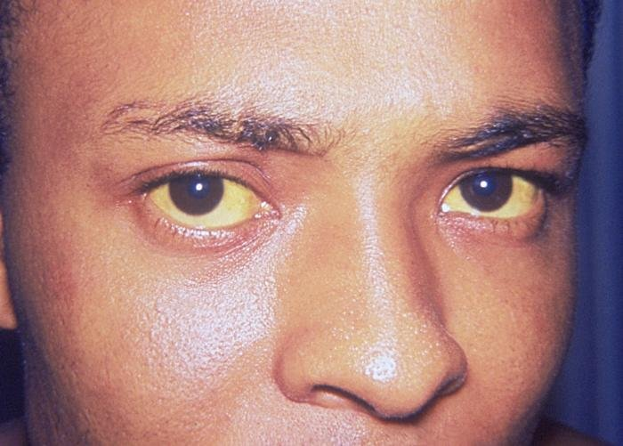

# Hepatitis A

**Prerequisites:** [Viruses](../../../microbiology/03-viruses.md); [Inactivated vaccines](../01-how-vaccines-work/04-inactivated-vaccines.md)

*Jaundice of the eyes and facial skin in a person with hepatitis A. Credit: Unknown authorUnknown author. License: Public domain. Source: [File:Jaundice_eye.jpg](https://commons.wikimedia.org/wiki/File:Jaundice_eye.jpg).*

## The disease

Hepatitis A is a liver infection caused by the hepatitis A virus, a picornavirus spread by the faecal–oral route: contaminated food or water, close contact, and some sexual practices ([WHO hepatitis A fact sheet](https://www.who.int/news-room/fact-sheets/detail/hepatitis-a)). After two to seven weeks it causes fever, tiredness, nausea, abdominal pain, dark urine and jaundice. Young children often have no symptoms but still spread the virus, while adults are more likely to be ill, sometimes for weeks. Unlike hepatitis B and C, it does not cause chronic infection, and recovery gives lifelong immunity. Rarely, it causes **fulminant hepatitis** (acute liver failure), with risk rising with age and existing liver disease. WHO estimates that about 35,600 people died of hepatitis A in 2023 ([WHO hepatitis A fact sheet](https://www.who.int/news-room/fact-sheets/detail/hepatitis-a)).

## Epidemiology shapes policy

Where sanitation is poor, nearly everyone is infected as a young child, mostly without symptoms, and outbreaks are rare. As sanitation improves, fewer children are infected, so more people reach adulthood susceptible and outbreaks become larger and more severe. This paradox explains why hepatitis A vaccination is a bigger priority in middle-income countries and among particular groups in rich countries: travellers, men who have sex with men, people who use drugs, people experiencing homelessness and people with chronic liver disease.

## The vaccine

Inactivated hepatitis A vaccines (first licensed in the US in 1995) are highly effective, with protection after one dose in most people and long-lasting immunity after two. The US recommended vaccination for children in high-incidence states in 1999 and for all children at 12–23 months in 2006; childhood rates fell sharply. Canada recommends it for travellers and high-risk groups, with routine programmes in some provinces and territories. Side effects are mostly sore arms and headache.

Since 2016, large outbreaks spread person-to-person among people who use drugs and people experiencing homelessness in several US states, causing thousands of hospitalisations and hundreds of deaths ([Foster et al., *MMWR* 2018](https://doi.org/10.15585/mmwr.mm6743a3)). They showed the limits of a childhood programme for adults who were never vaccinated.

## Under the 2026 US changes

The January 2026 US schedule moved hepatitis A from routine to high-risk groups and shared clinical decision-making, a change preliminarily blocked by a federal court in March 2026 ([HHS fact sheet, "CDC Childhood Immunization Recommendations" (January 2026)](https://www.hhs.gov/press-room/fact-sheet-cdc-childhood-immunization-recommendations.html); [*American Academy of Pediatrics v. Kennedy*, First Circuit docket 26-1503 (CourtListener)](https://www.courtlistener.com/docket/73286021/american-academy-of-pediatrics-v-kennedy/)). Supporters said it matched countries such as Denmark that do not routinely vaccinate children; critics pointed to the recent US outbreaks.

## Key ideas

- Hepatitis A spreads faecal–orally, causes acute (not chronic) liver infection and is more severe in adults.
- Improved sanitation increases the number of susceptible adults and the size of outbreaks.
- Inactivated vaccines are highly effective; recent US outbreaks hit unvaccinated adults.

## Where this leads

- [Hepatitis B](hepatitis-b.md); [[pregnancy-adult-and-travel-vaccination|Travel vaccination]].
