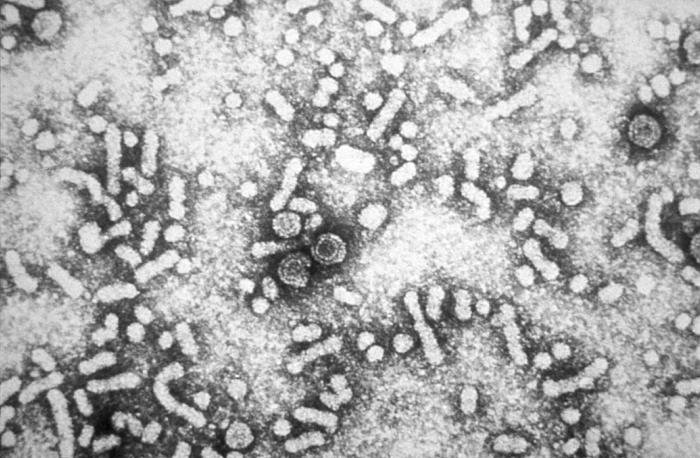

# Hepatitis B

**Prerequisites:** [Viruses](../../../microbiology/03-viruses.md); [Subunit and recombinant vaccines](../01-how-vaccines-work/06-subunit-and-recombinant-vaccines.md)

*Electron micrograph of hepatitis B virus particles ("Dane particles"). Credit: CDC. License: Public domain. Source: [File:Hepatitis-B_virions.jpg](https://commons.wikimedia.org/wiki/File:Hepatitis-B_virions.jpg).*

## The disease

Hepatitis B virus infects the liver and spreads through blood and body fluids: from mother to baby at birth, between young children, through sex, and through unsafe injections ([WHO hepatitis B fact sheet](https://www.who.int/news-room/fact-sheets/detail/hepatitis-b)). Acute infection can cause jaundice and, rarely, liver failure, but the main danger is **chronic infection**, which can lead to cirrhosis and liver cancer decades later. The risk of becoming chronically infected depends strongly on age: about 90% of infants infected at birth develop chronic infection, compared with fewer than 5% of infected adults. WHO estimates that about 240 million people were living with chronic hepatitis B in 2024, and that it caused about 1.1 million deaths that year ([WHO hepatitis B fact sheet](https://www.who.int/news-room/fact-sheets/detail/hepatitis-b)).

## The vaccines

The first hepatitis B vaccine, licensed in 1981, was made from surface antigen purified from the blood plasma of chronically infected people. In 1986 a vaccine made in genetically engineered yeast became the first **recombinant** vaccine. Three doses protect more than 90% of healthy infants and young adults.

Taiwan began a national infant programme in 1984. Within about a decade, liver cancer in Taiwanese children fell substantially, making hepatitis B vaccine the first vaccine shown to prevent a human cancer ([Chang et al., *NEJM* 1997](https://doi.org/10.1056/NEJM199706263362602)).

## The birth dose and the US debate

Because infection at birth is most likely to become chronic, WHO recommends that all infants receive a dose within 24 hours of birth. The US first targeted high-risk adults (1982), but found it hard to reach them and missed infected mothers whose test results were wrong or missing; it recommended universal infant vaccination in 1991, including a birth dose.

Critics long questioned giving a vaccine for a mostly sexually or blood-borne infection to newborns of mothers who test negative. In December 2025 the reconstituted ACIP voted 8–3 to replace the universal birth dose with individual decision-making for infants of mothers who test negative, with the first dose no earlier than two months if the birth dose is skipped; the CDC adopted the change later that month ([CDC newsroom, ACIP hepatitis B birth-dose vote (5 December 2025)](https://www.cdc.gov/media/releases/2025/2025-acip-recommends-individual-based-decision-making-for-hepatitis-b-vaccine-for-infants-born-to-women.html); [HHS fact sheet, "Hepatitis B Immunization" (CDC adoption, 16 December 2025)](https://www.hhs.gov/press-room/fact-sheet-hepatitis-b-immunization.html)). Supporters cited Denmark and other countries that vaccinate only infants of infected mothers. Opponents, including the AAP, warned that maternal testing misses some infections, that some infants are infected by household contacts, and that the birth dose was associated with a large fall in childhood infections. In January 2026 hepatitis B was moved to high-risk groups and shared decision-making in the revised schedule, which a court preliminarily blocked in March 2026 ([*American Academy of Pediatrics v. Kennedy*, First Circuit docket 26-1503 (CourtListener)](https://www.courtlistener.com/docket/73286021/american-academy-of-pediatrics-v-kennedy/)).

Canada vaccinates mainly through school programmes (grade 7 in Ontario), with infant programmes in some provinces and for infants of infected mothers.

## Safety and the multiple sclerosis question

Side effects are mostly sore arms and mild fever; anaphylaxis is rare. In the 1990s, reports of multiple sclerosis after vaccination in France led the government to suspend school-based hepatitis B vaccination in 1998. Large studies found no increased risk of MS or of relapses ([Ascherio et al., *NEJM* 2001](https://doi.org/10.1056/nejm200102013440502); [Confavreux et al., *NEJM* 2001](https://doi.org/10.1056/nejm200102013440501)). A French study of children found no overall increase in demyelinating disease, but an increased risk of MS in one subgroup with one brand more than three years after vaccination ([Mikaeloff et al., *Neurology* 2009](https://doi.org/10.1212/01.wnl.0000335762.42177.07)), a finding not replicated but still cited by critics.

## Key ideas

- Hepatitis B infection at birth usually becomes chronic and can cause liver cancer decades later.
- The vaccine was the first recombinant vaccine and the first shown to prevent cancer.
- The universal US birth dose was replaced in December 2025 with individual decisions for infants of HBsAg-negative mothers, a contested change.
- Large studies did not confirm a link with multiple sclerosis.

## Where this leads

- [Hepatitis A](hepatitis-a.md); [HPV](hpv.md), the other cancer-preventing vaccine; [the US schedule](../05-schedules/02-the-us-schedule.md).
