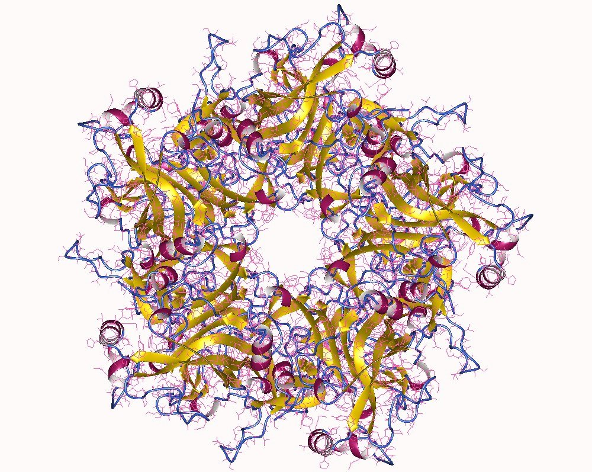

# Human papillomavirus (HPV)

**Prerequisites:** [Viruses](../../../microbiology/03-viruses.md); [Subunit and recombinant vaccines](../01-how-vaccines-work/06-subunit-and-recombinant-vaccines.md)

*Molecular model of the L1 capsid protein pentamer of human papillomavirus type 11; HPV vaccines are made from L1 proteins that assemble into virus-like particles. Credit: Deposition authors: Bishop, B., Dasgupta, J., Chen, X.S.; visualization author: User:Astrojan. License: [CC BY 4.0](https://creativecommons.org/licenses/by/4.0). Source: [File:2r5k.jpg](https://commons.wikimedia.org/wiki/File:2r5k.jpg).*

## The disease

Human papillomaviruses are a group of about 200 related viruses ([WHO HPV and cancer fact sheet](https://www.who.int/news-room/fact-sheets/detail/human-papilloma-virus-and-cancer)). Some cause common skin warts; others infect the genital tract and throat through sexual contact. Almost all sexually active people are infected at some point, usually without symptoms, and in about 90% of people the immune system clears the infection within two years. Persistent infection with **high-risk types**, especially HPV 16 and 18, can cause cell changes that progress over years or decades to cancer of the cervix, and also cancers of the anus, vulva, vagina, penis and oropharynx (throat). Low-risk types 6 and 11 cause most genital warts. WHO estimates HPV caused about 620,000 cancers in women and 70,000 in men in 2019 ([WHO HPV and cancer fact sheet](https://www.who.int/news-room/fact-sheets/detail/human-papilloma-virus-and-cancer)). Cervical cancer remains a leading cause of cancer death among women in low-income countries, where screening is limited.

## The vaccines

HPV vaccines contain **virus-like particles**: the L1 outer protein, made in yeast or insect cells, which assembles into empty shells that look like the virus but contain no DNA and cannot cause infection. Gardasil (quadrivalent, Merck) was licensed in 2006, Cervarix (bivalent, GSK) in 2007 in Europe, and Gardasil 9 (nine types) in 2014. Pivotal trials showed near-complete protection against precancerous lesions caused by vaccine types in women not previously infected ([FUTURE II Study Group, *NEJM* 2007](https://doi.org/10.1056/NEJMoa061741)).

Because the vaccine prevents infection rather than treating it, it works best before sexual activity begins, which is why it is given at around ages 9–14. Many countries vaccinate boys as well as girls. In 2022 WHO advised that a single dose provides protection comparable to two or three doses, and many countries have moved to one dose; in January 2026 the US also moved to a single dose ([HHS fact sheet, "CDC Childhood Immunization Recommendations" (January 2026)](https://www.hhs.gov/press-room/fact-sheet-cdc-childhood-immunization-recommendations.html)).

## Evidence of cancer prevention

Because cervical cancer takes many years to develop, early trials measured precancerous lesions. Population studies now show effects on cancer itself: in Sweden, women vaccinated before age 17 had an 88% lower rate of invasive cervical cancer ([Lei et al., *NEJM* 2020](https://doi.org/10.1056/NEJMoa1917338)); in England, cervical cancer rates were 87% lower in women offered vaccination at 12–13 ([Falcaro et al., *Lancet* 2021](https://doi.org/10.1016/S0140-6736(21)02178-4)); in Scotland, high-grade precancer fell by 89% in women vaccinated at 12–13 ([Palmer et al., *BMJ* 2019](https://doi.org/10.1136/bmj.l1161)). These are observational studies, but the size and consistency of the effect across countries is strong evidence. A Cochrane review rated the evidence on precancer high-certainty ([Arbyn et al., Cochrane review of HPV vaccines, 2018](https://doi.org/10.1002/14651858.CD009069.pub3)).

## Controversies

HPV vaccines have attracted more safety controversy than most. Reports of chronic pain (complex regional pain syndrome), fatigue and postural orthostatic tachycardia syndrome (POTS) in vaccinated girls led Japan to suspend its active recommendation in 2013, after which coverage fell from about 70% to under 1%; Japan resumed recommending the vaccine in 2022. Similar public alarms occurred in Denmark, Ireland and Colombia. A European Medicines Agency review in 2015 found no evidence of a causal link to CRPS or POTS. The Cochrane review itself was criticised for missing trials and using adjuvant controls ([Jørgensen, Gøtzsche & Jefferson, *BMJ Evidence-Based Medicine* 2018](https://doi.org/10.1136/bmjebm-2018-111012)). Social conservatives also objected that vaccinating children against a sexually transmitted infection could encourage sex, a claim not supported by studies of sexual behaviour. See [[hpv-vaccine-safety-claims|HPV vaccine safety claims]] and [the placebo controls debate](../02-development-and-regulation/03-placebo-controls-debate.md).

## Key ideas

- Persistent high-risk HPV infection causes cervical and several other cancers.
- HPV vaccines use virus-like particles and work best before sexual activity; one dose is now widely used.
- Population studies in Sweden, England and Scotland show large falls in cervical cancer and precancer.
- Safety concerns (CRPS, POTS) led to Japan's 2013–2022 suspension; regulators found no causal link.

## Where this leads

- [Hepatitis B](hepatitis-b.md), the other cancer-preventing vaccine; [[hpv-vaccine-safety-claims|HPV vaccine safety claims]]; [[hpv-vaccine-introduction|HPV vaccine introduction]].
