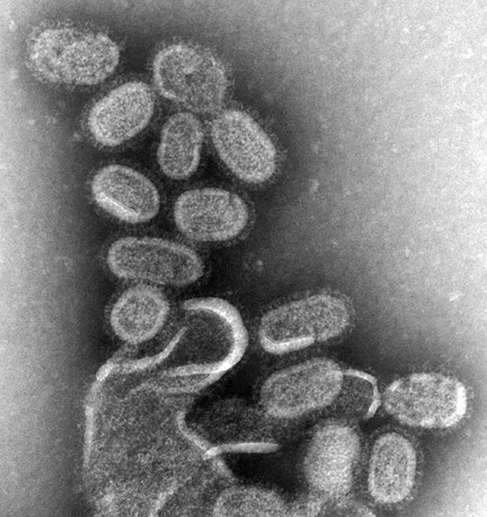

# Influenza

**Prerequisites:** [Viruses](../../../microbiology/03-viruses.md); [Inactivated vaccines](../01-how-vaccines-work/04-inactivated-vaccines.md); [Efficacy, effectiveness and waning](../../../epidemiology/13-efficacy-effectiveness-and-waning.md)

*Transmission electron micrograph of recreated 1918 pandemic influenza virus particles. Credit: Photo Credit: Cynthia Goldsmith Content Providers(s): CDC/ Dr. Terrence Tumpey. License: Public domain. Source: [File:EM_of_influenza_virus.jpg](https://commons.wikimedia.org/wiki/File:EM_of_influenza_virus.jpg).*

## The disease

Influenza viruses (types A and B cause seasonal epidemics) infect the respiratory tract and cause sudden fever, cough, sore throat, muscle aches and exhaustion. Most people recover within a week, but influenza can cause pneumonia, worsen heart and lung disease and kill, especially older adults, young children, pregnant women and people with chronic illness. WHO estimates about a billion cases a year, 3–5 million severe illnesses and 290,000–650,000 respiratory deaths ([WHO seasonal influenza fact sheet](https://www.who.int/news-room/fact-sheets/detail/influenza-(seasonal))).

Influenza viruses change constantly. Small mutations (**antigenic drift**) mean last year's immunity and vaccine protect less well; occasionally a new influenza A subtype emerges in humans from animals (**antigenic shift**), causing a **pandemic**. The 1918 pandemic killed tens of millions of people; later pandemics occurred in 1957, 1968 and 2009. Avian H5N1, which spread widely among US dairy cattle from 2024, is watched closely as a pandemic threat.

## The vaccines

Inactivated influenza vaccines were first used in the US military in the 1940s. Most are still grown in hens' eggs, though cell-culture and recombinant vaccines exist, and a live attenuated nasal spray (FluMist) is used in children in some countries. Because the virus drifts, WHO recommends updated strains twice a year (for each hemisphere), and vaccines are reformulated annually. High-dose and adjuvanted vaccines are used for older adults because their immune responses are weaker.

**How well do they work?** Effectiveness varies by season, from about 10% to 60% in US estimates, depending on how well the vaccine strains match circulating ones and on age. The Cochrane review of healthy adults found that vaccination reduced confirmed influenza from about 2.3% to 0.9% over a season, a modest absolute effect ([Demicheli et al., Cochrane review of influenza vaccines in healthy adults, 2018](https://doi.org/10.1002/14651858.CD001269.pub6)); evidence in older people is less certain ([Demicheli et al., Cochrane review of influenza vaccines in the elderly, 2018](https://doi.org/10.1002/14651858.CD004876.pub4)). Observational studies once suggested vaccination halved winter deaths in the elderly, but much of that apparent effect was due to the **healthy vaccinee** bias, because frail people near death were less likely to be vaccinated ([Jackson et al., *International Journal of Epidemiology* 2006](https://doi.org/10.1093/ije/dyi274)). Critics such as Tom Jefferson have used these findings to question universal flu vaccination; defenders argue that even modest effectiveness prevents many hospitalisations in a common disease.

The US has recommended annual vaccination for everyone over six months since 2010; Canada's NACI also recommends it for everyone six months and older, while the UK targets older adults, children and risk groups. In January 2026 the US moved childhood influenza vaccination to shared clinical decision-making ([HHS fact sheet, "CDC Childhood Immunization Recommendations" (January 2026)](https://www.hhs.gov/press-room/fact-sheet-cdc-childhood-immunization-recommendations.html)).

## Safety

Side effects are usually mild. Notable safety episodes include:

- **1976 swine flu**: a US mass campaign was linked to about one extra case of Guillain-Barré syndrome per 100,000 vaccinated ([Schonberger et al., *American Journal of Epidemiology* 1979](https://doi.org/10.1093/oxfordjournals.aje.a112795)). Later seasonal vaccines show at most about one extra case per million. See [[guillain-barre-syndrome|Guillain-Barré syndrome]].
- **Pandemrix (2009)**: an adjuvanted pandemic vaccine used in Europe caused narcolepsy, especially in children and adolescents in Finland and Sweden ([Nohynek et al., *PLoS One* 2012](https://doi.org/10.1371/journal.pone.0033536)). See [[narcolepsy-and-pandemrix|narcolepsy and Pandemrix]].
- **Thimerosal**: multi-dose vials contained the mercury-based preservative; in 2025 the US moved to thimerosal-free flu vaccines after an ACIP vote ([HHS press release on removing thimerosal from US influenza vaccines (23 July 2025)](https://www.hhs.gov/press-room/thimerosal-mercury-removed-from-us-flu-vaccines-acip.html)). See [[thimerosal-and-autism|thimerosal and autism]].
- **Fluvax in Australia (2010)**: one manufacturer's vaccine caused an unusually high rate of febrile seizures in young children and was suspended for children under five, an example of a brand- and season-specific problem caught by surveillance.

## Key ideas

- Influenza causes hundreds of thousands of deaths a year and occasional pandemics.
- Vaccines are reformulated each year; effectiveness is modest and variable.
- Healthy-vaccinee bias inflated early estimates of benefit in the elderly.
- Notable harms include GBS in 1976 and narcolepsy with Pandemrix.

## Where this leads

- [COVID-19](covid-19.md); [RSV](rsv.md); [the 1976 swine flu affair](../04-history/09-the-1976-swine-flu-affair.md).
