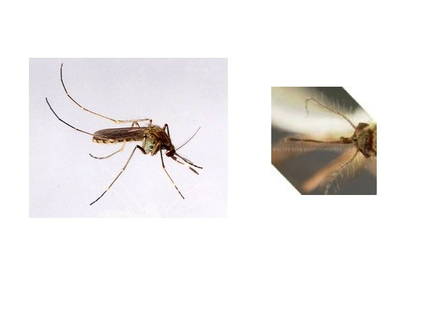

# Japanese encephalitis

**Prerequisites:** [Viruses](../../../microbiology/03-viruses.md); [Inactivated vaccines](../01-how-vaccines-work/04-inactivated-vaccines.md)

**Culex tritaeniorhynchus*, the main mosquito vector of Japanese encephalitis virus. Credit: Michael Wunderli. License: [CC BY 2.0](https://creativecommons.org/licenses/by/2.0). Source: [File:Culex Tritaeniorhynchus (14854579477).jpg](https://commons.wikimedia.org/wiki/File:Culex_Tritaeniorhynchus_%2814854579477%29.jpg).*

## The disease

Japanese encephalitis (JE) is caused by a flavivirus related to dengue, yellow fever and West Nile viruses. It cycles between mosquitoes (especially *Culex tritaeniorhynchus*, which breeds in rice paddies), pigs and wading birds; humans are dead-end hosts that do not spread it further. It is the main cause of viral encephalitis in many Asian countries, with an estimated 100,000 clinical cases a year ([WHO Japanese encephalitis fact sheet](https://www.who.int/news-room/fact-sheets/detail/japanese-encephalitis)). Most infections cause no symptoms, but among the few who develop encephalitis, up to 30% die and 30–50% of survivors have lasting neurological, cognitive or behavioural problems ([WHO Japanese encephalitis fact sheet](https://www.who.int/news-room/fact-sheets/detail/japanese-encephalitis)). Most cases are in children. Twenty-four countries in South-East Asia and the Western Pacific have endemic transmission, exposing more than 3 billion people ([WHO Japanese encephalitis fact sheet](https://www.who.int/news-room/fact-sheets/detail/japanese-encephalitis)). In 2022 JE spread unexpectedly to south-eastern Australia.

There is no specific treatment; care is supportive. Controlling mosquitoes is difficult because the vector breeds in irrigated rice fields, and keeping pigs away from homes helps only partly, which is why vaccination is the main tool.

## The vaccines

- **Mouse-brain-derived inactivated vaccine** (JE-VAX), used from the 1950s and 1960s, was effective but caused allergic reactions and rare acute disseminated encephalomyelitis; production stopped in 2005–2006. In Japan, the government stopped actively recommending JE vaccination in 2005 after a severe case of ADEM was linked to the mouse-brain vaccine, and resumed in 2010 once a cell-culture vaccine was available, an example of a safety signal leading to a change of product rather than abandonment of vaccination.
- **Live attenuated SA 14-14-2** vaccine, developed in China and used in national programmes there and in India and Nepal, is cheap and effective after one dose.
- **Cell-culture inactivated vaccine** (Ixiaro in Europe, North America and Australia) is used mainly for travellers.
- **Live recombinant chimeric vaccine** (Imojev), built on the yellow fever 17D backbone.

WHO recommends JE vaccination in national schedules wherever the disease is a public health problem; most endemic countries now have programmes, and incidence has fallen, partly because of vaccination ([WHO Japanese encephalitis fact sheet](https://www.who.int/news-room/fact-sheets/detail/japanese-encephalitis)). Japan and South Korea effectively controlled JE through vaccination plus changes in agriculture.

For travellers, the risk is low for short urban trips but higher for long stays in rural farming areas during the transmission season, which is the usual basis for recommending vaccine.

## Key ideas

- JE is a mosquito-borne flavivirus; rare encephalitis cases have high death and disability rates.
- Older mouse-brain vaccines were replaced by safer cell-culture and live attenuated vaccines.
- Vaccination is part of national programmes across much of Asia and is recommended for some travellers.

## Where this leads

- [Yellow fever](yellow-fever.md); [Dengue](dengue.md); [travel vaccination](../05-schedules/08-pregnancy-adult-and-travel-vaccination.md).
