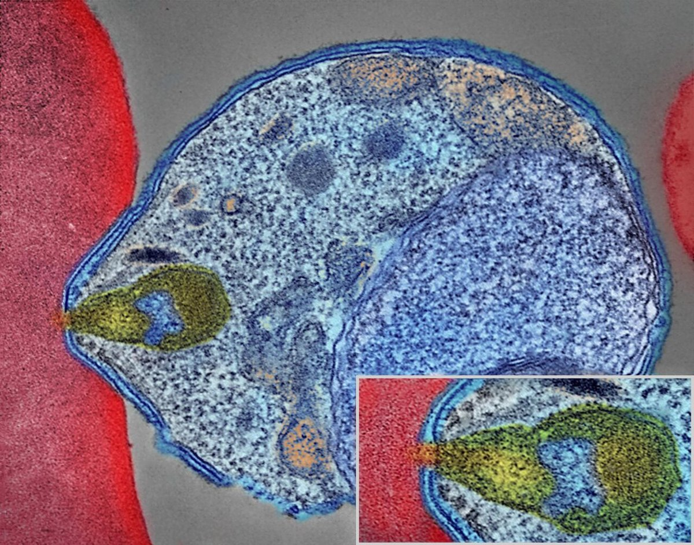

# Malaria

**Prerequisites:** [Parasites and fungi](../../../microbiology/05-parasites-and-fungi.md); [Subunit and recombinant vaccines](../01-how-vaccines-work/06-subunit-and-recombinant-vaccines.md)

*Colourised electron micrograph of a malaria parasite (blue) attaching to a human red blood cell. Credit: NIAID. License: [CC BY 2.0](https://creativecommons.org/licenses/by/2.0). Source: [File:Malaria_Parasite_Connecting_to_Human_Red_Blood_Cell_(34034143483).jpg](https://commons.wikimedia.org/wiki/File:Malaria_Parasite_Connecting_to_Human_Red_Blood_Cell_%2834034143483%29.jpg).*

## The disease

Malaria is caused by *Plasmodium* parasites spread by the bites of infected *Anopheles* mosquitoes. *P. falciparum*, dominant in Africa, causes most deaths; *P. vivax* is widespread in Asia and Latin America. After an infected bite, parasites multiply in the liver and then invade red blood cells, causing cycles of fever, chills and anaemia. Severe malaria, including cerebral malaria, can kill quickly, especially in young children and pregnant women. In 2024 there were an estimated 282 million cases and 610,000 deaths in 80 countries; 95% of deaths were in the WHO African Region, and about three-quarters of those were children under five ([WHO malaria fact sheet](https://www.who.int/news-room/fact-sheets/detail/malaria)).

Bed nets, indoor spraying, preventive drugs and prompt treatment have cut deaths substantially since 2000, but progress stalled in the late 2010s, and resistance to drugs and insecticides is spreading.

## Why a vaccine took so long

The parasite is far more complex than a virus or bacterium, with thousands of genes, several life stages and many ways of evading immunity. Natural immunity builds slowly after repeated infections and is never complete. Decades of effort produced many failed candidates.

## The vaccines

- **RTS,S/AS01** (Mosquirix), developed by GSK with the Walter Reed Army Institute of Research and later PATH, targets the circumsporozoite protein on the parasite's liver stage, joined to hepatitis B surface antigen and given with the AS01 adjuvant. In the phase 3 trial in young African children, four doses reduced clinical malaria by about 36% over about four years ([RTS,S Clinical Trials Partnership, *Lancet* 2015](https://doi.org/10.1016/S0140-6736(15)60721-8)). That modest efficacy was criticised, but because malaria is so common it translated into many cases prevented. After pilot introductions in Ghana, Kenya and Malawi, WHO recommended broad use in October 2021 ([WHO malaria fact sheet](https://www.who.int/news-room/fact-sheets/detail/malaria)). The trial also raised questions about meningitis and cerebral malaria imbalances and possibly higher mortality in girls, which were monitored in the pilots and not confirmed.
- **R21/Matrix-M**, developed by the University of Oxford and manufactured by the Serum Institute of India, uses a similar target with a different adjuvant. In a phase 3 trial it was about 75% effective over 12 months in sites with seasonal malaria ([Datoo et al., *Lancet* 2024 (R21 trial)](https://doi.org/10.1016/S0140-6736(23)02511-4)). WHO recommended it in October 2023. It is cheaper and easier to produce at scale.

Both vaccines are now being rolled out in routine childhood programmes across Africa with Gavi support ([WHO malaria fact sheet](https://www.who.int/news-room/fact-sheets/detail/malaria)), alongside bed nets and preventive drugs rather than replacing them.

## Key ideas

- Malaria killed about 610,000 people in 2024, mostly young African children.
- The parasite's complexity delayed vaccines for decades.
- RTS,S (2021) and R21 (2023) are the first recommended malaria vaccines; they are partially effective but prevent many cases.

## Where this leads

- [Adjuvants](../01-how-vaccines-work/10-adjuvants.md); [[global-immunisation-programmes|global immunisation programmes]].
