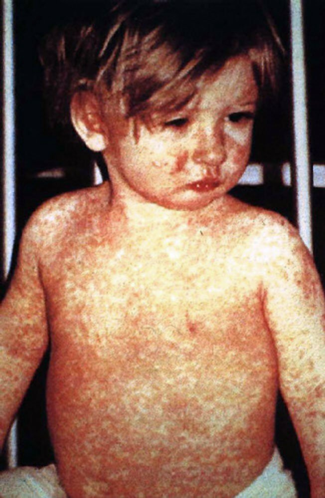

# Measles

**Prerequisites:** [Viruses](../../../microbiology/03-viruses.md); [Transmission and the reproduction number](../../../epidemiology/03-transmission-and-the-reproduction-number.md); [Live attenuated vaccines](../01-how-vaccines-work/03-live-attenuated-vaccines.md)

*A child with the classic measles rash on the fourth day. Credit: CDC/NIP/Barbara Rice. License: Public domain. Source: [File:RougeoleDP.jpg](https://commons.wikimedia.org/wiki/File:RougeoleDP.jpg).*

## The disease

Measles is caused by a paramyxovirus (genus *Morbillivirus*) and is among the most contagious human infections, with a basic reproduction number usually estimated at 12–18. It spreads through the air; the virus can linger in a room for up to two hours after an infected person leaves. After 10–14 days, fever, cough, runny nose and conjunctivitis are followed by small white spots in the mouth (Koplik spots) and a rash that spreads from the face downwards. People are infectious from about four days before to four days after the rash.

Complications include ear infections, diarrhoea, pneumonia (the usual cause of death in children), encephalitis in about 1 in 1,000 cases, and **subacute sclerosing panencephalitis (SSPE)**, a fatal brain disease appearing years later, most often in children infected in infancy. In high-income countries about 1–3 in 1,000 infected children die ([CDC, *Epidemiology and Prevention of Vaccine-Preventable Diseases* ("Pink Book")](https://www.cdc.gov/pinkbook/hcp/table-of-contents/index.html)); deaths are far higher where malnutrition and vitamin A deficiency are common. Measles also causes **immune amnesia**: it destroys a large share of existing antibodies to other pathogens, leaving survivors more vulnerable for months to years ([Mina et al., *Science* 2015](https://doi.org/10.1126/science.aaa3662); [Mina et al., *Science* 2019](https://doi.org/10.1126/science.aay6485)).

## Burden before and after vaccination

Before the first vaccine was licensed in 1963, measles caused major epidemics every two to three years and an estimated 2.6 million deaths a year worldwide. WHO estimates that measles vaccination averted nearly 59 million deaths between 2000 and 2024, yet about 95,000 people, mostly young children, died of measles in 2024 ([WHO measles fact sheet](https://www.who.int/news-room/fact-sheets/detail/measles)). In the US, nearly every child caught measles before vaccination, with roughly 400–500 reported deaths a year ([CDC, *Epidemiology and Prevention of Vaccine-Preventable Diseases* ("Pink Book")](https://www.cdc.gov/pinkbook/hcp/table-of-contents/index.html)).

The US declared measles eliminated (no continuous transmission for 12 months) in 2000 and Canada in 1998. Both lost that status after large outbreaks: Canada in November 2025, after an outbreak that began in October 2024 ([PAHO, "PAHO calls for regional action as the Americas lose measles elimination status" (10 November 2025)](https://www.paho.org/en/news/10-11-2025-paho-calls-regional-action-americas-lose-measles-elimination-status)), and the United States in November 2026, after a chain of transmission that began in January 2025, including the West Texas outbreak ([CDC joint statement, "Loss of U.S. Measles Elimination Status" (17 November 2026)](https://www.cdc.gov/media/releases/2026/loss-of-usmeasles-elimination-status.html); [Texas DSHS, "Texas announces end of West Texas measles outbreak" (18 August 2025)](https://www.dshs.texas.gov/news-alerts/texas-announces-end-west-texas-measles-outbreak)). See [[outbreaks-and-coverage|outbreaks and coverage]].

## The vaccine

Measles vaccine is a live attenuated virus, usually combined as **MMR** (measles, mumps, rubella) or **MMRV** (adding varicella). One dose is about 93% effective at preventing measles and two doses about 97% ([CDC, *Epidemiology and Prevention of Vaccine-Preventable Diseases* ("Pink Book")](https://www.cdc.gov/pinkbook/hcp/table-of-contents/index.html)); protection is long-lasting. Because of the high R0, around 95% of a population needs to be immune to stop spread.

Common side effects are fever (in about 5–15%) and a mild rash 7–12 days after vaccination. Rarer effects include febrile seizures (about 1 in 3,000–4,000 doses) and immune thrombocytopenia (about 1 in 30,000–40,000); severe disease from the vaccine virus can occur in people with badly weakened immune systems, for whom the vaccine is contraindicated. See [febrile seizures](../06-adverse-events/02-febrile-seizures.md) and [ITP](../06-adverse-events/11-itp-and-other-blood-disorders.md).

## Controversies

MMR is at the centre of the most famous vaccine controversy: Andrew Wakefield's 1998 *Lancet* paper suggesting a link with autism, since retracted, and many large studies finding no link, including a Danish cohort of 657,461 children ([Hviid et al., *Annals of Internal Medicine* 2019](https://doi.org/10.7326/M18-2101)). See [MMR and autism](../07-controversies/01-mmr-and-autism.md). In 2025, US federal health officials also promoted vitamin A and other treatments during the Texas outbreak; vitamin A reduces deaths in deficient children but does not prevent infection.

## Key ideas

- Measles is extremely contagious and can cause pneumonia, encephalitis, death and long-term immune amnesia.
- Two doses of MMR are about 97% effective; about 95% immunity is needed to stop spread.
- Canada (2025) and the United States (2026) lost their measles elimination status.
- MMR is the vaccine at the centre of the autism controversy.

## Where this leads

- [Mumps](mumps.md) and [rubella](rubella.md), the other components of MMR.
- [MMR and autism](../07-controversies/01-mmr-and-autism.md); [[maurice-hilleman|Maurice Hilleman]], who developed MMR.
