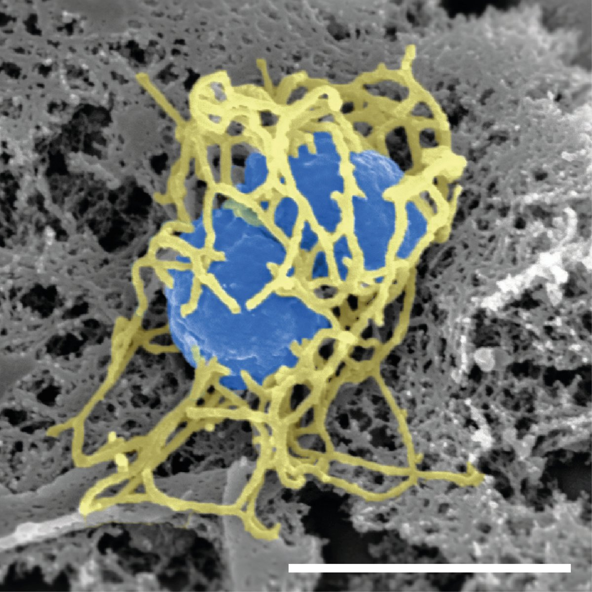

# Meningococcal disease

**Prerequisites:** [Bacteria](../../../microbiology/02-bacteria.md); [Conjugate vaccines](../01-how-vaccines-work/07-conjugate-vaccines.md)

*Scanning electron micrograph of a single *Neisseria meningitidis* cell (blue) with its meshwork of pili. Credit: Arthur Charles-Orszag. License: [CC BY-SA 4.0](https://creativecommons.org/licenses/by-sa/4.0). Source: [File:Neisseria_meningitidis_Charles-Orszag_2018.png](https://commons.wikimedia.org/wiki/File:Neisseria_meningitidis_Charles-Orszag_2018.png).*

## The disease

*Neisseria meningitidis* (the meningococcus) is a bacterium carried harmlessly in the throat by about one in ten people, more among adolescents and young adults. Rarely, it invades and causes **meningitis** or **septicaemia** (blood poisoning), sometimes both. It can kill within hours of the first symptoms, which include fever, headache, stiff neck and a rash that does not fade under pressure. Even with treatment, about 1 in 6 people with bacterial meningitis die and 1 in 5 survivors have severe complications such as amputations, deafness or brain damage ([WHO meningitis fact sheet](https://www.who.int/news-room/fact-sheets/detail/meningitis)). Babies, adolescents, students in residences, military recruits and Hajj pilgrims have higher risk.

Six serogroups (A, B, C, W, X and Y) cause most disease. Group A caused huge epidemics across the **African meningitis belt**, from Senegal to Ethiopia.

## The vaccines

- **Conjugate vaccines** against group C (MenC) were first introduced nationally by the UK in 1999, which cut group C disease sharply and produced herd effects by reducing carriage in teenagers. Quadrivalent **MenACWY** conjugates followed.
- **MenAfriVac**, a group A conjugate developed through a partnership of WHO, PATH and the Serum Institute of India to cost less than 50 US cents a dose, was rolled out from 2010. In nine meningitis-belt countries group A disease almost disappeared among vaccinated populations ([Trotter et al., *Lancet Infect Dis* 2017](https://doi.org/10.1016/s1473-3099(17)30301-8)). It is an example of a vaccine developed specifically for low-income countries.
- **Group B** vaccines were harder, because the group B capsule resembles human tissue. Protein-based vaccines (4CMenB, sold as Bexsero, and MenB-FHbp, Trumenba) were developed using "reverse vaccinology", searching the bacterial genome for suitable proteins. In 2015 the UK became the first country to add MenB to its infant schedule.

## Schedules differ

Countries make different choices. The UK and many provinces in Canada vaccinate infants and teenagers; Ontario gives MenC at one year and MenACWY in grade 7. The US recommends MenACWY at 11–12 and 16 years and MenB for 16–23-year-olds through shared decision-making; in January 2026 HHS moved meningococcal vaccines to high-risk groups and shared clinical decision-making, a change blocked in court in March 2026 ([HHS fact sheet, "CDC Childhood Immunization Recommendations" (January 2026)](https://www.hhs.gov/press-room/fact-sheet-cdc-childhood-immunization-recommendations.html); [*American Academy of Pediatrics v. Kennedy*, First Circuit docket 26-1503 (CourtListener)](https://www.courtlistener.com/docket/73286021/american-academy-of-pediatrics-v-kennedy/)). Saudi Arabia requires MenACWY for Hajj pilgrims.

## Safety

Conjugate vaccines cause mainly local reactions. Bexsero causes fever in many infants, especially when given with other vaccines, so the UK recommends paracetamol after infant doses. An early concern that MenACWY (Menactra) might cause Guillain-Barré syndrome was investigated and not confirmed by later studies.

## Key ideas

- Meningococcal disease is rare but can kill within hours and leave survivors disabled.
- Conjugate vaccines (MenC, MenACWY, MenAfriVac) reduce carriage as well as disease; MenAfriVac nearly eliminated group A disease in the meningitis belt.
- Group B vaccines use proteins found through genomics.

## Where this leads

- [Hib](haemophilus-influenzae-type-b.md); [Pneumococcal disease](pneumococcal-disease.md); [Canada's schedule](../05-schedules/03-canadas-schedule.md).
