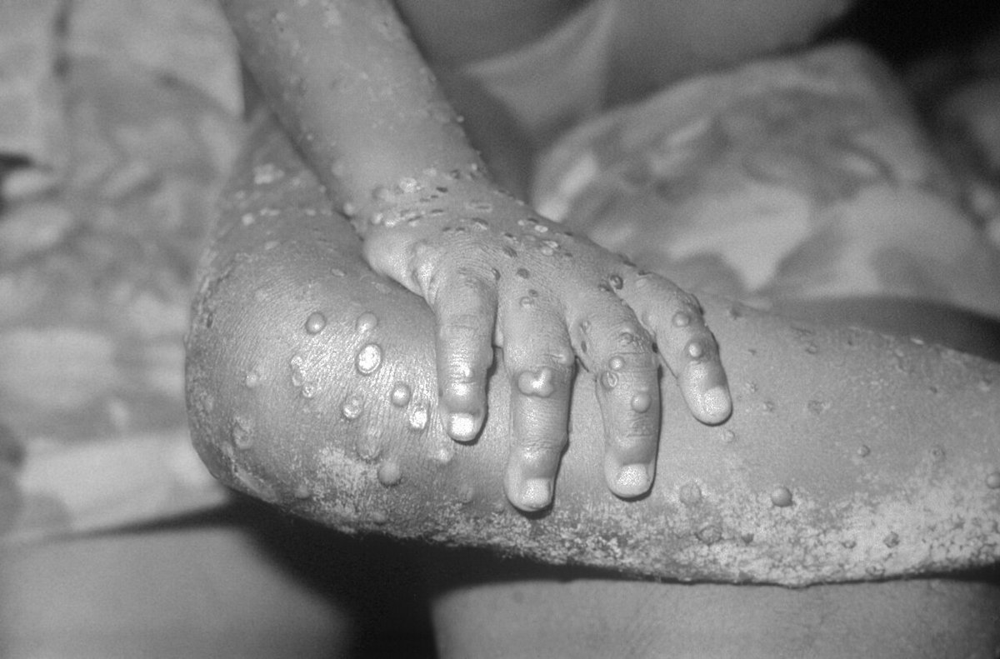

# Mpox

**Prerequisites:** [Viruses](../../../microbiology/03-viruses.md); [Smallpox](smallpox.md)

*Mpox lesions on the arm and leg of a four-year-old girl. Credit: not listed. License: Public domain. Source: [File:Monkeypox.jpg](https://commons.wikimedia.org/wiki/File:Monkeypox.jpg).*

## The disease

Mpox (formerly monkeypox) is caused by monkeypox virus, an orthopoxvirus related to smallpox ([WHO mpox fact sheet](https://www.who.int/news-room/fact-sheets/detail/mpox)). Despite its old name, its main animal reservoirs are probably rodents. It causes fever, swollen lymph nodes and a rash or lesions on the skin and mucous membranes, which can be very painful and last two to four weeks. It spreads through close contact, including sexual contact, contaminated materials and infected animals, and can pass from mother to fetus. **Clade I** (subclades Ia and Ib), found mainly in Central Africa, is generally more severe than **clade II** (IIa and IIb), from West Africa ([WHO mpox fact sheet](https://www.who.int/news-room/fact-sheets/detail/mpox)).

## Outbreaks

Mpox was first identified in humans in 1970 in what is now the Democratic Republic of the Congo, and for decades occurred mainly there and in West Africa, with a US outbreak in 2003 traced to imported pet rodents. In 2022 a global outbreak of clade IIb spread mainly through sexual networks of men who have sex with men, reaching more than 100 countries; WHO declared it a Public Health Emergency of International Concern (2022–2023). A second emergency was declared in 2024 because of spreading clade Ib in the DRC and neighbouring countries.

Smallpox vaccination gave cross-protection against mpox, and the end of smallpox vaccination after 1980 left most people born since then without that protection, which may have contributed to rising mpox cases.

## The vaccines

- **MVA-BN** (Jynneos, Imvanex, Imvamune), a non-replicating vaccinia-based vaccine originally developed for smallpox, was used widely in 2022. A US case-control study estimated about 75% effectiveness with one dose and 86% with two ([Deputy et al., *NEJM* 2023](https://doi.org/10.1056/NEJMoa2215201)). Because it cannot replicate, it is safer than older smallpox vaccines, including for people with HIV.
- **ACAM2000**, a replicating vaccinia vaccine, is more reactogenic and carries risks such as myocarditis.
- **LC16m8**, a minimally replicating vaccine from Japan, has been used in the DRC.

Vaccination can be given before exposure or within four days after contact ([WHO mpox fact sheet](https://www.who.int/news-room/fact-sheets/detail/mpox)). Access in Africa has lagged, raising equity concerns similar to those of COVID-19. Stigma also complicated the 2022 response: health agencies had to warn about the risk to gay and bisexual men without implying that only they could be infected, and WHO renamed the disease from monkeypox to mpox in late 2022 partly for this reason.

## Key ideas

- Mpox is a smallpox relative causing painful lesions; clade I is generally more severe.
- The 2022 global outbreak spread mainly through sexual networks; a new emergency followed in 2024 with clade Ib.
- Non-replicating MVA vaccine is about 75–86% effective; access in Africa has been limited.

## Where this leads

- [Smallpox](smallpox.md); [global immunisation programmes](../09-public-health-and-ethics/03-global-immunisation-programmes.md).
