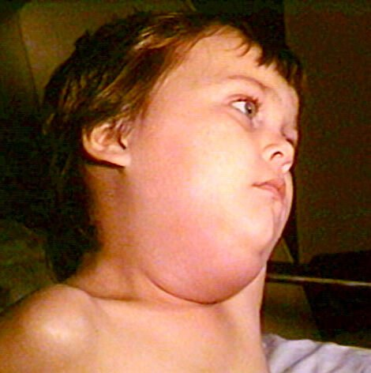

# Mumps

**Prerequisites:** [Viruses](../../../microbiology/03-viruses.md); [Live attenuated vaccines](../01-how-vaccines-work/03-live-attenuated-vaccines.md)

*A child with the swollen jaw typical of mumps. Credit: Photo Credit: Content Providers: CDC/NIP/Barbara Rice. License: Public domain. Source: [File:Mumps_PHIL_130_lores.jpg](https://commons.wikimedia.org/wiki/File:Mumps_PHIL_130_lores.jpg).*

## The disease

Mumps is caused by a paramyxovirus with a single serotype, spread by respiratory droplets and saliva. After an incubation period of about two to four weeks, it begins with fever, headache and tiredness, followed by painful swelling of the parotid salivary glands that gives the classic "hamster cheeks". Many infections are mild or symptomless.

Complications include viral meningitis, encephalitis, deafness (usually one ear), and inflammation of the testes (**orchitis**) in around 20% of infected young adult men, occasionally reducing fertility; inflammation of the ovaries and pancreas also occur ([WHO mumps page](https://www.who.int/teams/immunization-vaccines-and-biologicals/diseases/mumps)). Before vaccination, mumps was a leading cause of viral meningitis and acquired deafness in children.

## Burden before and after vaccination

Before vaccination, most children caught mumps. The US reported about 186,000 cases in 1967, the year the vaccine was licensed, and true numbers were much higher because many cases were never reported ([CDC, *Epidemiology and Prevention of Vaccine-Preventable Diseases* ("Pink Book")](https://www.cdc.gov/pinkbook/hcp/table-of-contents/index.html)). Reported cases fell by more than 99% after vaccination became routine.

## The vaccine

The **Jeryl Lynn** strain, used in US MMR, was developed by Maurice Hilleman from a virus taken from his daughter Jeryl Lynn in 1963 and licensed in 1967. Mumps is the weakest part of MMR: two doses are about 88% effective (with a wide range across studies) and one dose about 78% ([CDC, *Epidemiology and Prevention of Vaccine-Preventable Diseases* ("Pink Book")](https://www.cdc.gov/pinkbook/hcp/table-of-contents/index.html)). Protection wanes, and since the mid-2000s outbreaks have occurred among vaccinated young adults in close-contact settings, such as US universities in 2006 and 2016–17. In 2017 ACIP recommended a third MMR dose for people at increased risk during outbreaks.

Other strains caused safety problems. The **Urabe** strain caused aseptic (viral) meningitis at rates that varied widely between studies, from around 1 in a few thousand doses to 1 in more than 100,000; the UK withdrew Urabe-containing MMR in 1992, and Japan stopped its domestic MMR in 1993 after reports of meningitis. These episodes are sometimes cited as evidence that vaccine safety problems are real and can lead to withdrawal, which is true; they are also cited as evidence that surveillance works.

## Litigation: the Merck whistleblower case

In 2010 two former Merck virologists, Stephen Krahling and Joan Wlochowski, filed a False Claims Act suit alleging that Merck had manipulated testing to overstate the mumps component's efficacy. A related antitrust claim was brought by physicians. In 2023 a federal court granted Merck summary judgment, and in 2024 the Third Circuit affirmed, holding that even if Merck's representations were false they were not material to the CDC's purchasing decisions, since the CDC relied on its own data and continued to buy the vaccine ([*United States ex rel. Krahling v. Merck & Co.*, No. 23-2553 (3d Cir. 6 August 2024)](https://www2.ca3.uscourts.gov/opinarch/232553np.pdf)). The courts did not decide whether the efficacy testing was misrepresented. Critics of Merck still cite the case; others note the CDC knew from field studies that mumps protection was imperfect.

## Key ideas

- Mumps causes swollen salivary glands and can cause meningitis, deafness and orchitis.
- The mumps component of MMR is the least effective and wanes, causing outbreaks among vaccinated young adults.
- The Urabe strain was withdrawn in the UK and Japan after meningitis was linked to it.
- A whistleblower suit against Merck over mumps efficacy was dismissed on materiality grounds, not on the merits of the testing allegations.

## Where this leads

- [Measles](measles.md); [Rubella](rubella.md); [Efficacy, effectiveness and waning](../../../epidemiology/13-efficacy-effectiveness-and-waning.md).
