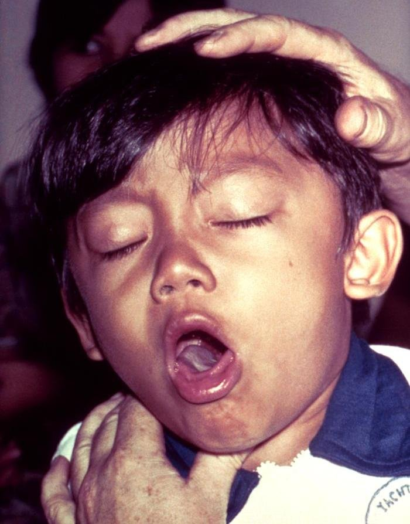

# Pertussis (whooping cough)

**Prerequisites:** [Bacteria](../../../microbiology/02-bacteria.md); [Subunit and recombinant vaccines](../01-how-vaccines-work/06-subunit-and-recombinant-vaccines.md); [Efficacy, effectiveness and waning](../../../epidemiology/13-efficacy-effectiveness-and-waning.md)

*A young boy with pertussis (whooping cough). Credit: UnknownUnknown / CDC. License: Public domain. Source: [File:Pertussis.jpg](https://commons.wikimedia.org/wiki/File:Pertussis.jpg).*

## The disease

Pertussis is caused by the bacterium *Bordetella pertussis*, spread by coughing and sneezing. After a cold-like start, it causes spasms of coughing that can last weeks or months (the Chinese name means "100-day cough"), often ending in a "whoop" as the person gasps for air, or in vomiting. In young infants, it may cause apnoea (pauses in breathing) rather than a whoop, and pneumonia, seizures, brain damage or death. Most deaths are in babies too young to be fully vaccinated. WHO counted more than 264,000 cases globally in 2025 ([WHO pertussis health topic](https://www.who.int/health-topics/pertussis)).

## Burden before and after vaccination

In the US before vaccination, pertussis caused more than 200,000 reported cases a year in the 1930s and 1940s and thousands of child deaths ([CDC, *Epidemiology and Prevention of Vaccine-Preventable Diseases* ("Pink Book")](https://www.cdc.gov/pinkbook/hcp/table-of-contents/index.html)). Whole-cell vaccines, combined with diphtheria and tetanus toxoids as DTP from the late 1940s, cut reported cases by more than 99% by the 1970s.

## Whole-cell and acellular vaccines

The original **whole-cell** vaccine (DTwP) contained killed bacteria. It was effective but caused frequent fever, pain and swelling, and less commonly persistent crying, febrile seizures and hypotonic-hyporesponsive episodes. In the 1970s and 1980s, fears that it caused brain damage led to falling coverage and pertussis resurgence in the UK, Sweden and Japan, and to lawsuits in the US that helped produce the 1986 compensation system ([Kulenkampff, Schwartzman & Wilson, *Archives of Disease in Childhood* 1974](https://doi.org/10.1136/adc.49.1.46); [Gangarosa et al., *Lancet* 1998](https://doi.org/10.1016/S0140-6736(97)04334-1)). See [[dtp-and-whole-cell-pertussis|DTP and whole-cell pertussis]].

Japan developed **acellular** vaccines (DTaP), containing a few purified proteins, in the early 1980s; the US switched fully to DTaP for infants in 1997. Acellular vaccines cause fewer reactions but protection wanes faster: a Kaiser Permanente study found the odds of pertussis rose by about 42% each year after the fifth DTaP dose ([Klein et al., *NEJM* 2012](https://doi.org/10.1056/NEJMoa1200850)). Baboon experiments suggested that acellular vaccines prevent disease but not infection and transmission ([Warfel, Zimmerman & Merkel, *PNAS* 2014](https://doi.org/10.1073/pnas.1314688110)). Together with better testing and bacterial adaptation, this helps explain why pertussis has resurged since the 2000s in countries using acellular vaccines, with large epidemics in 2012 and again in 2024. Some researchers argue for returning to whole-cell vaccines or developing new ones; whole-cell vaccines are still used in most low- and middle-income countries.

## Protecting newborns

Because babies are most at risk before their first doses, many countries vaccinate pregnant women with Tdap; antibodies cross the placenta. In England, maternal vaccination introduced in 2012 was about 91% effective against pertussis in infants under three months ([Amirthalingam et al., *Lancet* 2014](https://doi.org/10.1016/S0140-6736(14)60686-3)). A Cochrane review found acellular vaccines effective in infants ([Zhang et al., Cochrane review of acellular pertussis vaccines, 2014](https://doi.org/10.1002/14651858.CD001478.pub6)).

## Key ideas

- Pertussis is most dangerous for young babies.
- Whole-cell vaccines worked well but caused frequent reactions; fears about brain damage led to resurgences in the 1970s–80s.
- Acellular vaccines are gentler but wane faster and may not block transmission, contributing to modern resurgence.
- Vaccinating pregnant women protects newborns.

## Where this leads

- [[dtp-and-whole-cell-pertussis|DTP and whole-cell pertussis]]; [[the-1980s-dtp-lawsuits|the 1980s DTP lawsuits]]; [Diphtheria](diphtheria.md); [Tetanus](tetanus.md).
