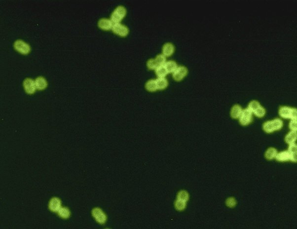

# Pneumococcal disease

**Prerequisites:** [Bacteria](../../../microbiology/02-bacteria.md); [Conjugate vaccines](../01-how-vaccines-work/07-conjugate-vaccines.md); [Herd immunity](../../../epidemiology/04-herd-immunity.md)

**Streptococcus pneumoniae* in spinal fluid, fluorescent antibody stain. Credit: Photo Credit: Content Providers(s): CDC/Dr. M.S. Mitchell. License: Public domain. Source: [File:Pneumococcus_CDC_PHIL_ID1003.jpg](https://commons.wikimedia.org/wiki/File:Pneumococcus_CDC_PHIL_ID1003.jpg).*

## The disease

*Streptococcus pneumoniae* (the pneumococcus) is a bacterium carried in the nose and throat of many healthy children. It causes ear infections and sinusitis, and invasive disease: pneumonia with bacteraemia, meningitis and sepsis. Risk is highest in young children, adults over 65, and people with weakened immunity, no spleen, sickle cell disease, chronic illness or cochlear implants, and smokers. It is a leading cause of pneumonia deaths in children worldwide. More than 100 serotypes are known, distinguished by their polysaccharide capsule.

An estimated 294,000 children aged 1–59 months without HIV died of pneumococcal infections in 2015, down about 51% since 2000, with half of these deaths in India, Nigeria, the Democratic Republic of the Congo and Pakistan ([Wahl et al., *Lancet Global Health* 2018](https://doi.org/10.1016/s2214-109x(18)30247-x)).

## The vaccines

- **Polysaccharide vaccine (PPSV23)**, covering 23 serotypes, has been used in older adults since 1983 (an earlier 14-valent version from 1977). It does not work well in young children and gives limited, shorter-lived protection.
- **Pneumococcal conjugate vaccines (PCVs)** were licensed in the US in 2000 (PCV7), followed by PCV10 and PCV13 (2010) and, for adults and children, PCV15, PCV20 and PCV21 in the 2020s.

PCV7 cut invasive pneumococcal disease in US children dramatically, and rates also fell in adults who were not vaccinated, because vaccinated children stopped carrying and spreading vaccine serotypes ([Whitney et al., *NEJM* 2003](https://doi.org/10.1056/NEJMoa022823)). In adults over 65, the CAPITA trial of about 85,000 Dutch adults found PCV13 prevented about 46% of first episodes of vaccine-type community-acquired pneumonia ([Bonten et al., *NEJM* 2015 (CAPITA)](https://doi.org/10.1056/NEJMoa1408544)); the trial was funded by Pfizer, the manufacturer.

## Serotype replacement

Removing vaccine serotypes leaves room for others. **Serotype replacement**, especially serotype 19A after PCV7, eroded some of the benefit and drove the development of vaccines with ever more serotypes. This arms race is a genuine scientific limitation of the approach, and critics point to it when arguing that vaccines reshape rather than remove disease. The overall effect has still been large net reductions in invasive disease.

## Safety

Side effects are mostly local reactions, fever and irritability. When PCV13 and inactivated flu vaccine were given at the same visit, the Vaccine Safety Datalink detected a small increase in febrile seizures in young children; the absolute risk was low and US recommendations did not change. Pneumococcal vaccines remain routine for all children in the 2026 US schedule ([HHS fact sheet, "CDC Childhood Immunization Recommendations" (January 2026)](https://www.hhs.gov/press-room/fact-sheet-cdc-childhood-immunization-recommendations.html)).

## Key ideas

- Pneumococcus causes pneumonia, meningitis and sepsis, especially in young children and older adults.
- Conjugate vaccines protect infants and reduce spread, giving herd effects for adults.
- Serotype replacement drives the need for vaccines covering more serotypes.

## Where this leads

- [Hib](haemophilus-influenzae-type-b.md); [Meningococcal disease](meningococcal-disease.md); [adult vaccination](../05-schedules/08-pregnancy-adult-and-travel-vaccination.md).
