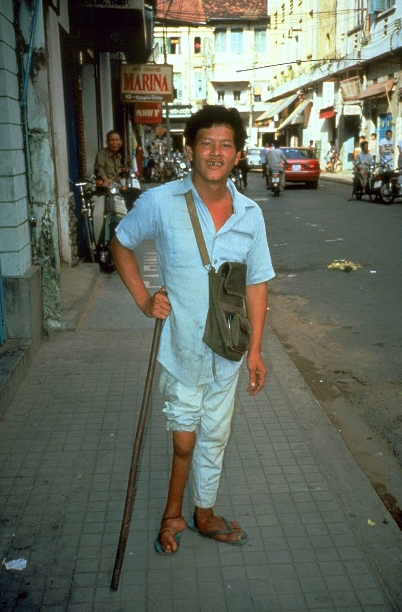

# Polio

**Prerequisites:** [Viruses](../../../microbiology/03-viruses.md); [Live attenuated vaccines](../01-how-vaccines-work/03-live-attenuated-vaccines.md); [Inactivated vaccines](../01-how-vaccines-work/04-inactivated-vaccines.md)

*A man with wasting and paralysis of the right leg caused by polio. Credit: Photo Credit: Content Providers(s): CDC/NIP/ Barbara Rice. License: Public domain. Source: [File:Polio_lores134.jpg](https://commons.wikimedia.org/wiki/File:Polio_lores134.jpg).*

## The disease

Poliomyelitis is caused by poliovirus, an enterovirus with three types, spread mainly by the faecal–oral route and sometimes by saliva. Most infections cause no symptoms or a mild illness, but in about 1 in 200 infections the virus invades the nervous system and destroys motor neurons, causing permanent paralysis, usually of the legs. Of those paralysed, 5–10% die when breathing muscles are affected ([WHO poliomyelitis fact sheet](https://www.who.int/news-room/fact-sheets/detail/poliomyelitis)). Decades later, many survivors develop **post-polio syndrome**: new weakness and fatigue.

## Burden before and after vaccination

Polio became epidemic in industrialised countries in the early 20th century, partly because improved sanitation delayed infection from infancy (when maternal antibodies protect) to later childhood. In 1952 the United States had about 21,000 cases of paralytic polio; iron lungs filled hospital wards ([CDC, *Epidemiology and Prevention of Vaccine-Preventable Diseases* ("Pink Book")](https://www.cdc.gov/pinkbook/hcp/table-of-contents/index.html)). Fear of polio drove the March of Dimes and the 1954 field trial of the Salk vaccine. See [Salk, Sabin and the Cutter incident](../04-history/06-salk-sabin-and-the-cutter-incident.md).

The last case caused by wild poliovirus contracted in the US was in 1979. In 1988 the World Health Assembly launched the **Global Polio Eradication Initiative (GPEI)**; wild cases have fallen by over 99% from an estimated 350,000 in more than 125 countries. Wild types 2 and 3 have been certified eradicated (in 2015 and 2019); wild type 1 remains endemic only in Afghanistan and Pakistan ([WHO poliomyelitis fact sheet](https://www.who.int/news-room/fact-sheets/detail/poliomyelitis)). See [the polio eradication campaign](../04-history/08-polio-eradication.md).

## The vaccines

- **Inactivated polio vaccine (IPV)**, developed by Jonas Salk and licensed in 1955, is injected. It protects the individual against paralysis but produces less gut immunity, so vaccinated people can still carry and spread the virus briefly.
- **Oral polio vaccine (OPV)**, developed by Albert Sabin and licensed in the US in 1961–63, contains live weakened virus. It is cheap, easy to give and produces gut immunity that blocks transmission, which made it the main tool for eradication.

OPV has a serious drawback. Rarely, the weakened virus mutates back to a paralysing form. **Vaccine-associated paralytic polio (VAPP)** occurred in about 1 in 2.4 million doses in the US, causing around 8–9 cases a year in the 1980s and 1990s; for this reason the US switched entirely to IPV in 2000 ([CDC, *Epidemiology and Prevention of Vaccine-Preventable Diseases* ("Pink Book")](https://www.cdc.gov/pinkbook/hcp/table-of-contents/index.html)). In under-immunised communities, vaccine virus can also spread and regain virulence, causing **circulating vaccine-derived poliovirus (cVDPV)** outbreaks, which now cause more paralysis cases each year than wild poliovirus. A paralytic case in an unvaccinated man in New York State in 2022 was caused by vaccine-derived virus. In response, countries removed the type 2 component from OPV in a coordinated switch in 2016, and a genetically more stable **novel OPV2** was introduced under WHO Emergency Use Listing in 2021. See [vaccine-derived polio](../06-adverse-events/10-vaccine-derived-polio.md).

## Controversies

Polio vaccines were at the centre of several controversies: the 1955 [Cutter incident](../04-history/06-salk-sabin-and-the-cutter-incident.md) ([Offit, *NEJM* 2005, "The Cutter incident, 50 years later"](https://doi.org/10.1056/NEJMp048180)); contamination of early vaccines with the monkey virus SV40, for which the IOM found evidence inadequate to accept or reject a link with cancer ([Institute of Medicine, *SV40 Contamination of Polio Vaccine and Cancer* (2002)](https://doi.org/10.17226/10534)); the claim, rejected by expert reviews, that OPV trials in Africa started the HIV pandemic; the 2003–04 boycott in northern Nigeria ([Jegede, *PLoS Medicine* 2007](https://doi.org/10.1371/journal.pmed.0040073)); and the CIA's fake hepatitis B vaccination campaign in Pakistan, which damaged trust in polio workers ([Martinez-Bravo & Stegmann, *Journal of the European Economic Association* 2022](https://doi.org/10.1093/jeea/jvab018)).

## Key ideas

- About 1 in 200 polio infections causes permanent paralysis.
- IPV (Salk) protects individuals; OPV (Sabin) also blocks transmission but can rarely cause paralysis and vaccine-derived outbreaks.
- Wild polio is endemic only in Afghanistan and Pakistan; vaccine-derived outbreaks are now the larger problem.

## Where this leads

- [The polio eradication campaign](../04-history/08-polio-eradication.md); [[jonas-salk|Jonas Salk]]; [[albert-sabin|Albert Sabin]].
