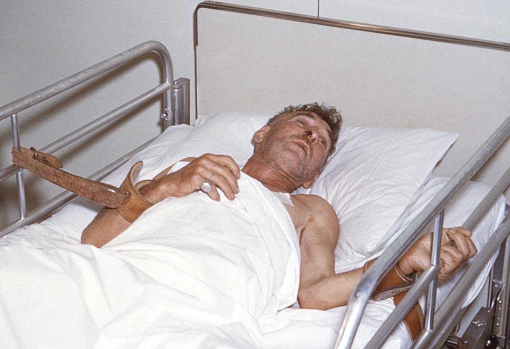

# Rabies

**Prerequisites:** [Viruses](../../../microbiology/03-viruses.md); [Passive and active immunity](../../08-passive-and-active-immunity.md)

*A man with rabies showing progressive signs of the disease. Credit: CDC. License: Public domain. Source: [File:Manwithrabies4.png](https://commons.wikimedia.org/wiki/File:Manwithrabies4.png).*

## The disease

Rabies is caused by a lyssavirus that infects mammals and spreads through the saliva of infected animals, usually by bites or scratches. Dogs cause about 99% of human cases ([WHO rabies fact sheet](https://www.who.int/news-room/fact-sheets/detail/rabies)); in North America, bats, raccoons, skunks and foxes are the main reservoirs. The virus travels slowly along nerves to the brain, so the incubation period is usually one to three months but can be days or more than a year. Once symptoms appear (fever, then agitation, hydrophobia, paralysis and coma) rabies is almost always fatal.

Rabies kills tens of thousands of people a year, mostly in Asia and Africa, 40% of them children under 15 ([WHO rabies fact sheet](https://www.who.int/news-room/fact-sheets/detail/rabies)). A widely cited 2015 estimate put the toll at about 59,000 deaths a year ([Hampson et al., *PLoS Neglected Tropical Diseases* 2015](https://doi.org/10.1371/journal.pntd.0003709)).

## Pasteur and the first rabies vaccine

In July 1885 Louis Pasteur and his colleagues treated nine-year-old Joseph Meister, who had been badly bitten by a rabid dog, with a series of injections of dried spinal cord from rabbits infected with rabies. Meister survived, and Pasteur became famous. The treatment was ethically controversial even then: Pasteur was not a physician, had limited animal data, and his private notebooks, studied by historian Gerald Geison in the 1990s, showed his public accounts of earlier experiments were not fully accurate. See [Louis Pasteur](../10-people/louis-pasteur.md) and [Pasteur and the germ theory vaccines](../04-history/04-pasteur-and-the-germ-theory-vaccines.md).

Early nerve-tissue vaccines caused serious neurological reactions (allergic encephalomyelitis) in a small share of recipients. Modern vaccines, grown in cell culture since the 1970s, are far safer, causing mostly local reactions and headache.

## Post-exposure prophylaxis

Because of the long incubation period, vaccination can work even *after* exposure. **Post-exposure prophylaxis (PEP)** consists of thorough wound washing, a course of rabies vaccine, and for severe exposures rabies immunoglobulin or monoclonal antibodies injected around the wound ([WHO rabies fact sheet](https://www.who.int/news-room/fact-sheets/detail/rabies)). Given promptly, PEP is almost always effective. More than 29 million people receive human rabies vaccine each year, but vaccines and especially immunoglobulin are often unavailable or unaffordable where most deaths occur ([WHO rabies fact sheet](https://www.who.int/news-room/fact-sheets/detail/rabies)).

**Pre-exposure vaccination** is offered to veterinarians, laboratory workers, cavers and some travellers.

## Vaccinating dogs

The most cost-effective way to prevent human rabies is to vaccinate dogs, which stops transmission at its source. Mass dog vaccination eliminated dog-mediated rabies in Western Europe, North America and much of Latin America. WHO and partners aim to end human deaths from dog-mediated rabies by 2030. In Europe, oral vaccine baits dropped from aircraft largely eliminated rabies in foxes.

## Key ideas

- Rabies is almost always fatal once symptoms appear; dogs cause 99% of human cases.
- The long incubation period allows post-exposure vaccination, first done by Pasteur in 1885.
- Vaccinating dogs is the most effective way to prevent human deaths.

## Where this leads

- [Louis Pasteur](../10-people/louis-pasteur.md); [travel vaccination](../05-schedules/08-pregnancy-adult-and-travel-vaccination.md).
