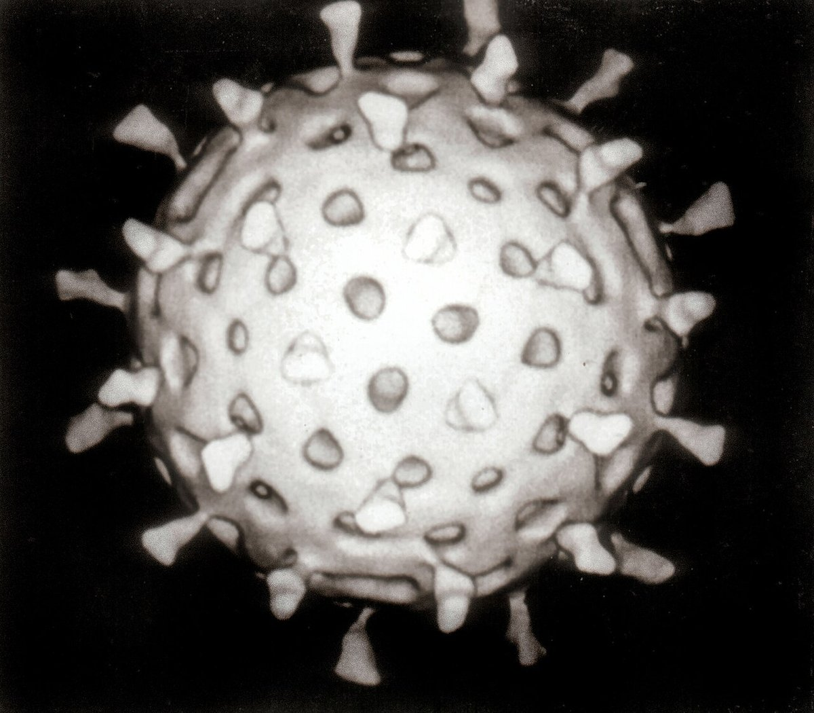

# Rotavirus

**Prerequisites:** [Viruses](../../../microbiology/03-viruses.md); [Live attenuated vaccines](../01-how-vaccines-work/03-live-attenuated-vaccines.md)

*Computer reconstruction of a rotavirus particle. Credit: User:Graham Beards (this image was verified as being an accurate approximation of a rotavirus using: https://www.ecdc.europa.eu/en/rotavirus. License: [CC BY 3.0](https://creativecommons.org/licenses/by/3.0). Source: [File:Rotavirus_Reconstruction.jpg](https://commons.wikimedia.org/wiki/File:Rotavirus_Reconstruction.jpg).*

## The disease

Rotavirus is a highly contagious virus that infects the gut and was, before vaccines, the most common cause of severe diarrhoea in young children worldwide. Almost every child was infected by age five. It causes vomiting, watery diarrhoea and fever, leading to dehydration that can kill quickly without oral rehydration or intravenous fluids. It spreads by the faecal–oral route and survives well on surfaces, so even excellent sanitation does not stop it. An estimated 128,500 children under five died of rotavirus in 2016, more than 100,000 of them in sub-Saharan Africa ([Troeger et al., *JAMA Pediatrics* 2018](https://doi.org/10.1001/jamapediatrics.2018.1960)). In high-income countries deaths were rare but hospitalisations common: in the US, rotavirus caused tens of thousands of hospital admissions a year before vaccination.

## RotaShield and intussusception

The first vaccine, **RotaShield** (Wyeth), was licensed in the US in 1998. Within a year, VAERS reports and then controlled studies showed it caused **intussusception**, a bowel obstruction in which part of the intestine telescopes into itself, in roughly 1 in 10,000 vaccinated infants ([Murphy et al., *NEJM* 2001](https://doi.org/10.1056/NEJM200102223440804)). It was withdrawn in 1999. Some public health experts argued that in poor countries, where rotavirus killed many more children, the benefit would still have outweighed the risk, but the vaccine was never used there. See [intussusception and rotavirus vaccines](../06-adverse-events/05-intussusception-and-rotavirus-vaccines.md).

## Current vaccines

Successor vaccines were tested in some of the largest trials ever run, sized to detect intussusception: **RotaTeq** (Merck, about 70,000 infants; [Vesikari et al., *NEJM* 2006 (RotaTeq trial)](https://doi.org/10.1056/NEJMoa052664)) and **Rotarix** (GSK, about 63,000 infants; [Ruiz-Palacios et al., *NEJM* 2006 (Rotarix trial)](https://doi.org/10.1056/NEJMoa052434)). Both are oral live vaccines. Indian-made **Rotavac** and **Rotasiil** are WHO-prequalified and cheaper. Post-marketing studies found a small intussusception risk with current vaccines too, up to about 6 per 100,000 vaccinated infants, which WHO considers outweighed by their benefits ([WHO rotavirus page](https://www.who.int/teams/immunization-vaccines-and-biologicals/diseases/rotavirus)). Doses must start early (the first by 15 weeks in many schedules), because intussusception naturally becomes more common later in infancy.

The vaccines are highly effective in high-income countries; efficacy is lower in low-income countries, as with other oral vaccines, but because disease is so much more common there, they prevent more deaths ([WHO rotavirus page](https://www.who.int/teams/immunization-vaccines-and-biologicals/diseases/rotavirus)). A Cochrane review found substantial protection against severe rotavirus diarrhoea ([Bergman et al., Cochrane review of rotavirus vaccines, 2021](https://doi.org/10.1002/14651858.CD008521.pub6)).

In 2010 researchers found DNA from porcine circovirus, a pig virus not known to cause human disease, in Rotarix. The FDA briefly recommended pausing its use and then lifted the pause after review. Critics cite the episode as evidence of manufacturing contamination; regulators concluded there was no safety risk.

## Under the 2026 US changes

The January 2026 US schedule moved rotavirus vaccine to shared clinical decision-making, a change blocked in court in March 2026 ([HHS fact sheet, "CDC Childhood Immunization Recommendations" (January 2026)](https://www.hhs.gov/press-room/fact-sheet-cdc-childhood-immunization-recommendations.html); [*American Academy of Pediatrics v. Kennedy*, First Circuit docket 26-1503 (CourtListener)](https://www.courtlistener.com/docket/73286021/american-academy-of-pediatrics-v-kennedy/)). Paul Offit, a prominent defender of vaccines, is a co-inventor of RotaTeq; see [conflicts of interest and funding](../07-controversies/14-conflicts-of-interest-and-funding.md).

## Key ideas

- Rotavirus caused severe childhood diarrhoea almost universally, killing more than 100,000 children a year in Africa.
- RotaShield was withdrawn in 1999 after causing intussusception in about 1 in 10,000 infants.
- Current oral vaccines carry a much smaller intussusception risk and prevent many deaths.

## Where this leads

- [Intussusception and rotavirus vaccines](../06-adverse-events/05-intussusception-and-rotavirus-vaccines.md); [Post-market surveillance](../02-development-and-regulation/07-post-market-surveillance.md); [[paul-offit|Paul Offit]].
