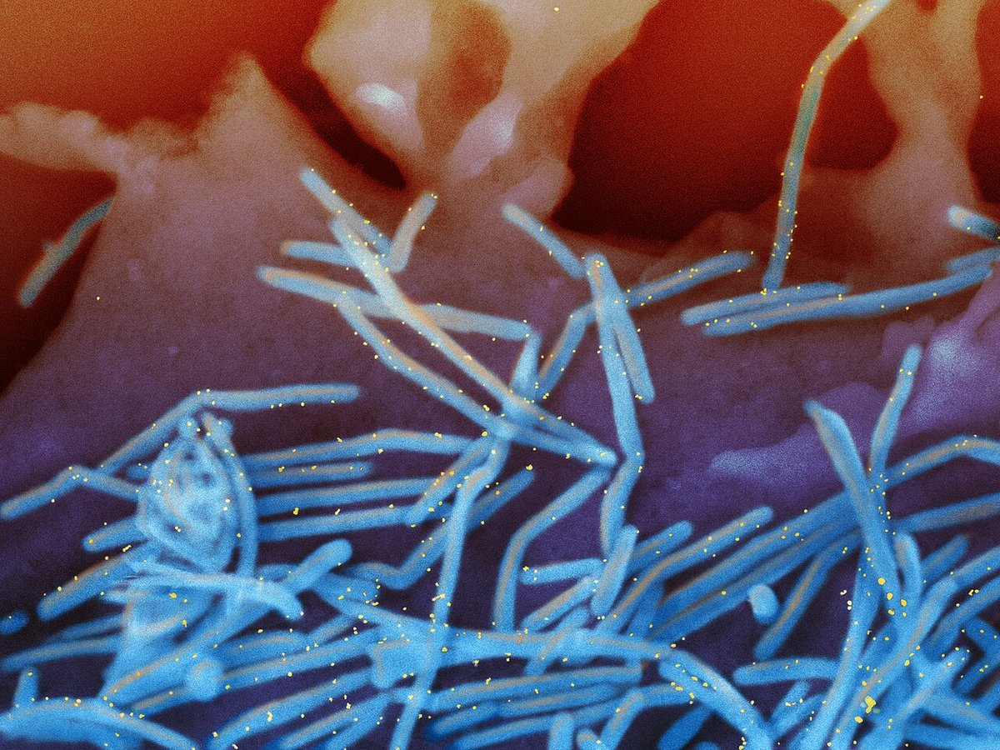

# Respiratory syncytial virus (RSV)

**Prerequisites:** [Viruses](../../../microbiology/03-viruses.md); [Passive and active immunity](../../08-passive-and-active-immunity.md)

*Scanning electron micrograph of respiratory syncytial virus particles (colourised blue). Credit: NIAID. License: [CC BY 2.0](https://creativecommons.org/licenses/by/2.0). Source: [File:Human_Respiratory_Syncytial_Virus_(RSV)_(33114415716).jpg](https://commons.wikimedia.org/wiki/File:Human_Respiratory_Syncytial_Virus_%28RSV%29_%2833114415716%29.jpg).*

## The disease

RSV is a common respiratory virus that infects nearly all children by age two ([WHO RSV health topic](https://www.who.int/health-topics/respiratory-syncytial-virus)). Most get a cold, but in young infants it is the leading cause of bronchiolitis and pneumonia, and it is a major cause of illness and death in older adults. WHO estimates that in 2019 RSV caused 33 million lower respiratory infections, 3.6 million hospital admissions and about 101,400 deaths in children under five, more than 97% of them in low- and middle-income countries ([WHO RSV health topic](https://www.who.int/health-topics/respiratory-syncytial-virus)).

## A vaccine disaster in the 1960s

In the 1960s, a formalin-inactivated RSV vaccine was tested in infants. When vaccinated children later caught RSV, many developed *worse* disease: in one study 80% of infected vaccinated children were hospitalised compared with 5% of controls, and two children died ([Kim et al., *American Journal of Epidemiology* 1969](https://doi.org/10.1093/oxfordjournals.aje.a120955)). This **vaccine-enhanced disease** was later linked to the inactivated vaccine producing antibodies that did not neutralise the virus well and a skewed T-cell response. It set back RSV vaccine development for decades and is a real example of a vaccine causing harm, often mentioned by critics and taken seriously by vaccine developers.

## The breakthrough

The key discovery was that the RSV fusion (F) protein changes shape, and that antibodies against its **prefusion** form are far more protective. This led, in 2023, to:

- **Older-adult vaccines**: GSK's Arexvy (efficacy about 83% against RSV lower respiratory disease in the first season; [Papi et al., *NEJM* 2023](https://doi.org/10.1056/NEJMoa2209604)), Pfizer's Abrysvo, and in 2024 Moderna's mRESVIA. A small increased risk of Guillain-Barré syndrome was later identified, and the FDA required a warning in 2025.
- **Maternal vaccination**: Pfizer's Abrysvo given at 32–36 weeks of pregnancy; its trial showed about 82% efficacy against severe RSV in infants in the first 90 days ([Kampmann et al., *NEJM* 2023](https://doi.org/10.1056/NEJMoa2216480)). A similar GSK maternal vaccine trial was stopped in 2022 because of more preterm births in the vaccine group ([Dieussaert et al., *NEJM* 2024](https://doi.org/10.1056/NEJMoa2305478)); Pfizer's trial showed a small numerical imbalance that was not statistically significant, and the FDA approved Abrysvo only for weeks 32–36 to reduce any risk.
- **Monoclonal antibodies for infants**: nirsevimab (Beyfortus), a long-acting antibody given once before the RSV season, reduced medically attended RSV infections by about 75% in its trial ([Hammitt et al., *NEJM* 2022](https://doi.org/10.1056/NEJMoa2110275)). Clesrovimab followed in 2025. These provide passive immunity rather than vaccination.

Early real-world data showed large falls in infant RSV hospitalisations where these products were widely used. Under the January 2026 US schedule, RSV immunisation of infants was moved to high-risk groups, a change blocked in court in March 2026 ([HHS fact sheet, "CDC Childhood Immunization Recommendations" (January 2026)](https://www.hhs.gov/press-room/fact-sheet-cdc-childhood-immunization-recommendations.html); [*American Academy of Pediatrics v. Kennedy*, First Circuit docket 26-1503 (CourtListener)](https://www.courtlistener.com/docket/73286021/american-academy-of-pediatrics-v-kennedy/)).

## Key ideas

- RSV is the leading cause of serious respiratory infection in infants and a major risk to older adults.
- A 1960s inactivated vaccine made later disease worse, delaying progress for decades.
- Prefusion F protein science produced effective older-adult and maternal vaccines and long-acting infant antibodies in 2023.
- Preterm birth and GBS signals shaped how the new products are used.

## Where this leads

- [Passive and active immunity](../../08-passive-and-active-immunity.md); [[pregnancy-adult-and-travel-vaccination|Pregnancy vaccination]]; [[guillain-barre-syndrome|Guillain-Barré syndrome]].
