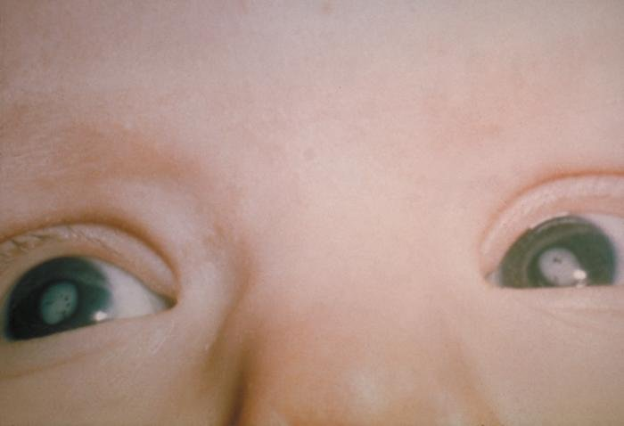

# Rubella

**Prerequisites:** [Viruses](../../../microbiology/03-viruses.md); [Live attenuated vaccines](../01-how-vaccines-work/03-live-attenuated-vaccines.md)

*Cataracts in a child's eyes caused by congenital rubella syndrome. Credit: http://phil.cdc.gov/phil_images/20030724/28/PHIL_4284_lores.jpg. License: Public domain. Source: [File:Cataracts_due_to_Congenital_Rubella_Syndrome_(CRS)_PHIL_4284_lores.jpg](https://commons.wikimedia.org/wiki/File:Cataracts_due_to_Congenital_Rubella_Syndrome_%28CRS%29_PHIL_4284_lores.jpg).*

## The disease

Rubella ("German measles") is caused by a togavirus spread by respiratory droplets. In children and most adults it is mild: a low fever, swollen lymph nodes behind the ears and a pink rash lasting about three days. Up to half of infections cause no symptoms. Adult women often have joint pain or arthritis.

Its danger lies in pregnancy. A woman infected early in pregnancy has about a 90% chance of passing the virus to the fetus, which can cause miscarriage, stillbirth or **congenital rubella syndrome (CRS)**: deafness, cataracts, heart defects, intellectual disability and other problems ([WHO rubella fact sheet](https://www.who.int/news-room/fact-sheets/detail/rubella)). The most severe damage occurs in the first trimester.

## Burden before and after vaccination

The 1964–65 rubella epidemic in the United States caused an estimated 12.5 million infections and about 20,000 babies born with CRS, along with thousands of miscarriages and stillbirths and therapeutic abortions ([CDC, *Epidemiology and Prevention of Vaccine-Preventable Diseases* ("Pink Book")](https://www.cdc.gov/pinkbook/hcp/table-of-contents/index.html)). The epidemic changed American abortion politics, as many pregnant women sought abortions because of feared birth defects.

Vaccines were licensed in 1969. The Americas were declared free of endemic rubella and CRS in 2015. Worldwide, WHO estimates about 100,000 babies are still born with CRS each year, making rubella the leading vaccine-preventable cause of birth defects ([WHO rubella fact sheet](https://www.who.int/news-room/fact-sheets/detail/rubella)).

## The vaccine

The strain used in most of the world, including in MMR in the US and Canada, is **RA 27/3**, developed by Stanley Plotkin at the Wistar Institute and grown in the **WI-38** human fetal cell line, derived from an elective abortion in Sweden in 1962 (the virus itself was isolated from a fetus aborted because of rubella infection). It produces immunity in about 95% or more of recipients after one dose ([CDC, *Epidemiology and Prevention of Vaccine-Preventable Diseases* ("Pink Book")](https://www.cdc.gov/pinkbook/hcp/table-of-contents/index.html)).

Side effects are usually mild: fever, rash and swollen glands. Temporary joint pain and arthritis occur in a significant minority of adult women. The Institute of Medicine concluded in 1991 that evidence supported a causal link between rubella vaccine and acute arthritis in adult women, and found the evidence weaker for chronic arthritis ([Institute of Medicine, *Adverse Effects of Pertussis and Rubella Vaccines* (1991)](https://doi.org/10.17226/1815)).

## Strategy debates

Countries have chosen different strategies. Some first vaccinated only adolescent girls, protecting future pregnancies directly (the UK until 1988). Others vaccinated all children to interrupt transmission (the US). Vaccinating children at low coverage can be counterproductive, because it raises the average age of infection and may increase infections among women of childbearing age, as seen in Greece in the 1990s. This is why WHO recommends introducing rubella vaccine only once measles coverage reaches high levels.

## Fetal cell lines and religious objections

Because the RA 27/3 strain was developed in a cell line from an aborted fetus, some religious people object to rubella vaccine. The Catholic Church's Pontifical Academy for Life (2005, reaffirmed 2017) and the Congregation for the Doctrine of the Faith (2020, on COVID-19 vaccines) have said Catholics may use such vaccines when no alternative exists. See [religious and philosophical exemptions](../07-controversies/15-religious-and-philosophical-exemptions.md) and [excipients and ingredients](../01-how-vaccines-work/11-excipients-and-ingredients.md).

## Key ideas

- Rubella is mild in children but causes miscarriage and congenital rubella syndrome in early pregnancy.
- The 1964–65 US epidemic caused about 20,000 CRS births; the Americas eliminated rubella in 2015.
- The vaccine strain was developed in a fetal cell line, the basis of some religious objections.
- Vaccinating at low coverage can shift infection to older ages.

## Where this leads

- [Measles](measles.md); [Mumps](mumps.md); [Stanley Plotkin](../10-people/stanley-plotkin.md).
