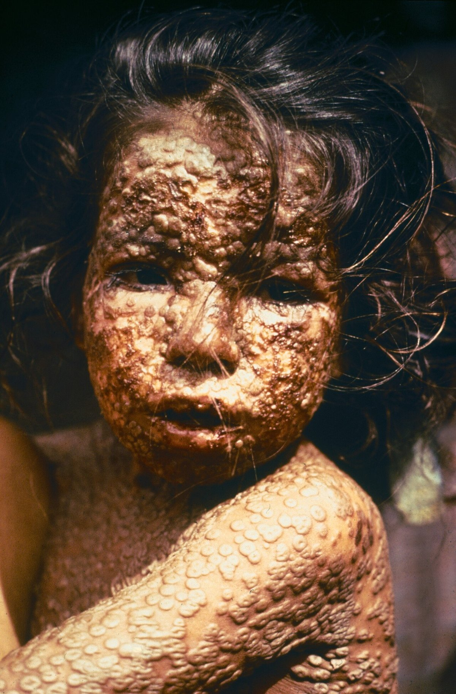

# Smallpox

**Prerequisites:** [Viruses](../../../microbiology/03-viruses.md); [Live attenuated vaccines](../01-how-vaccines-work/03-live-attenuated-vaccines.md)

*A young girl in Bangladesh with smallpox in 1973. Credit: Photo Credit: Content Providers(s): CDC/James Hicks. License: Public domain. Source: [File:Child_with_Smallpox_Bangladesh.jpg](https://commons.wikimedia.org/wiki/File:Child_with_Smallpox_Bangladesh.jpg).*

## The disease

Smallpox was caused by variola virus, an orthopoxvirus that infected only humans. It spread by respiratory droplets and close contact. After about 12 days, high fever and prostration were followed by a rash that turned into deep, fluid-filled pustules, concentrated on the face and limbs, which crusted and left pitted scars. **Variola major** killed about 30% of those infected, more among infants; survivors were often scarred and sometimes blinded. A milder form, variola minor, killed about 1% or less.

## Burden

Smallpox is believed to have existed for at least 3,000 years ([WHO smallpox health topic](https://www.who.int/health-topics/smallpox)). It shaped history: it devastated Indigenous populations in the Americas after European contact, and it killed monarchs. Estimates of smallpox deaths in the 20th century alone, before eradication, are commonly put at around 300 million, though any such figure is approximate.

## The vaccine

Smallpox vaccination began with Edward Jenner's 1796 experiment using cowpox, following centuries of [variolation](../04-history/01-variolation.md) (deliberate infection with smallpox itself). The vaccine used in the 20th century was **vaccinia**, a related orthopoxvirus of uncertain origin, given by scratching the skin with a bifurcated needle; a successful "take" left a scar. See [Jenner and cowpox](../04-history/02-jenner-and-cowpox.md).

Vaccinia caused more serious adverse events than any vaccine in routine use today: generalised vaccinia, eczema vaccinatum in people with eczema, progressive vaccinia in people with immune defects (often fatal), post-vaccinal encephalitis, and roughly one death per million first vaccinations in US surveys of the 1960s. When US vaccination of military personnel and health workers resumed in 2002–2003 because of bioterrorism concerns, myocarditis was identified as a further risk. Routine vaccination ended in the US in 1972 because the risk from the vaccine exceeded the risk of disease. Newer vaccines include ACAM2000 (a vaccinia vaccine grown in cell culture) and the non-replicating MVA vaccine (Jynneos/Imvanex/Imvamune), also used against [mpox](mpox.md).

## Eradication

WHO launched an intensified eradication programme in 1967. Mass vaccination alone was not enough in densely populated areas; the decisive strategy was **surveillance and containment** ("ring vaccination"): finding cases quickly and vaccinating their contacts. The last natural case was Ali Maow Maalin in Somalia in 1977, and WHO declared smallpox eradicated in 1980, the only human disease so far eradicated ([WHO smallpox health topic](https://www.who.int/health-topics/smallpox)). A medical photographer, Janet Parker, died in 1978 after a laboratory-acquired infection in Birmingham, England. See [smallpox eradication](../04-history/07-smallpox-eradication.md).

## After eradication

Official stocks of variola virus are kept at two laboratories: the CDC in Atlanta and the VECTOR centre in Koltsovo, Russia. Whether to destroy them has been debated at the World Health Assembly for decades. Concern about undeclared stocks keeps countries stockpiling vaccines and antivirals (tecovirimat).

## Key ideas

- Smallpox killed about 30% of those infected and was eradicated in 1980 after a WHO campaign based on surveillance and ring vaccination.
- The vaccinia vaccine had more serious side effects than any current vaccine; routine use ended once risk from the vaccine exceeded risk from disease.
- Virus stocks remain in two laboratories.

## Where this leads

- [Smallpox eradication](../04-history/07-smallpox-eradication.md); [Eradication and elimination](../09-public-health-and-ethics/01-eradication-and-elimination.md); [Mpox](mpox.md).
