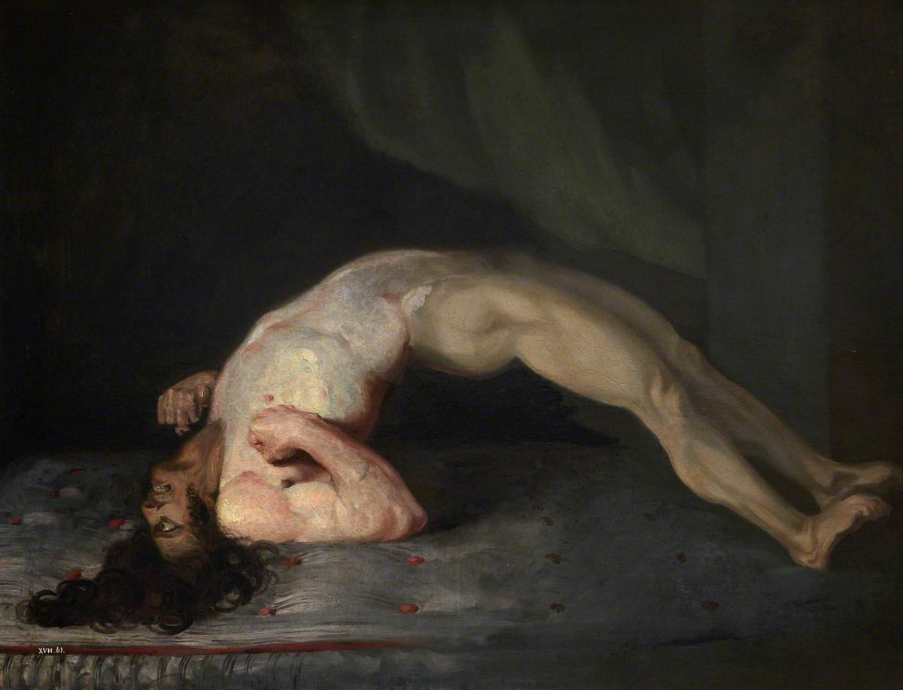

# Tetanus

**Prerequisites:** [Bacteria](../../../microbiology/02-bacteria.md); [Toxins and toxin-mediated disease](../../../microbiology/04-toxins-and-toxin-mediated-disease.md); [Toxoid vaccines](../01-how-vaccines-work/05-toxoid-vaccines.md)

*Opisthotonus, the arched-back spasm of tetanus, in an 1809 painting by Sir Charles Bell. Credit: Sir Charles Bell. License: Public domain. Source: [File:Opisthotonus_in_a_patient_suffering_from_tetanus_-_Painting_by_Sir_Charles_Bell_-_1809.jpg](https://commons.wikimedia.org/wiki/File:Opisthotonus_in_a_patient_suffering_from_tetanus_-_Painting_by_Sir_Charles_Bell_-_1809.jpg).*

## The disease

Tetanus is caused by a toxin made by *Clostridium tetani*, a bacterium whose spores live in soil, dust and animal faeces and survive for years ([WHO tetanus fact sheet](https://www.who.int/news-room/fact-sheets/detail/tetanus)). Spores enter through wounds, including puncture wounds, burns, injection sites and, in newborns, the cut umbilical cord. In low-oxygen conditions they germinate and produce **tetanospasmin**, which blocks the nerves that normally relax muscles. The result is painful spasms and rigidity, starting with the jaw ("lockjaw"), and in severe cases spasms strong enough to break bones and stop breathing. Even with intensive care, a significant share of patients die; without it, most severe cases are fatal.

Tetanus is not contagious, so herd immunity does not protect anyone: every person must be immune themselves. Recovering from tetanus does not give immunity, because the amount of toxin that causes disease is too small to provoke an immune response.

## Neonatal tetanus

Most tetanus deaths worldwide are in newborns, infected through the umbilical cord when mothers are unvaccinated and births are unhygienic. In 2021 just over 7,700 newborns died of neonatal tetanus, an 84% reduction since 2000 ([WHO tetanus fact sheet](https://www.who.int/news-room/fact-sheets/detail/tetanus)), largely because pregnant women are vaccinated so that antibodies cross the placenta. WHO's Maternal and Neonatal Tetanus Elimination initiative targets fewer than one case per 1,000 live births in every district.

## The vaccine

Tetanus toxoid, developed in the 1920s and used widely by the military in the Second World War, is given with diphtheria toxoid and pertussis antigens as DTaP, Tdap or Td. Wound care includes a tetanus booster if the last dose was too long ago, plus tetanus immune globulin for dirty wounds in people not fully vaccinated. In the US, reported tetanus fell from about 500–600 cases a year in the late 1940s to a few dozen a year, mostly in unvaccinated or under-vaccinated older adults ([CDC, *Epidemiology and Prevention of Vaccine-Preventable Diseases* ("Pink Book")](https://www.cdc.gov/pinkbook/hcp/table-of-contents/index.html)).

Like diphtheria toxoid, tetanus toxoid mainly causes local reactions, more common with frequent boosting. Rare allergic reactions occur. The IOM accepted a causal link between tetanus toxoid and brachial neuritis and, with less certainty, Guillain-Barré syndrome in its 1994 review ([Institute of Medicine, *Adverse Events Associated with Childhood Vaccines* (1994)](https://doi.org/10.17226/2138)).

## The Kenya controversy

In 2014, Kenya's Catholic bishops alleged that a WHO- and UNICEF-supported tetanus vaccination campaign for women of childbearing age was a covert sterilisation programme, claiming that vials contained human chorionic gonadotropin (hCG), a hormone that could induce antibodies preventing pregnancy. The Kenyan government and WHO rejected the claim; testing of samples was disputed, with each side challenging the other's methods and chain of custody. The episode echoed earlier rumours about anti-fertility tetanus vaccines in Mexico, the Philippines and Nicaragua in the 1990s, and shows how real historical research into hCG-based contraceptive vaccines (pursued by WHO in the 1970s–90s) can feed suspicion. See [[trust-and-misinformation|trust and misinformation]].

## Key ideas

- Tetanus comes from soil spores entering wounds; it is not contagious, so everyone needs personal immunity.
- Neonatal tetanus deaths fell 84% between 2000 and 2021 through vaccinating pregnant women.
- Tetanus toxoid is safe and effective; boosters are given after some wounds.
- Rumours that tetanus vaccines were secret contraceptives have repeatedly undermined campaigns.

## Where this leads

- [Diphtheria](diphtheria.md); [Pertussis](pertussis.md); [[pregnancy-adult-and-travel-vaccination|Pregnancy, adult and travel vaccination]].
