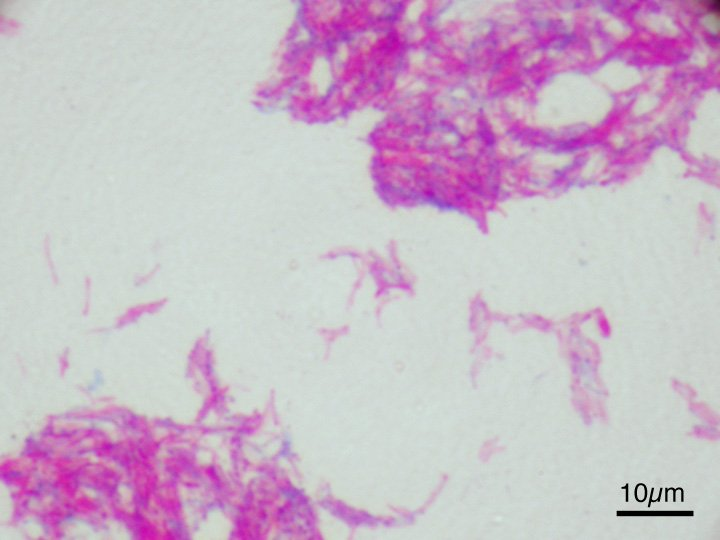

# Tuberculosis and BCG

**Prerequisites:** [Bacteria](../../../microbiology/02-bacteria.md); [Live attenuated vaccines](../01-how-vaccines-work/03-live-attenuated-vaccines.md); [T cells](../../06-t-cells.md)

*Bacille Calmette-Guérin (BCG, Japan strain) under the microscope, Ziehl-Neelsen stain. Credit: Y tambe. License: [CC BY-SA 3.0](http://creativecommons.org/licenses/by-sa/3.0/). Source: [File:Mycobacterium_bovis_BCG_ZN.jpg](https://commons.wikimedia.org/wiki/File:Mycobacterium_bovis_BCG_ZN.jpg).*

## The disease

Tuberculosis (TB) is caused by *Mycobacterium tuberculosis*, spread through the air when people with lung TB cough. Most infected people control the bacteria without becoming ill (latent infection), but about 5–10% develop active disease at some point, a risk greatly increased by HIV, malnutrition, diabetes and smoking. Active TB usually affects the lungs, causing cough, fever, night sweats and weight loss; it can also spread to the brain (TB meningitis), bones and other organs, especially in young children. TB is the world's leading cause of death from a single infectious agent: WHO estimates 10.6 million people fell ill and 1.13 million died in 2025 ([WHO tuberculosis fact sheet](https://www.who.int/news-room/fact-sheets/detail/tuberculosis)). Drug-resistant TB is a major threat.

## BCG

**Bacille Calmette-Guérin (BCG)** is a live attenuated strain of *Mycobacterium bovis*, developed by Albert Calmette and Camille Guérin at the Pasteur Institute through 13 years of repeated culturing, and first given to an infant in 1921. It is the only licensed TB vaccine and one of the most widely used vaccines in the world, given at birth in most countries with high TB rates.

**How well does it work?** BCG protects young children well against severe forms such as TB meningitis and miliary (disseminated) TB. Its protection against lung TB in adolescents and adults, who drive transmission, varies enormously between studies, from none to about 80%, with better results farther from the equator and in people not previously exposed to environmental mycobacteria ([Mangtani et al., *Clinical Infectious Diseases* 2014](https://doi.org/10.1093/cid/cit790)). This variability is one of the great puzzles of vaccinology.

**Where it is used.** The US has never used BCG routinely, preferring testing and treating latent infection (BCG makes the tuberculin skin test harder to interpret). Canada uses it only in some communities with high TB rates, such as some Inuit and First Nations communities. The UK ended universal school BCG in 2005, moving to targeted vaccination of infants at higher risk.

## The Lübeck disaster

In 1930 in Lübeck, Germany, about 250 newborns were given BCG that had been accidentally contaminated with virulent TB bacteria in the laboratory, and more than 70 of them died. The subsequent trial of the doctors responsible was a landmark in medical accountability and contributed to German thinking about research ethics.

## New vaccines

After decades of failure, a protein-adjuvant vaccine, **M72/AS01E**, showed about 50% efficacy in preventing active TB in adults with latent infection in a phase 2b trial ([Tait et al., *NEJM* 2019 (M72/AS01E)](https://doi.org/10.1056/NEJMoa1909953)). A large phase 3 trial funded by the Gates Medical Research Institute and Wellcome began in 2024. A new vaccine that prevents adult lung TB could have a larger impact than any other vaccine in development.

**Non-specific effects.** Some researchers, notably Peter Aaby's group in Guinea-Bissau, argue that BCG reduces deaths from other infections by "training" the innate immune system. The evidence is debated; trials of BCG against COVID-19 did not show protection.

## Key ideas

- TB killed about 1.13 million people in 2025, more than any other single infectious agent.
- BCG, first used in 1921, protects young children against severe TB but its protection against adult lung TB varies widely.
- The US does not use BCG routinely; Canada and the UK use it selectively.
- A new vaccine, M72/AS01E, is in phase 3 trials.

## Where this leads

- [Early vaccines: toxoids and BCG](../04-history/05-early-vaccines-toxoids-and-bcg.md); [T cells](../../06-t-cells.md).
