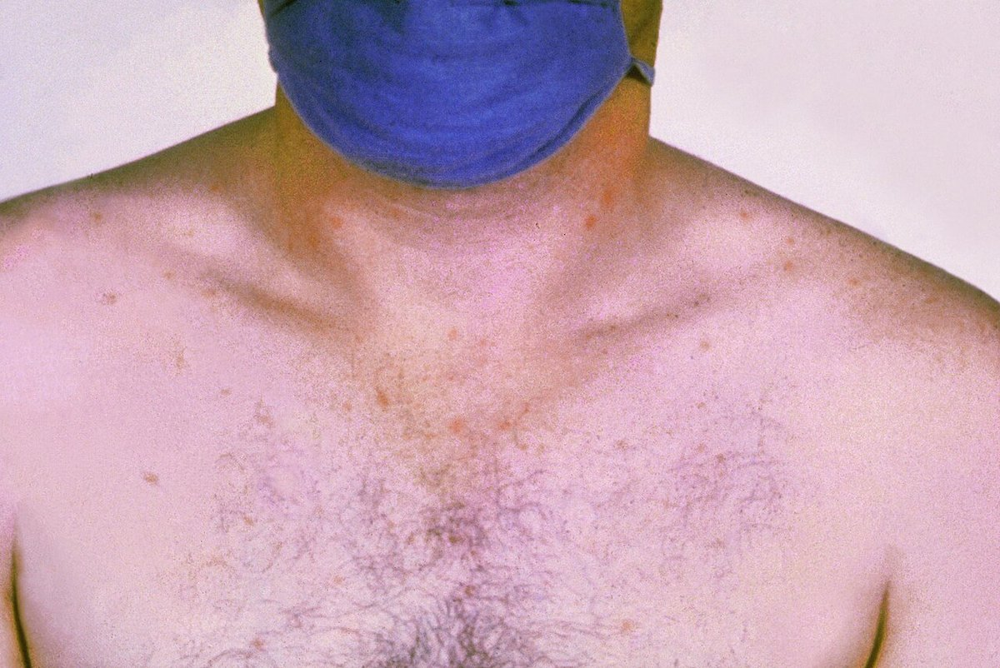

# Typhoid

**Prerequisites:** [Bacteria](../../../microbiology/02-bacteria.md); [Conjugate vaccines](../01-how-vaccines-work/07-conjugate-vaccines.md)

*Rose spots on the chest of a patient with typhoid fever. Credit: Photo Credit: Content Providers(s): CDC/Armed Forces Institute of Pathology, Charles N. Farmer. License: Public domain. Source: [File:Salmonella_typhi_typhoid_fever_PHIL_2215_lores.jpg](https://commons.wikimedia.org/wiki/File:Salmonella_typhi_typhoid_fever_PHIL_2215_lores.jpg).*

## The disease

Typhoid fever is caused by *Salmonella enterica* serovar Typhi, which lives only in humans and spreads through food and water contaminated by faeces ([WHO typhoid fact sheet](https://www.who.int/news-room/fact-sheets/detail/typhoid)). After one to three weeks it causes prolonged high fever, fatigue, headache, abdominal pain and constipation or diarrhoea; complications include intestinal bleeding and perforation. Some people become long-term carriers, the most famous being Mary Mallon ("Typhoid Mary"), a cook in New York in the early 1900s who was forcibly isolated for decades. WHO estimated about 9 million cases and 110,000 deaths a year as of 2019, mostly in South Asia and sub-Saharan Africa ([WHO typhoid fact sheet](https://www.who.int/news-room/fact-sheets/detail/typhoid)).

Clean water and sanitation largely eliminated typhoid from rich countries in the early 20th century, before vaccines played much role. **Antibiotic resistance** is a growing problem: an extensively drug-resistant (XDR) strain emerged in Sindh, Pakistan, in 2016, leaving few oral treatment options.

## The vaccines

- **Whole-cell killed vaccines**, developed by Almroth Wright and others in the 1890s, were used by the British and US armies in the early 20th century; they were reactogenic and are no longer used.
- **Vi polysaccharide** injectable vaccine for people over two years, and **Ty21a**, an oral live attenuated vaccine in capsules for people over six ([WHO typhoid fact sheet](https://www.who.int/news-room/fact-sheets/detail/typhoid)). Both give moderate protection that wanes after a few years and are used mainly for travellers.
- **Typhoid conjugate vaccines (TCV)**, linking the Vi polysaccharide to a carrier protein, work in infants from six months with a single dose. A trial in Nepal found about 82% efficacy ([Shakya et al., *NEJM* 2019](https://doi.org/10.1056/NEJMoa1905047)). WHO's SAGE recommended TCV for routine use in endemic countries in 2017, and Gavi supports introduction; Pakistan used it in response to the XDR outbreak.

Vaccines are seen as one tool against antibiotic resistance, because preventing infections reduces antibiotic use.

## Travellers

Travellers to South Asia face the highest risk; most typhoid cases diagnosed in the US, Canada and the UK are in people returning from visiting friends and relatives in the region. Because travel vaccines give only partial protection, food and water precautions still matter. Typhoid vaccines are not part of routine schedules in high-income countries.

## Key ideas

- Typhoid spreads through contaminated food and water; sanitation largely removed it from rich countries.
- Older vaccines are moderately effective; conjugate vaccines work from infancy with one dose.
- Antibiotic resistance, including XDR typhoid in Pakistan, makes vaccination more important.

## Where this leads

- [Cholera](cholera.md); [[historical-mortality-decline-argument|the historical mortality decline argument]]; [[pregnancy-adult-and-travel-vaccination|travel vaccination]].
