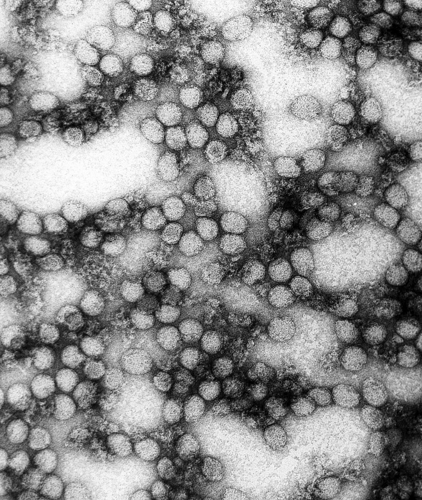

# Yellow fever

**Prerequisites:** [Viruses](../../../microbiology/03-viruses.md); [Live attenuated vaccines](../01-how-vaccines-work/03-live-attenuated-vaccines.md)

*Electron micrograph of yellow fever virus particles. Credit: Erskine Palmer, Ph.D. License: Public domain. Source: [File:YellowFeverVirus.jpg](https://commons.wikimedia.org/wiki/File:YellowFeverVirus.jpg).*

## The disease

Yellow fever is caused by a flavivirus spread by *Aedes* and *Haemagogus* mosquitoes, with monkeys as a forest reservoir. Most infections are mild or symptomless, but a minority of patients develop a toxic phase with jaundice (hence "yellow"), bleeding and kidney failure, and about half of those die. Twenty-seven African and 13 Latin American countries are at high risk, and WHO estimates 31,000–82,000 deaths a year ([WHO yellow fever fact sheet](https://www.who.int/news-room/fact-sheets/detail/yellow-fever)). Yellow fever shaped history, from epidemics in US port cities in the 18th and 19th centuries to the failure of the French attempt to build the Panama Canal. In 1900 Walter Reed's US Army commission in Cuba confirmed Carlos Finlay's theory that mosquitoes transmit it, using human volunteers, some of whom died.

## The vaccine

Max Theiler developed the live attenuated **17D** strain in 1937 at the Rockefeller Foundation, winning the 1951 Nobel Prize. A single dose provides lifelong protection for most people ([WHO yellow fever fact sheet](https://www.who.int/news-room/fact-sheets/detail/yellow-fever)); WHO stopped recommending ten-yearly boosters in 2014. Under the International Health Regulations, countries can require proof of vaccination (the "yellow card") from travellers.

During shortages, as in the 2016 outbreak in Angola and the Democratic Republic of the Congo, WHO approved **fractional dosing** (one fifth of a standard dose), which still produced protective immunity in most people.

## Safety

The vaccine is generally safe, but as a live vaccine it carries rare serious risks:

- **Yellow fever vaccine-associated viscerotropic disease**, a multi-organ illness resembling yellow fever itself, and **neurotropic disease** (encephalitis, GBS), each reported at rates below about 1 per 100,000 doses in US traveller data, more often in people over 60 and in people with thymus disorders.
- It is not recommended for infants under nine months, people with severe immune deficiency or thymus disease, or (except in outbreaks) pregnant women ([WHO yellow fever fact sheet](https://www.who.int/news-room/fact-sheets/detail/yellow-fever)).

A historical episode: in 1942, yellow fever vaccine given to US troops was stabilised with human serum that turned out to contain hepatitis B virus, causing about 50,000 cases of jaundice and dozens of deaths. It is one of the largest documented vaccine contamination events and led to changes in vaccine production.

## Key ideas

- Yellow fever is a mosquito-borne flavivirus with high mortality in severe cases.
- The 17D vaccine (1937) gives lifelong protection with one dose; fractional doses work during shortages.
- Rare viscerotropic and neurotropic reactions occur, more in older people.
- The 1942 contamination of military vaccine with hepatitis B is a major historical safety failure.

## Where this leads

- [Dengue](dengue.md) and [Japanese encephalitis](japanese-encephalitis.md), related flaviviruses; [travel vaccination](../05-schedules/08-pregnancy-adult-and-travel-vaccination.md).
