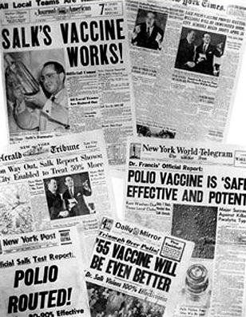

# Salk, Sabin and the Cutter incident

**Prerequisites:** [Polio](../03-diseases/polio.md); [Inactivated vaccines](../01-how-vaccines-work/04-inactivated-vaccines.md); [Live attenuated vaccines](../01-how-vaccines-work/03-live-attenuated-vaccines.md)

*Newspaper headlines announcing the success of the Salk polio vaccine field trial in April 1955. Credit: March of Dimes. License: Public domain. Source: [File:Salk headlines.jpg](https://commons.wikimedia.org/wiki/File:Salk_headlines.jpg).*

## Fear of polio

By the 1950s polio was the most feared disease of American childhood: summer epidemics closed swimming pools, and paralysed children filled hospital wards and iron lungs. President Franklin D. Roosevelt, himself paralysed in 1921 (probably by polio), helped found the National Foundation for Infantile Paralysis in 1938, whose **March of Dimes** fundraising paid for much of the research.

## The Salk vaccine and the 1954 field trial

Jonas Salk at the University of Pittsburgh developed an inactivated vaccine, growing the three poliovirus types in monkey kidney cells and killing them with formaldehyde. In 1954 the National Foundation sponsored one of the largest medical experiments in history: about 1.8 million schoolchildren, the "Polio Pioneers", took part, including more than 600,000 who received injections in a placebo-controlled, double-blind component, with others in observed control areas. The evaluation, led by Thomas Francis Jr. at the University of Michigan, was announced on 12 April 1955: the vaccine was about 80–90% effective against paralytic polio ([Francis et al., *JAMA* 1955 (1954 polio field trial)](https://doi.org/10.1001/jama.1955.02960140028004)). The vaccine was licensed the same day. Asked who owned the patent, Salk told the broadcaster Edward R. Murrow, "There is no patent. Could you patent the sun?"

## The Cutter incident

Within days, several manufacturers began producing vaccine. In April 1955, vaccine made by **Cutter Laboratories** in Berkeley, California, contained live, incompletely inactivated poliovirus. Of about 120,000 children who received it, about 40,000 developed mild polio, 51 were permanently paralysed and 5 died; the virus then spread to family members and communities, causing more paralysis and deaths ([Offit, *NEJM* 2005, "The Cutter incident, 50 years later"](https://doi.org/10.1056/NEJMp048180); [Nathanson & Langmuir, *American Journal of Hygiene* 1963](https://doi.org/10.1093/oxfordjournals.aje.a120328)). Vaccination was briefly halted.

The consequences shaped vaccines for decades:

- **Regulation**: the federal Laboratory of Biologics Control was strengthened and manufacturing and testing standards tightened.
- **Liability**: in *Gottsdanker v. Cutter Laboratories* (1958) a jury found Cutter not negligent but liable for breach of implied warranty, establishing that manufacturers could be liable without fault. Paul Offit argues this set the stage for the litigation that later drove companies out of vaccine making ([Offit, *NEJM* 2005, "The Cutter incident, 50 years later"](https://doi.org/10.1056/NEJMp048180)); see [the 1980s DTP lawsuits](../08-litigation-and-compensation/01-the-1980s-dtp-lawsuits.md).

## Sabin's oral vaccine

Albert Sabin developed a live attenuated oral polio vaccine (OPV). Because the US was committed to Salk's vaccine, Sabin's was tested on a massive scale in the Soviet Union, with Mikhail Chumakov, in 1959, an unusual Cold War collaboration. OPV was licensed in the US in 1961–1962 and largely replaced IPV, promoted through mass "Sabin oral Sundays". It was cheaper, easier to give and gave gut immunity that blocked transmission, but it caused rare vaccine-associated paralysis, which eventually led the US back to IPV in 2000. Salk and Sabin were bitter rivals. See [polio](../03-diseases/polio.md).

## SV40

In 1960 Ben Sweet and Maurice Hilleman at Merck identified a monkey virus, **SV40**, in the kidney cells used to make polio vaccines, and it was found in some doses given between 1955 and 1963. SV40 causes tumours in hamsters. The Institute of Medicine concluded in 2002 that evidence was inadequate to accept or reject a causal relationship with cancer in humans ([Institute of Medicine, *SV40 Contamination of Polio Vaccine and Cancer* (2002)](https://doi.org/10.17226/10534)); epidemiological studies have not shown increased cancer rates in those who received contaminated vaccine.

## Key ideas

- The 1954 Salk field trial involved about 1.8 million children and found the vaccine 80–90% effective.
- The 1955 Cutter incident, from incompletely inactivated vaccine, paralysed and killed children and led to stronger regulation and manufacturer liability without fault.
- Sabin's oral vaccine, tested in the USSR, replaced Salk's in the 1960s but caused rare paralysis.
- SV40 contamination of early vaccines has not been shown to cause human cancer.

## Where this leads

- Next: [Smallpox eradication](07-smallpox-eradication.md).
- People: [Jonas Salk](../10-people/jonas-salk.md); [Albert Sabin](../10-people/albert-sabin.md).
