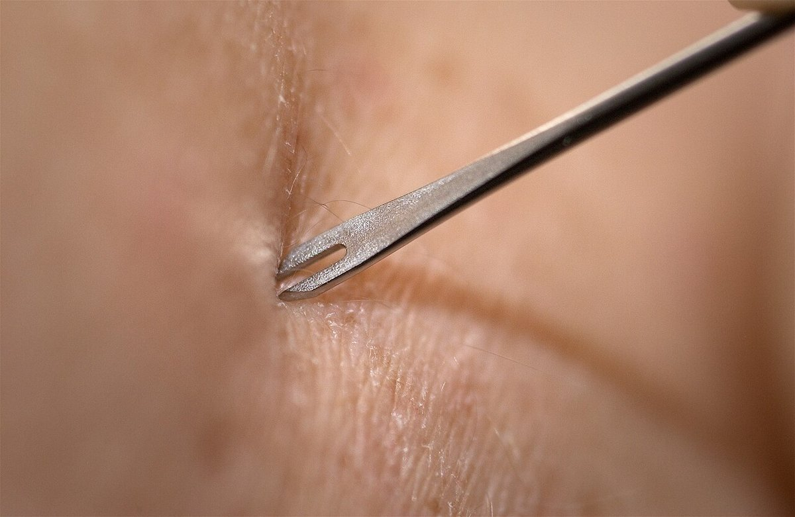

# Smallpox eradication

**Prerequisites:** [Smallpox](../03-diseases/smallpox.md); [Eradication and elimination](../09-public-health-and-ethics/01-eradication-and-elimination.md)

*A CDC clinician demonstrates the bifurcated needle at a 2002 smallpox vaccinator workshop; the same simple tool was used in the eradication campaign. Credit: Photo Credit: James Gathany Content Providers(s): CDC. License: Public domain. Source: [File:Smallpox_vaccine_injection.jpg](https://commons.wikimedia.org/wiki/File:Smallpox_vaccine_injection.jpg).*

## Why smallpox could be eradicated

Smallpox had features that made eradication possible: it infected only humans, with no animal reservoir; nearly every infection caused a visible rash, so cases could be found; there was no long-term carrier state; and one vaccination gave long-lasting protection. By the 1950s it had been eliminated from Europe and North America, but it was still endemic across much of Africa, South Asia and South America.

## The campaign

In 1959, on a proposal from the Soviet Union, the World Health Assembly resolved to eradicate smallpox, but progress was slow. In 1967 WHO launched an **Intensified Eradication Programme**, led by the American epidemiologist D. A. Henderson. That year there were an estimated 10–15 million cases in more than 30 endemic countries ([Fenner et al., *Smallpox and Its Eradication* (WHO, 1988)](https://iris.who.int/handle/10665/39485)).

Technical advances helped: heat-stable **freeze-dried vaccine** and the **bifurcated needle**, which held a measured drop of vaccine between two prongs and could be used by village volunteers after minimal training.

The decisive change was in strategy. Mass vaccination aimed at 80% coverage did not stop transmission in densely populated areas. During an outbreak in eastern Nigeria in 1966–67, when vaccine was short, William Foege and colleagues instead found cases quickly and vaccinated everyone around them, cutting transmission with far fewer doses. This **surveillance and containment** approach, also called **ring vaccination**, became the core of the campaign. It required a network of case reporting, rewards for reporting cases, and teams that could reach any village rapidly.

## The end

India and Bangladesh, with dense populations and huge numbers of cases, were the hardest battlegrounds in the early 1970s. The last case of variola major occurred in Rahima Banu, a two-year-old girl in Bangladesh, in 1975. The last naturally occurring case of smallpox (variola minor) was Ali Maow Maalin, a hospital cook in Merca, Somalia, in October 1977; he survived and later worked as a polio vaccinator ([WHO smallpox health topic](https://www.who.int/health-topics/smallpox)).

In 1978 Janet Parker, a medical photographer in Birmingham, England, died of smallpox acquired from a laboratory in the building where she worked; the head of the laboratory took his own life. After two years of searching for cases, a global commission certified eradication in December 1979, and the World Health Assembly declared smallpox eradicated on 8 May 1980 ([Fenner et al., *Smallpox and Its Eradication* (WHO, 1988)](https://iris.who.int/handle/10665/39485)).

## Assessment

Smallpox eradication is widely seen as public health's greatest achievement. It was a Cold War collaboration (the Soviet Union supplied much of the vaccine; the US much of the money and leadership) and relied on tens of thousands of local health workers. It was not without coercion: in parts of India in the 1970s, vaccinators sometimes forced their way into homes and vaccinated people against their will, which historians have documented and which complicates the heroic narrative.

Smallpox remains the only human disease eradicated. Attempts to repeat the success with polio, measles and others have proved harder; see [polio eradication](08-polio-eradication.md) and [eradication and elimination](../09-public-health-and-ethics/01-eradication-and-elimination.md).

## Key ideas

- Smallpox's biology (human-only, visible cases, lasting immunity) made eradication feasible.
- WHO's 1967 Intensified Programme succeeded through surveillance and containment (ring vaccination), not just mass vaccination.
- The last natural case was in Somalia in 1977; eradication was declared in 1980.
- The campaign involved some coercion, which complicates its history.

## Where this leads

- Next: [The polio eradication campaign](08-polio-eradication.md).
