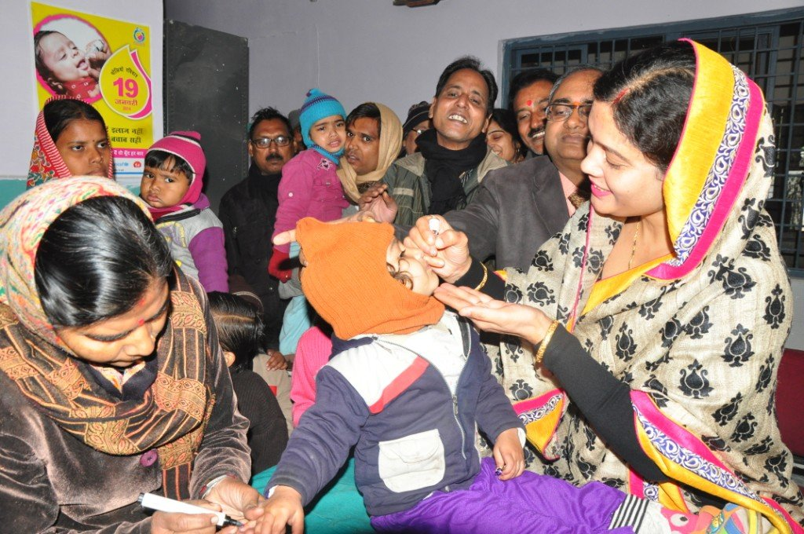

# The polio eradication campaign

**Prerequisites:** [Polio](../03-diseases/polio.md); [Smallpox eradication](07-smallpox-eradication.md)

*A child receiving oral polio vaccine drops on Pulse Polio Day in Gwalior, India, in January 2014, three years after India's last wild polio case. Credit: Shobhit Gosain. License: [CC BY-SA 3.0](https://creativecommons.org/licenses/by-sa/3.0). Source: [File:Pulse Polio Day, Gwalior, January 2014.jpg](https://commons.wikimedia.org/wiki/File:Pulse_Polio_Day,_Gwalior,_January_2014.jpg).*

## Launch

Encouraged by the success against smallpox and by polio's elimination from the Americas (certified in 1994), the World Health Assembly in 1988 launched the **Global Polio Eradication Initiative (GPEI)**, a partnership of WHO, Rotary International, the US CDC and UNICEF, later joined by the Gates Foundation and Gavi. The target was eradication by 2000. At the start, wild poliovirus paralysed an estimated 350,000 children a year in more than 125 countries ([WHO poliomyelitis fact sheet](https://www.who.int/news-room/fact-sheets/detail/poliomyelitis)).

## Progress

The main tool was oral polio vaccine, given repeatedly in **national immunisation days** and house-to-house campaigns to hundreds of millions of children, alongside surveillance of acute flaccid paralysis and environmental testing of sewage. Regions were certified polio-free: the Americas (1994), the Western Pacific (2000), Europe (2002), South-East Asia (2014, after India's last case in 2011) and Africa (2020, after Nigeria's last wild case in 2016). Wild types 2 and 3 were certified eradicated in 2015 and 2019. Wild type 1 now persists only in Afghanistan and Pakistan ([WHO poliomyelitis fact sheet](https://www.who.int/news-room/fact-sheets/detail/poliomyelitis)).

## Setbacks

**Boycotts and distrust.** In 2003, political and religious leaders in northern Nigeria, particularly Kano state, called for a boycott, alleging that the vaccine was contaminated with anti-fertility agents or HIV. The suspicion drew on memories of the 1996 Trovan trial in Kano and on resentment of foreign-led campaigns that brought polio drops while other health needs went unmet ([Jegede, *PLoS Medicine* 2007](https://doi.org/10.1371/journal.pmed.0040073)). The boycott lasted about a year, and polio spread from Nigeria to many countries.

**The CIA's fake vaccination campaign.** In 2011 the CIA used a sham hepatitis B vaccination campaign in Abbottabad, Pakistan, run by a Pakistani doctor, in an effort to obtain DNA from Osama bin Laden's family. After this became public, the Pakistani Taliban banned polio vaccination in areas they controlled, and many polio workers were killed in attacks. A study found that vaccination rates in Pakistan fell after the disclosure, especially in areas where support for militancy was high ([Martinez-Bravo & Stegmann, *Journal of the European Economic Association* 2022](https://doi.org/10.1093/jeea/jvab018)). In 2014 the White House said the CIA would no longer use vaccination programmes as cover. See [[cia-fake-vaccination-in-pakistan|the CIA fake vaccination campaign]].

**Vaccine-derived polio.** As wild polio declined, outbreaks of **circulating vaccine-derived poliovirus** in under-immunised communities became the larger problem; see [vaccine-derived polio](../06-adverse-events/10-vaccine-derived-polio.md). In 2016 countries switched from trivalent to bivalent OPV, removing type 2, and a novel, more stable OPV2 was deployed from 2021. Some critics argue the programme should have moved to IPV sooner; others note that only OPV could stop transmission where sanitation is poor.

**Cost and opportunity cost.** The programme has cost more than 20 billion US dollars and repeatedly missed its target dates. Critics have argued that the money could have done more good strengthening routine immunisation and primary care; supporters argue that eradication is permanent and that polio infrastructure has supported measles, COVID-19 and Ebola responses ([WHO poliomyelitis fact sheet](https://www.who.int/news-room/fact-sheets/detail/poliomyelitis)).

## Key ideas

- GPEI, launched in 1988, has reduced wild polio by more than 99%; only type 1 remains, in Afghanistan and Pakistan.
- Boycotts in Nigeria (2003–04) and the fallout from the CIA's fake vaccination campaign in Pakistan (2011) caused major setbacks.
- Vaccine-derived outbreaks now cause more paralysis than wild virus.
- The campaign's cost and repeated missed deadlines are debated.

## Where this leads

- Next: [The 1976 swine flu affair](09-the-1976-swine-flu-affair.md).
- Related: [[trovan-kano-and-the-polio-boycott|Trovan, Kano and the polio boycott]].
