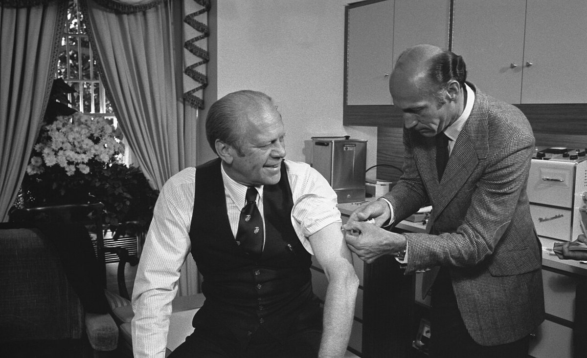

# The 1976 swine flu affair

**Prerequisites:** [Influenza](../03-diseases/influenza.md); [[guillain-barre-syndrome|Guillain-Barré syndrome]]

*President Gerald Ford receiving a swine flu inoculation from the White House physician in October 1976. Credit: David Hume Kennerly. License: Public domain. Source: [File:President Ford receives a swine flu inoculation - NARA - 7064718.jpg](https://commons.wikimedia.org/wiki/File:President_Ford_receives_a_swine_flu_inoculation_-_NARA_-_7064718.jpg).*

## The scare

In February 1976, an influenza outbreak at the Fort Dix army base in New Jersey killed one recruit, Private David Lewis, and was found to be caused by a swine-origin H1N1 virus, related to the virus believed to have caused the 1918 pandemic. Public health officials feared a new pandemic. On 24 March 1976, President Gerald Ford announced a plan to vaccinate "every man, woman and child in the United States".

## Liability

Insurers refused to cover manufacturers against lawsuits from a mass campaign, and companies would not proceed without protection. In August Congress passed the National Swine Flu Immunization Program Act, which made the federal government the defendant for claims arising from the vaccine. It was an early example of the government taking on vaccine liability, foreshadowing the 1986 Act and the PREP Act; see [[the-national-childhood-vaccine-injury-act-1986|the 1986 Act]] and [[prep-act-and-cicp|the PREP Act]].

## The campaign and its end

Vaccination began on 1 October 1976. About 45 million Americans were vaccinated in ten weeks. Early on, three elderly people died shortly after vaccination at a Pittsburgh clinic, causing alarm, though the deaths were judged coincidental heart attacks, an early lesson in [base rates and coincidence](../../../epidemiology/11-base-rates-and-coincidence.md). Then reports of **Guillain-Barré syndrome**, a paralysing nerve disorder, accumulated. The programme was suspended on 16 December 1976. The pandemic never came: the Fort Dix virus did not spread beyond the base.

A CDC study later estimated an excess of roughly one case of GBS per 100,000 people vaccinated in the six weeks after vaccination ([Schonberger et al., *American Journal of Epidemiology* 1979](https://doi.org/10.1093/oxfordjournals.aje.a112795)). Thousands of compensation claims were filed against the government. Whether the 1976 vaccine caused GBS was itself debated for years; later reanalyses supported a real but small increase, and the finding shaped how every later influenza vaccine has been monitored.

## Lessons

A 1978 report commissioned by the US government, *The Swine Flu Affair* by Richard Neustadt and Harvey Fineberg, concluded that officials had made decisions with too little reconsideration as evidence changed, had over-promised, and had not prepared the public for possible side effects or for the pandemic not arriving. CDC director David Sencer was dismissed in 1977.

The affair is cited in several ways:

- By sceptics, as evidence that public health authorities can push vaccines on the basis of exaggerated fears, and that vaccines can cause serious harm.
- By public health experts, as a lesson in decision-making under uncertainty: preparing for a pandemic that does not happen is not necessarily a mistake, but communication and flexibility matter.
- In later debates, such as the 2009 H1N1 pandemic and COVID-19, as a reason for active surveillance for GBS and other adverse events from the start of any mass campaign.

## Key ideas

- A 1976 swine flu outbreak at Fort Dix prompted a plan to vaccinate all Americans.
- About 45 million were vaccinated before a GBS signal stopped the programme; the pandemic never arrived.
- The federal government took on liability, a precedent for later compensation schemes.
- The affair remains a case study in risk communication and decision-making under uncertainty.

## Where this leads

- Next: [The MMR era](10-the-mmr-era.md).
