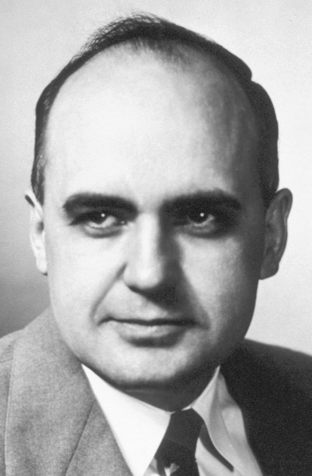

# The MMR era

**Prerequisites:** [Measles](../03-diseases/measles.md); [Mumps](../03-diseases/mumps.md); [Rubella](../03-diseases/rubella.md)

*Maurice Hilleman, who developed the mumps vaccine and the combined MMR vaccine at Merck. Credit: Walter Reed Army Medical Center. License: Public domain. Source: [File:Hilleman-Walter-Reed.jpeg](https://commons.wikimedia.org/wiki/File:Hilleman-Walter-Reed.jpeg).*

## Three vaccines, one shot

Growing viruses in cell culture, made possible by John Enders, Thomas Weller and Frederick Robbins in 1949, led to a run of live virus vaccines in the 1960s:

- **Measles**: Enders and colleagues isolated the virus from a sick schoolboy, David Edmonston, in 1954, and the attenuated Edmonston B vaccine was licensed in the US in 1963. It caused frequent fever and rash and was often given with immune globulin; further-attenuated strains (Schwarz in 1965; Maurice Hilleman's Moraten in 1968) replaced it.
- **Mumps**: Hilleman's Jeryl Lynn strain, licensed in 1967.
- **Rubella**: vaccines licensed in 1969, after the 1964–65 epidemic; Stanley Plotkin's RA 27/3 strain later became standard.

Merck combined the three as **MMR** in 1971. Fewer injections improved coverage. See [Maurice Hilleman](../10-people/maurice-hilleman.md).

## From one dose to two

A single dose leaves a few percent of children unprotected, and in highly vaccinated populations those few can sustain outbreaks. Between 1989 and 1991 the US had a large measles resurgence, with about 55,000 cases and more than 100 deaths, mostly among unvaccinated preschool children in poor urban areas ([CDC, *Epidemiology and Prevention of Vaccine-Preventable Diseases* ("Pink Book")](https://www.cdc.gov/pinkbook/hcp/table-of-contents/index.html)). The response was a second routine dose (recommended in 1989) and the Vaccines for Children programme (1994), which pays for vaccines for children whose families cannot. The US declared measles eliminated in 2000; Canada, which moved to two doses in 1996–97, did so in 1998.

## The Wakefield episode

In 1998 Andrew Wakefield and colleagues published a case series of 12 children in *The Lancet* suggesting a link between MMR, bowel disease and autism, and Wakefield called at a press conference for single vaccines instead. MMR coverage in England fell to around 80% in the early 2000s, and measles returned; an outbreak centred on Swansea, Wales, in 2012–13 caused more than 1,000 cases and one death. Investigations by the journalist Brian Deer found undisclosed payments from lawyers preparing litigation against manufacturers and manipulation of the children's data; the paper was retracted in 2010 and Wakefield was struck off the UK medical register ([Wakefield et al., *Lancet* 1998 (retracted)](https://doi.org/10.1016/S0140-6736(97)11096-0); [Deer, *BMJ* 2011, "How the case against the MMR vaccine was fixed"](https://doi.org/10.1136/bmj.c5347); [Godlee, Smith & Marcovitch, *BMJ* 2011 editorial](https://doi.org/10.1136/bmj.c7452)). Large studies found no link between MMR and autism ([Madsen et al., *NEJM* 2002](https://doi.org/10.1056/NEJMoa021134); [Hviid et al., *Annals of Internal Medicine* 2019](https://doi.org/10.7326/M18-2101)). See [MMR and autism](../07-controversies/01-mmr-and-autism.md).

## MMRV and the second generation

A combined measles–mumps–rubella–varicella vaccine (MMRV, ProQuad) was licensed in the US in 2005. When the Vaccine Safety Datalink found it doubled the risk of febrile seizures as a first dose in toddlers compared with separate MMR and varicella shots ([Klein et al., *Pediatrics* 2010](https://doi.org/10.1542/peds.2010-0665)), the US stopped preferring MMRV for the first dose; in 2025 the reconstituted ACIP voted against MMRV for children under four. The UK went the other way and introduced MMRV for all children in January 2026 ([UKHSA, "MMRV vaccination: information for healthcare professionals"](https://www.gov.uk/government/publications/mmrv-programme-information-for-healthcare-practitioners/mmrv-vaccination-information-for-healthcare-professionals)).

## Global measles control

Measles vaccine was added to WHO's Expanded Programme on Immunization in 1974. From 2001 the Measles & Rubella Partnership (formerly the Measles Initiative) supported mass campaigns; WHO estimates measles vaccination averted nearly 59 million deaths between 2000 and 2024 ([WHO measles fact sheet](https://www.who.int/news-room/fact-sheets/detail/measles)). Coverage stalled during the COVID-19 pandemic, and from 2024 large outbreaks returned in the Americas, ending elimination in Canada (2025) and the United States (2026) ([PAHO, "PAHO calls for regional action as the Americas lose measles elimination status" (10 November 2025)](https://www.paho.org/en/news/10-11-2025-paho-calls-regional-action-americas-lose-measles-elimination-status); [CDC joint statement, "Loss of U.S. Measles Elimination Status" (17 November 2026)](https://www.cdc.gov/media/releases/2026/loss-of-usmeasles-elimination-status.html)).

## Key ideas

- Measles (1963), mumps (1967) and rubella (1969) vaccines were combined as MMR in 1971.
- A 1989–91 US resurgence led to a routine second dose.
- Wakefield's 1998 paper, later retracted, cut MMR coverage in the UK and fed global distrust.
- Measles vaccination averted tens of millions of deaths, but outbreaks returned in North America from 2024.

## Where this leads

- Next: [Hib and the conjugate revolution](11-hib-and-the-conjugate-revolution.md).
