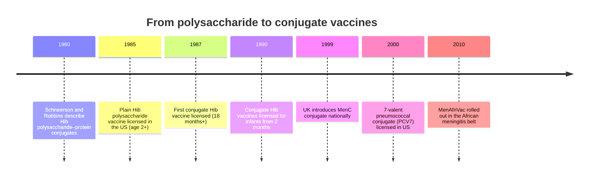

# Hib and the conjugate revolution

**Prerequisites:** [Hib](../03-diseases/haemophilus-influenzae-type-b.md); [Conjugate vaccines](../01-how-vaccines-work/07-conjugate-vaccines.md)

## The problem

By the 1970s *Haemophilus influenzae* type b was the leading cause of bacterial meningitis in young children in the US. The obvious vaccine target was the bacterium's sugar capsule, the polyribosylribitol phosphate (PRP) polysaccharide. A plain polysaccharide vaccine was licensed in 1985, but it barely worked in children under about 18 months, the age when most disease occurred. Infants' B cells respond poorly to polysaccharides without help from T cells, and polysaccharides alone do not create good immune memory. See [B cells and antibodies](../../05-b-cells-and-antibodies.md).

## The solution

Researchers found that chemically attaching ("conjugating") the polysaccharide to a protein carrier turned it into a T-cell-dependent antigen that infants could respond to, with boostable memory. Rachel Schneerson and John Robbins at the US National Institutes of Health described Hib conjugates in 1980 ([Schneerson et al., *Journal of Experimental Medicine* 1980](https://doi.org/10.1084/jem.152.2.361)); Porter Anderson and David Smith at the University of Rochester developed another version. Several conjugates using different carriers (diphtheria toxoid, a non-toxic diphtheria mutant protein CRM197, tetanus toxoid and a meningococcal outer membrane protein) were licensed for older toddlers in 1987 and for infants in 1990. In 1996 the four researchers shared the Lasker Award for clinical research.

Hib disease in young US children fell by more than 99% within a few years ([CDC, *Epidemiology and Prevention of Vaccine-Preventable Diseases* ("Pink Book")](https://www.cdc.gov/pinkbook/hcp/table-of-contents/index.html)). The vaccines also reduced throat carriage of the bacterium, so unvaccinated children were protected through herd effects.

## The revolution spreads

The same principle was applied to other encapsulated bacteria:

- **Meningococcus**: the UK's MenC conjugate programme in 1999 rapidly cut group C disease; MenACWY conjugates followed, and MenAfriVac (2010) nearly eliminated group A epidemics in the African meningitis belt ([Trotter et al., *Lancet Infect Dis* 2017](https://doi.org/10.1016/s1473-3099(17)30301-8)).
- **Pneumococcus**: PCV7 (2000) and its successors cut invasive disease in children and, through herd effects, in older adults ([Whitney et al., *NEJM* 2003](https://doi.org/10.1056/NEJMoa022823)).
- **Typhoid**: typhoid conjugate vaccines prequalified from 2017 ([Shakya et al., *NEJM* 2019](https://doi.org/10.1056/NEJMoa1905047)).

## Why it mattered beyond Hib

Before conjugate vaccines, a child with fever and a stiff neck in a US emergency department had a real chance of Hib meningitis, and paediatricians routinely performed lumbar punctures on febrile infants. Within a decade many young doctors had never seen a case of Hib epiglottitis. This disappearance of a disease from clinical memory is a recurring pattern after successful vaccination, and it is part of why later generations of parents and doctors weigh vaccine risks differently from those who saw the diseases: the benefit becomes invisible while the side effects remain visible. See [trust and misinformation](../07-controversies/19-trust-and-misinformation.md).

Conjugate vaccines also changed combination vaccines. Hib was added to DTaP and polio vaccines to form the five- and six-in-one infant shots used in Canada, the UK and many other countries, which reduced the number of injections but has also fed the "too many, too soon" debate about how many antigens infants receive at once; see [too many, too soon](../07-controversies/07-too-many-too-soon.md).

## Reaching poor countries

Conjugate vaccines were expensive, and for years Hib vaccine was used mainly in rich countries, even though most Hib deaths occurred in poor ones. Gavi's Hib Initiative from 2005 helped lower prices and support introduction; global Hib deaths in children fell by about 90% between 2000 and 2015 ([Wahl et al., *Lancet Global Health* 2018](https://doi.org/10.1016/s2214-109x(18)30247-x)). The lag between rich- and poor-country introduction, often a decade or more, is a recurring equity concern; see [[global-immunisation-programmes|global immunisation programmes]].

## Key ideas

- Plain polysaccharide vaccines failed in infants; conjugation to a protein carrier made them work.
- Conjugate Hib vaccines (1987–1990) cut disease by more than 99% and reduced carriage.
- The approach was extended to meningococcal, pneumococcal and typhoid vaccines.
- Poor countries received these vaccines years after rich ones.

## Where this leads

- Next: [HPV vaccine introduction](12-hpv-vaccine-introduction.md).
