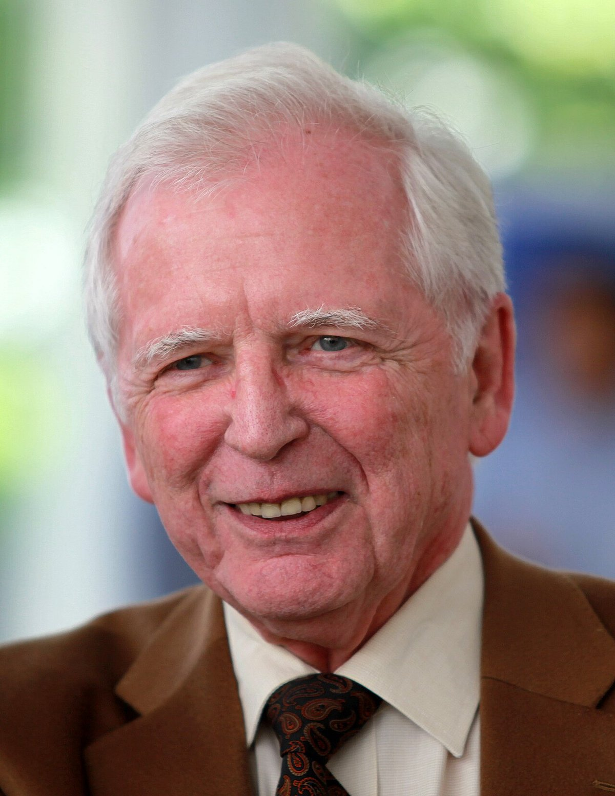

# HPV vaccine introduction

**Prerequisites:** [HPV](../03-diseases/hpv.md); [Subunit and recombinant vaccines](../01-how-vaccines-work/06-subunit-and-recombinant-vaccines.md)

*Harald zur Hausen, who linked HPV to cervical cancer and received the 2008 Nobel Prize. Credit: Kuebi = Armin Kuebelbeck. License: [CC BY-SA 3.0](https://creativecommons.org/licenses/by-sa/3.0). Source: [File:Harald_zur_Hausen_03.jpg](https://commons.wikimedia.org/wiki/File:Harald_zur_Hausen_03.jpg).*

## From virus to cancer

In the early 1980s Harald zur Hausen's laboratory in Germany found HPV types 16 and 18 in cervical cancer tissue, establishing that a virus causes most cervical cancer. He shared the 2008 Nobel Prize in Physiology or Medicine. If the virus caused the cancer, a vaccine against the virus might prevent the cancer.

## Virus-like particles

HPV could not easily be grown in the laboratory, so a conventional vaccine was impractical. In 1991 Jian Zhou and Ian Frazer at the University of Queensland reported that the L1 capsid protein could assemble into particles resembling the virus, and in 1992 Reinhard Kirnbauer, Douglas Lowy, John Schiller and colleagues at the US National Cancer Institute showed that such **virus-like particles** were highly immunogenic ([Kirnbauer et al., *PNAS* 1992](https://doi.org/10.1073/pnas.89.24.12180)). Several groups and institutions held competing patents, later licensed to Merck and GSK; the NIH earned substantial royalties, an example of public research feeding private products.

## Licensing and the first controversies

Merck's Gardasil was licensed in the US in June 2006 after trials showing near-complete protection against vaccine-type precancer ([FUTURE II Study Group, *NEJM* 2007](https://doi.org/10.1056/NEJMoa061741)), and ACIP recommended it for girls aged 11–12. Australia began a national programme in 2007, and Canada's federal government funded provincial school programmes from the same year.

Within months, the vaccine became politically charged:

- In February 2007 Texas governor Rick Perry ordered HPV vaccination for schoolgirls by executive order; the legislature overrode him. Reports that Merck had funded lobbying for school mandates, including through a group of women state legislators, fed suspicion that commercial interests were driving policy, and Merck stopped its lobbying for mandates.
- Social conservatives argued that vaccinating 11-year-olds against a sexually transmitted infection could encourage early sex; studies of sexual behaviour after vaccination have not found this.
- The cost (several hundred dollars per course in the US) and the speed of mandates were criticised even by some supporters of the vaccine.

Boys were added to US recommendations in 2011 and later in many other countries, both to protect them against anal, penile and throat cancers and to reduce transmission.

## Safety scares

Public alarms about chronic pain, fatigue and fainting in vaccinated girls arose in Japan, Denmark, Ireland and Colombia. Japan suspended its active recommendation in 2013, and coverage collapsed from about 70% to under 1% before the recommendation was restored in 2022. Regulators, including the European Medicines Agency in 2015, found no causal link between the vaccine and the syndromes reported. See [HPV vaccine safety claims](../07-controversies/09-hpv-vaccine-safety-claims.md). Lawsuits against Merck in the US over alleged Gardasil injuries are discussed in [litigation outside the VICP](../08-litigation-and-compensation/08-litigation-outside-the-vicp.md).

## Evidence of cancer prevention, and one dose

By 2020–2021, population studies in Sweden and England showed large falls in invasive cervical cancer among women vaccinated young ([Lei et al., *NEJM* 2020](https://doi.org/10.1056/NEJMoa1917338); [Falcaro et al., *Lancet* 2021](https://doi.org/10.1016/S0140-6736(21)02178-4)). In 2022 WHO advised that a single dose was sufficient for girls and young women, making large-scale programmes cheaper in low-income countries, and many countries moved to one dose; the US followed in January 2026 ([HHS fact sheet, "CDC Childhood Immunization Recommendations" (January 2026)](https://www.hhs.gov/press-room/fact-sheet-cdc-childhood-immunization-recommendations.html)). WHO's 2020 strategy for eliminating cervical cancer as a public health problem relies on vaccination, screening and treatment.

## Key ideas

- HPV causes most cervical cancer; virus-like particle vaccines, developed in the early 1990s, prevent infection with vaccine types.
- Gardasil (2006) quickly became controversial over mandates, industry lobbying and sexual morality.
- Safety scares led Japan to suspend its recommendation from 2013 to 2022.
- Population data now show falls in cervical cancer, and single-dose schedules are widely used.

## Where this leads

- Next: [COVID-19 vaccines and Operation Warp Speed](13-covid-19-vaccines-and-operation-warp-speed.md).
