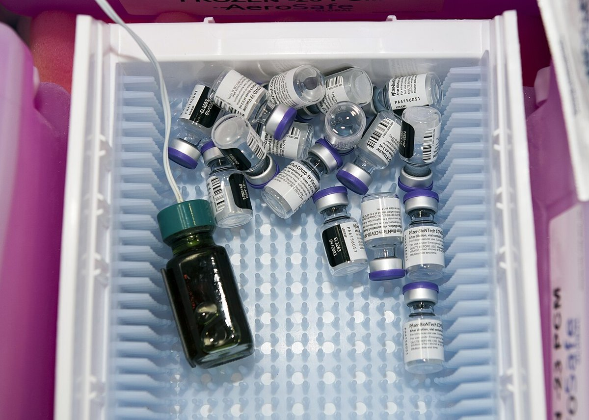

# COVID-19 vaccines and Operation Warp Speed

**Prerequisites:** [COVID-19](../03-diseases/covid-19.md); [mRNA vaccines](../01-how-vaccines-work/09-mrna-vaccines.md); [The development pipeline](../02-development-and-regulation/01-development-pipeline.md)

*US military personnel at Joint Base Elmendorf-Richardson, Alaska, being vaccinated after the base received its first COVID-19 vaccine shipment, January 2021. Credit: Airman 1st Class Samuel Colvin. License: Public domain. Source: [File:210104-F-YL679-1060.jpg](https://commons.wikimedia.org/wiki/File:210104-F-YL679-1060.jpg).*

## Years of groundwork

The COVID-19 vaccines were fast, but they built on decades of work. Katalin Karikó and Drew Weissman showed in 2005 that modifying the nucleosides in mRNA stopped it from triggering harmful innate immune responses ([Karikó et al., *Immunity* 2005](https://doi.org/10.1016/j.immuni.2005.06.008)), work recognised with the 2023 Nobel Prize ([Nobel Prize in Physiology or Medicine 2023, press release](https://www.nobelprize.org/prizes/medicine/2023/press-release/)). Researchers at the US National Institutes of Health and elsewhere had learned from SARS and MERS that stabilising the coronavirus spike protein in its prefusion shape produced better antibodies. Adenovirus vector platforms had been developed for Ebola and other diseases.

## The race

The SARS-CoV-2 genome was published in January 2020. Moderna, working with the NIH's Vaccine Research Center, began a phase 1 trial in March 2020. Pfizer partnered with the German company BioNTech; Oxford University with AstraZeneca.

The US government launched **Operation Warp Speed** in May 2020, a partnership of HHS and the Department of Defense led by Moncef Slaoui, a former GSK vaccine executive, and General Gustave Perna. Its strategy was to fund several candidates on different platforms at once, run clinical phases in overlapping fashion, and pay for manufacturing at financial risk before results were known, so that doses would be ready if trials succeeded ([Slaoui & Hepburn, *NEJM* 2020](https://doi.org/10.1056/nejmp2027405)). More than ten billion dollars was committed. Pfizer did not take development money but signed a contract to supply 100 million doses for about 1.95 billion dollars. Slaoui's large shareholding in Moderna, which he divested after criticism, was one of several conflict-of-interest controversies.

## Results and rollout

In November 2020 Pfizer–BioNTech and Moderna reported efficacy of about 95% against symptomatic disease in trials of about 44,000 and 30,000 people ([Polack et al., *NEJM* 2020 (BNT162b2 trial)](https://doi.org/10.1056/NEJMoa2034577); [Baden et al., *NEJM* 2021 (mRNA-1273 trial)](https://doi.org/10.1056/NEJMoa2035389)). The UK authorised the Pfizer–BioNTech vaccine on 2 December 2020 and began vaccinating on 8 December; Canada authorised it on 9 December and the US issued an Emergency Use Authorization on 11 December. Full US approval followed in August 2021. Within a year, billions of doses had been given worldwide.

## Criticisms

- **Speed and follow-up**: trials followed participants for a median of about two months at the time of authorisation; long-term outcomes were unknown, and rare harms such as myocarditis and VITT appeared only after rollout.
- **Endpoints**: trials measured symptomatic infection, not severe disease or transmission, which some argued was the wrong target.
- **Trial conduct**: in 2021 *The BMJ* published allegations from Brook Jackson, a former employee of Ventavia, a contractor running Pfizer trial sites in Texas, of data-integrity problems ([Thacker, *BMJ* 2021](https://doi.org/10.1136/bmj.n2635)). Her False Claims Act suit was dismissed after the Justice Department moved to end it, and the Fifth Circuit affirmed in November 2026 ([*United States ex rel. Jackson v. Ventavia Research Group*, No. 24-40564 (5th Cir. 13 November 2026)](https://www.ca5.uscourts.gov/opinions/pub/24/24-40564-CV0.pdf)); the courts did not decide whether her allegations about the sites were true.
- **Profit and access**: manufacturers earned very large revenues, while low-income countries received vaccines late; COVAX fell far short of its goals. Moderna agreed in 2023 to pay the NIH for use of patented technology after a dispute over credit.

## Assessment

Supporters count the programme among the great scientific achievements of the century; modelling estimated that vaccines prevented millions of deaths in their first year ([Watson et al., *Lancet Infectious Diseases* 2022](https://doi.org/10.1016/S1473-3099(22)00320-6)). Critics see a rushed process whose harms were downplayed and whose mandates damaged trust. Both views shape current policy, including the 2025 US decisions to narrow COVID-19 recommendations and end BARDA funding for mRNA projects ([Prasad & Makary, *NEJM* 2025, "An Evidence-Based Approach to Covid-19 Vaccination"](https://doi.org/10.1056/NEJMsb2506929); [HHS press release, "HHS Winds Down mRNA Vaccine Development Under BARDA" (5 August 2025)](https://www.hhs.gov/press-room/hhs-winds-down-mrna-development-under-barda.html)). See [COVID-19 vaccines, mandates and mortality](../07-controversies/10-covid-19-vaccines-mandates-and-mortality.md).

## Key ideas

- COVID-19 vaccines rested on decades of mRNA, spike protein and vector research.
- Operation Warp Speed funded multiple candidates and at-risk manufacturing; the first vaccines were authorised within a year.
- Speed, follow-up, trial conduct, conflicts of interest and global access were all criticised.

## Where this leads

- Back to: [History](README.md).
- Next section: [Schedules](../05-schedules/README.md).
