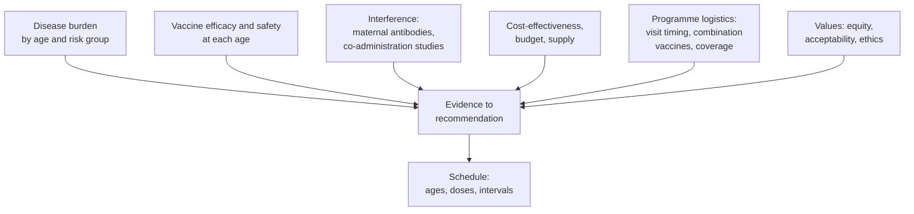

# How schedules are built

**Prerequisites:** [Advisory committees](../02-development-and-regulation/06-advisory-committees-acip-naci-and-jcvi.md); [Immunological memory](../../07-immunological-memory.md)

## A schedule is a set of trade-offs

An immunisation schedule specifies which vaccines are given, at what ages, how many doses and at what intervals. It is not a single scientific fact but the result of trade-offs, which is why schedules differ between countries that share the same evidence.

## Why the timing?

- **Protect before the danger peaks.** Pertussis, Hib and pneumococcal disease are most dangerous in the first months of life, so their vaccines start at two months (US, Canada, UK) or three months (Nordic countries).
- **Maternal antibodies.** Antibodies passed across the placenta protect newborns for a few months against some diseases, but they also neutralise live vaccines. Measles vaccine works poorly before about 9–12 months for this reason, which is why MMR is given at 12–15 months.
- **Immune maturity.** Young infants respond poorly to plain polysaccharides, so conjugate vaccines are used ([conjugate vaccines](../01-how-vaccines-work/07-conjugate-vaccines.md)).
- **Priming and boosting.** Several spaced doses build stronger and longer-lasting immunity; minimum intervals (often four weeks) allow the immune response to mature.
- **Before exposure.** HPV vaccine is given at 9–14 years, before sexual activity begins.
- **Natural history quirks.** Rotavirus vaccine must start early because the background risk of intussusception rises later in infancy ([rotavirus](../03-diseases/rotavirus.md)).

## Giving vaccines together

Most schedules give several vaccines at the same visit and use combination vaccines (such as six-in-one infant shots). Before a new vaccine is added, **co-administration studies** check that giving it with existing vaccines does not reduce immune responses or increase side effects unacceptably. Some combinations do increase side effects: MMRV doubles the risk of febrile seizures as a first dose compared with separate MMR and varicella ([Klein et al., *Pediatrics* 2010](https://doi.org/10.1542/peds.2010-0665)), and Bexsero with routine infant vaccines causes more fever.

Critics argue that the cumulative effect of the whole schedule has not been tested as such. The Institute of Medicine's 2013 review agreed that few studies examine the schedule as a whole, found no evidence of harm, and judged a randomised trial of the full schedule against no vaccines unethical ([Institute of Medicine, *The Childhood Immunization Schedule and Safety* (2013)](https://doi.org/10.17226/13563)). See [too many, too soon](../07-controversies/07-too-many-too-soon.md).

## Cost and programme considerations

Some countries, notably the UK, require recommendations to be cost-effective ([UKHSA, "Complete routine immunisation schedule from 1 September 2026"](https://www.gov.uk/government/publications/the-complete-routine-immunisation-schedule/complete-routine-immunisation-schedule-from-1-july-2026)). Others weigh cost less formally. Practical factors also matter: fitting vaccines into existing visits, the number of injections per visit, supply, and whether a vaccine can be delivered through schools. A vaccine may be added in one country and not another because of differences in disease rates (hepatitis B, tuberculosis), healthcare systems (who pays for hospital care), or values (how much weight to give rare harms against common benefits).

## How a vaccine gets added

The typical path: licensing, then a committee review of evidence and cost-effectiveness, then a recommendation, then funding decisions (in Canada by each province; in the US through insurance mandates and the Vaccines for Children programme). Removing or downgrading a vaccine follows the same path in reverse, which is one reason the January 2026 US changes, made by the CDC acting director following a presidential memorandum rather than through the usual ACIP evidence review, were challenged in court ([CDC newsroom, "CDC Acts on Presidential Memorandum to Update Childhood Immunization Schedule" (5 January 2026)](https://www.cdc.gov/media/releases/2026/2026-cdc-acts-on-presidential-memorandum-to-update-childhood-immunization-schedule.html); [*American Academy of Pediatrics v. Kennedy*, First Circuit docket 26-1503 (CourtListener)](https://www.courtlistener.com/docket/73286021/american-academy-of-pediatrics-v-kennedy/)).

## Key ideas

- Schedules balance disease risk by age, immune response, interference, safety, cost and logistics.
- Timing reflects when diseases are most dangerous, maternal antibodies and immune maturity.
- Co-administration is tested vaccine by vaccine; the full schedule has been studied less directly.
- Countries reach different schedules from similar evidence because of different burdens, systems and values.

## Where this leads

- Next: [The US schedule](02-the-us-schedule.md).
