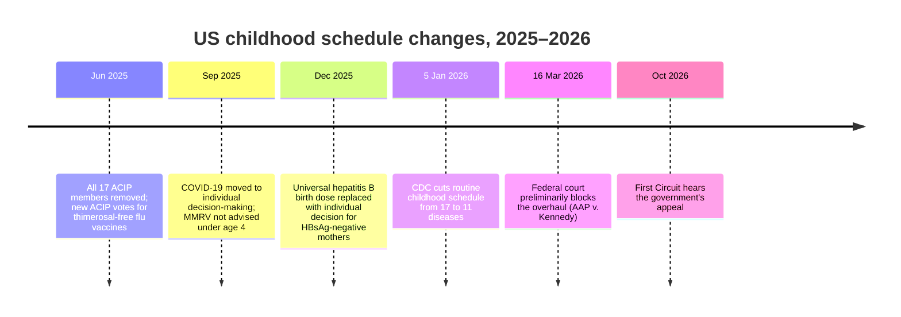

# The US schedule

**Prerequisites:** [How schedules are built](01-how-schedules-are-built.md); [Advisory committees](../02-development-and-regulation/06-advisory-committees-acip-naci-and-jcvi.md)

## The schedule before 2025

By 2024 the CDC's routine childhood and adolescent schedule protected against 17 or 18 diseases, depending on how they are counted. In outline:

| Age | Vaccines |
|---|---|
| Birth | Hepatitis B |
| 2, 4, 6 months | DTaP, Hib, pneumococcal conjugate, polio (IPV), rotavirus, hepatitis B (by 6–18 months) |
| 6 months onward | Influenza every year; COVID-19 |
| 12–15 months | MMR, varicella, Hib and PCV boosters, hepatitis A (two doses by 2 years) |
| 15–18 months | DTaP |
| 4–6 years | DTaP, IPV, MMR, varicella |
| 11–12 years | Tdap, HPV, MenACWY |
| 16 years | MenACWY booster; MenB by shared decision |
| Infants (RSV season) | Nirsevimab or maternal RSV vaccine |

These recommendations mattered beyond medicine: under the Affordable Care Act most insurers had to cover them without cost-sharing; the Vaccines for Children programme bought vaccines for about half of US children; and each state used them to set school entry requirements, with exemptions varying by state (see [exemptions](../07-controversies/15-religious-and-philosophical-exemptions.md)).

## The 2025–2026 changes

After Robert F. Kennedy Jr. became HHS Secretary, US policy changed rapidly. He removed all 17 ACIP members in June 2025 and appointed new ones ([CDC newsroom, ACIP June 2025 meeting votes](https://www.cdc.gov/media/releases/2025/2025-cdcs-advisory-committee-on-immunization-concludes-meeting-with-joint-statement.html)). The new committee voted to use only thimerosal-free influenza vaccines ([HHS press release on removing thimerosal from US influenza vaccines (23 July 2025)](https://www.hhs.gov/press-room/thimerosal-mercury-removed-from-us-flu-vaccines-acip.html)), moved COVID-19 vaccination to individual decision-making, advised against MMRV under age four, and in December 2025 ended the universal hepatitis B birth-dose recommendation for infants of mothers testing negative ([CDC newsroom, ACIP hepatitis B birth-dose vote (5 December 2025)](https://www.cdc.gov/media/releases/2025/2025-acip-recommends-individual-based-decision-making-for-hepatitis-b-vaccine-for-infants-born-to-women.html)).

Following a presidential memorandum of 5 December 2025 directing that the schedule be aligned with those of peer countries, acting CDC director Jim O'Neill on 5 January 2026 reduced the routine childhood schedule from 17 to 11 diseases, explicitly modelled on Denmark ([CDC newsroom, "CDC Acts on Presidential Memorandum to Update Childhood Immunization Schedule" (5 January 2026)](https://www.cdc.gov/media/releases/2026/2026-cdc-acts-on-presidential-memorandum-to-update-childhood-immunization-schedule.html); [HHS fact sheet, "CDC Childhood Immunization Recommendations" (January 2026)](https://www.hhs.gov/press-room/fact-sheet-cdc-childhood-immunization-recommendations.html)):

- **Recommended for all children**: diphtheria, tetanus, pertussis, Hib, pneumococcal, polio, measles, mumps, rubella, varicella, and HPV (cut to one dose).
- **High-risk groups only**: RSV, hepatitis A, hepatitis B, dengue, MenACWY and MenB.
- **Shared clinical decision-making**: rotavirus, COVID-19, influenza, meningococcal, hepatitis A and hepatitis B.

HHS said insurance coverage would continue for all of these vaccines ([KFF, "The New Federal Vaccine Schedule for Children: What Changed and What Are the Implications?"](https://www.kff.org/other-health/the-new-federal-vaccine-schedule-what-changed/)).

## The arguments

Supporters argued that the US schedule was the most extensive in the world, that Denmark and other wealthy countries achieve good health with fewer vaccines, that some vaccines (hepatitis B at birth, COVID-19 for healthy children) offer small benefits to most children, and that public trust required less one-size-fits-all policy.

Critics, including the American Academy of Pediatrics and many former CDC officials, argued that Denmark differs in ways that matter (universal health care, a lower prevalence of hepatitis B, universal prenatal hepatitis B screening and smaller gaps in access to care), that the change bypassed the usual evidence review, that "shared decision-making" in practice reduces uptake, and that cuts came during the largest measles outbreaks in decades. The AAP and several states issued their own schedules.

## The court challenge

The AAP and others sued. On 16 March 2026 a federal judge in Massachusetts preliminarily blocked the overhaul and the reconstituted ACIP, finding the challengers likely to succeed on claims under the Administrative Procedure Act and Federal Advisory Committee Act ([*American Academy of Pediatrics v. Kennedy*, First Circuit docket 26-1503 (CourtListener)](https://www.courtlistener.com/docket/73286021/american-academy-of-pediatrics-v-kennedy/); [AP News, "Judge blocks changes to US government vaccine recommendations" (March 2026)](https://apnews.com/article/kennedy-acip-vaccines-cdc-fc758951019f41d2f5e81e4e2faa22d3)). The First Circuit heard the government's appeal in October 2026; at the time of writing it has not ruled, and the earlier schedule remains in force. See [[mandate-cases-jacobson-to-covid|mandate cases]].

## Key ideas

- Before 2025 the US routinely vaccinated children against 17–18 diseases, with legal and insurance consequences.
- In 2025–26 ACIP was replaced and the routine schedule cut to 11 diseases, modelled on Denmark.
- A federal court blocked the overhaul in March 2026; an appeal is pending.

## Where this leads

- Next: [Canada's schedule](03-canadas-schedule.md); compare [the Danish and Nordic schedules](05-the-danish-and-nordic-schedules.md).
