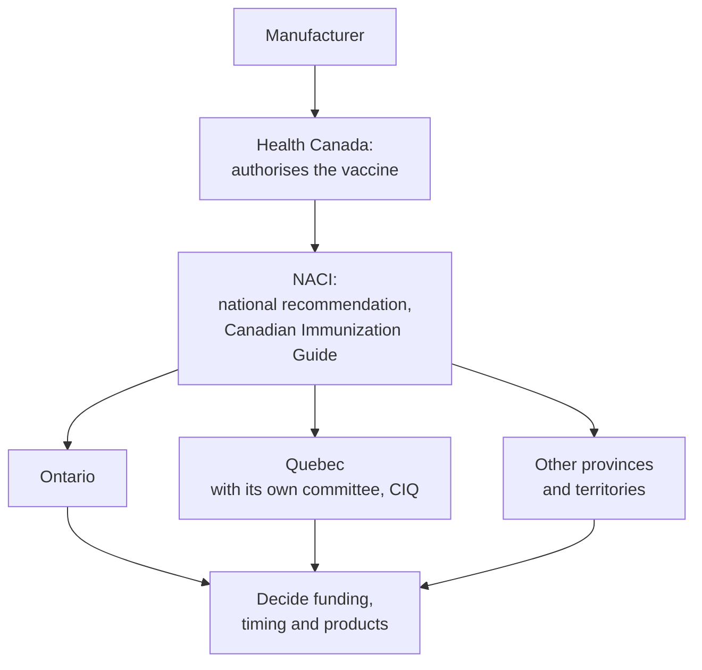

# Canada's schedule

**Prerequisites:** [How schedules are built](01-how-schedules-are-built.md); [Advisory committees](../02-development-and-regulation/06-advisory-committees-acip-naci-and-jcvi.md)

## Thirteen schedules

Health care is a provincial and territorial responsibility in Canada, so there is no single national schedule. The **National Advisory Committee on Immunization (NACI)** gives national recommendations, published in the *Canadian Immunization Guide* ([Public Health Agency of Canada, *Canadian Immunization Guide*: recommended immunization schedules](https://www.canada.ca/en/public-health/services/publications/healthy-living/canadian-immunization-guide-part-1-key-immunization-information/page-13-recommended-immunization-schedules.html)), and each province and territory decides what it funds and when. The result is broadly similar schedules with differences in timing, products and some vaccines. Vaccines in provincial programmes are free; there is no equivalent of US insurance mandates. Vaccination is not generally required for school, except in Ontario and New Brunswick, which require proof of certain vaccines or a documented exemption.

## Ontario as an example

Ontario's publicly funded routine schedule as published in 2026 ([Ontario Ministry of Health, "Ontario's routine immunization schedule"](https://www.ontario.ca/page/ontarios-routine-immunization-schedule)):

| Age | Vaccines |
|---|---|
| 2 months | DTaP-IPV-Hib, pneumococcal conjugate, rotavirus |
| 4 months | DTaP-IPV-Hib, pneumococcal conjugate, rotavirus |
| 6 months | DTaP-IPV-Hib |
| 1 year | Pneumococcal conjugate, meningococcal conjugate, MMR |
| 15 months | Varicella |
| 18 months | DTaP-IPV-Hib |
| 4 years | Tdap-IPV, MMRV |
| Grade 7 | Hepatitis B, HPV, MenACYW |
| 14 years | Tdap |
| Adults | Td every 10 years; Tdap once and in every pregnancy; influenza and COVID-19 yearly; pneumococcal at 65; shingles at 65–70; RSV at 75 and older (and some 60–74) |

Ontario also offers RSV protection to eligible infants and high-risk children in season, and RSV vaccine to adults aged 60–74 with risk factors. Pregnant people are offered pertussis, flu and COVID-19 vaccines, and RSV vaccine is available in pregnancy to protect newborns.

## Notable differences from the US

- **Hepatitis B** is mostly given in school (grade 7 in Ontario) rather than at birth, with infant doses for babies of infected mothers and in some provinces (Quebec, for example, includes it in infant combination vaccines). This school-based approach has been cited in US debates about the birth dose.
- **Hepatitis A** is not part of most routine childhood schedules; it is offered to travellers and risk groups.
- **Meningococcal**: a meningococcal conjugate dose at one year and another in grade 7, rather than US-style adolescent doses only.
- **Influenza and COVID-19** are recommended by NACI for everyone six months and older, with provinces deciding programme details; in 2025 NACI emphasised vaccination of higher-risk groups for COVID-19.
- **Pneumococcal** vaccine for adults is given at 65 in Ontario, whereas the US lowered its adult age to 50 in 2024.

## Mandatory reporting and compensation

Canadian health professionals report adverse events following immunisation to public health (see [surveillance outside the US](../02-development-and-regulation/10-surveillance-outside-the-us.md)). Since 2021 Canada has had a federal no-fault compensation programme, now the Vaccine Impact Assistance Program, alongside Quebec's longstanding programme; see [Canada's compensation programs](../08-litigation-and-compensation/07-canadas-compensation-programs.md).

## Measles and Canada's coverage

Canada lost measles elimination status in November 2025 after an outbreak that began in New Brunswick in October 2024 and spread mainly in under-vaccinated communities in Ontario and Alberta, with 5,462 confirmed and probable cases in 2025 and two deaths, both of premature babies infected before birth; 94% of outbreak cases were unvaccinated or of unknown status. The outbreak was declared over in October 2026 ([Public Health Agency of Canada, Measles and Rubella Weekly Monitoring Report](https://health-infobase.canada.ca/measles-rubella/); [PAHO, "PAHO calls for regional action as the Americas lose measles elimination status" (10 November 2025)](https://www.paho.org/en/news/10-11-2025-paho-calls-regional-action-americas-lose-measles-elimination-status)). The outbreak renewed debate over school requirements and catch-up programmes. See [[outbreaks-and-coverage|outbreaks and coverage]].

## Key ideas

- NACI recommends; each province and territory decides and funds its own schedule.
- Ontario's schedule is broadly similar to the pre-2025 US schedule but gives hepatitis B in grade 7 and does not routinely include hepatitis A.
- Only Ontario and New Brunswick require school vaccination, with exemptions.
- Canada lost measles elimination in 2025.

## Where this leads

- Next: [The UK schedule](04-the-uk-schedule.md).
