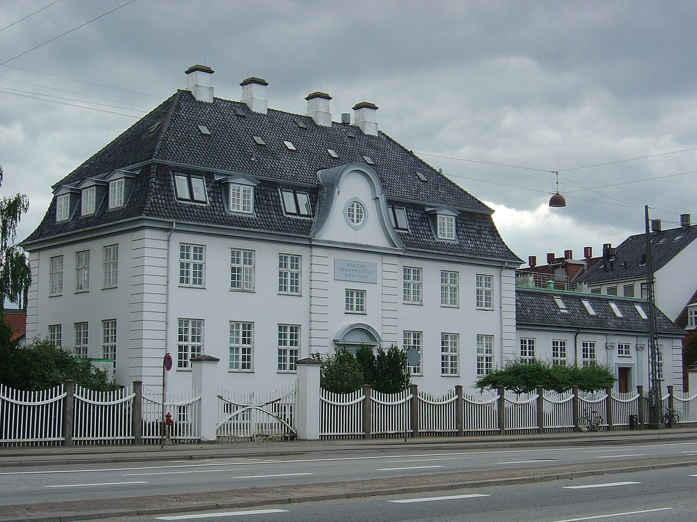

# The Danish and Nordic schedules

**Prerequisites:** [How schedules are built](01-how-schedules-are-built.md)

*Statens Serum Institut in Copenhagen, Denmark's national public health and vaccine institute. Credit: Froztbyte. License: [CC BY-SA 3.0](https://creativecommons.org/licenses/by-sa/3.0). Source: [File:Statens_Serum_Institut_hovedbygning.JPG](https://commons.wikimedia.org/wiki/File:Statens_Serum_Institut_hovedbygning.JPG).*

## Denmark: a short schedule

Denmark's childhood programme is voluntary, free and delivered by family doctors, who send reminders through the national digital post system. It covers ([Danish Health Authority, *The Danish Childhood Immunisation Programme* (English, 2022)](https://www.sst.dk/media/ymhpf0cq/boernevaccinationsprogrammet-i-danmark-2022-engelsk.pdf)):

| Age | Vaccines |
|---|---|
| 3, 5 and 12 months | Diphtheria-tetanus-pertussis-polio-Hib combination, pneumococcal conjugate |
| 15 months | MMR |
| 4 years | MMR |
| 5 years | Diphtheria-tetanus-pertussis-polio booster |
| 12 years | HPV (girls and, since 2019, boys) |

Pregnant women are offered pertussis vaccination, and young children have been offered seasonal flu vaccine in recent seasons. Compared with the pre-2025 US schedule, Denmark does not routinely vaccinate against hepatitis B (it screens all pregnant women and vaccinates infants of infected mothers), hepatitis A, rotavirus, varicella, meningococcal disease, or (for healthy children) COVID-19. It uses a "3, 5, 12 months" priming schedule with fewer infant doses.

## Why Denmark became the model

Denmark's schedule was the explicit model for the January 2026 US changes ([CDC newsroom, "CDC Acts on Presidential Memorandum to Update Childhood Immunization Schedule" (5 January 2026)](https://www.cdc.gov/media/releases/2026/2026-cdc-acts-on-presidential-memorandum-to-update-childhood-immunization-schedule.html)). Supporters pointed out that Denmark has low child mortality and high life expectancy with far fewer vaccines. Critics replied that Denmark differs from the US: low hepatitis B prevalence and universal prenatal screening; universal health care that makes rotavirus or chickenpox complications easier to manage; smaller inequalities; and a single national registry system. Danish officials and scientists also noted that Denmark's choices reflect its own cost-effectiveness judgements, not a finding that other vaccines are unsafe.

## Registries and research

Denmark, like the other Nordic countries, assigns every resident a personal identification number linking vaccinations, hospital diagnoses, prescriptions and deaths. This makes it possible to study whole national populations. Danish registry studies are among the most cited in vaccine safety: MMR and autism in 537,303 children ([Madsen et al., *NEJM* 2002](https://doi.org/10.1056/NEJMoa021134)) and 657,461 children ([Hviid et al., *Annals of Internal Medicine* 2019](https://doi.org/10.7326/M18-2101)), thimerosal and autism ([Hviid et al., *JAMA* 2003 (thimerosal)](https://doi.org/10.1001/jama.290.13.1763)), and HPV vaccine safety. Critics of these studies have questioned diagnostic coding and the involvement of Statens Serum Institut, which also produced and sold vaccines until its vaccine production business was sold in 2016–17; see [[mmr-and-autism|MMR and autism]] and [[conflicts-of-interest-and-funding|conflicts of interest and funding]].

## The other Nordic countries

The Nordic schedules are not identical:

- **Sweden** and **Norway** added hepatitis B to infant combination vaccines and introduced rotavirus vaccine in the 2010s.
- **Finland** introduced rotavirus vaccine in 2009 and offers flu vaccine to young children; it was also the country most affected by Pandemrix-associated narcolepsy ([Nohynek et al., *PLoS One* 2012](https://doi.org/10.1371/journal.pone.0033536)).
- All give MMR in two doses and HPV in adolescence, and none has school vaccination requirements; coverage relies on trust and reminders.

Sweden's 1979 decision to stop whole-cell pertussis vaccination, after concerns about its safety and efficacy, was followed by a large resurgence of pertussis until acellular vaccines were introduced in 1996, an episode discussed in [[dtp-and-whole-cell-pertussis|DTP and whole-cell pertussis]] ([Gangarosa et al., *Lancet* 1998](https://doi.org/10.1016/S0140-6736(97)04334-1)).

## Key ideas

- Denmark vaccinates against about ten diseases in childhood, with no hepatitis B (except for infants of infected mothers), rotavirus, varicella or meningococcal vaccines.
- It was the model for the 2026 US cuts; critics argue the countries' health systems and disease patterns differ.
- Nordic registries underpin many of the largest vaccine-safety studies.

## Where this leads

- Next: [Comparing schedules](06-comparing-schedules.md).
