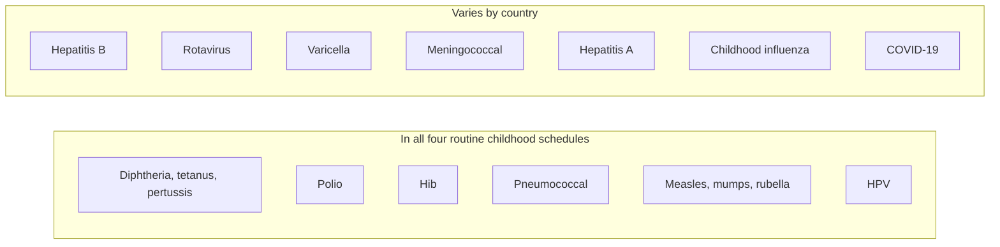

# Comparing schedules

**Prerequisites:** [The US schedule](02-the-us-schedule.md); [Canada's schedule](03-canadas-schedule.md); [The UK schedule](04-the-uk-schedule.md); [The Danish and Nordic schedules](05-the-danish-and-nordic-schedules.md)

## The core is shared

Every high-income country vaccinates children against diphtheria, tetanus, pertussis, polio, Hib, pneumococcal disease, measles, mumps, rubella and HPV. These are the vaccines whose benefits are largest and least disputed, and they correspond closely to the 11-disease US core adopted in January 2026 (which added varicella). Differences lie at the margins.

## Side by side (routine programmes for healthy children, late 2026)

| Disease | US pre-2025 | US Jan 2026 (blocked) | Ontario | UK | Denmark |
|---|---|---|---|---|---|
| Diphtheria, tetanus, pertussis, polio, Hib | Yes | Yes | Yes | Yes | Yes |
| Pneumococcal | Yes | Yes | Yes | Yes | Yes |
| Measles, mumps, rubella | Yes | Yes | Yes | Yes | Yes |
| HPV | Yes (2 doses) | Yes (1 dose) | Yes (grade 7) | Yes (1 dose) | Yes |
| Varicella | Yes | Yes | Yes | Yes (from 2026) | No |
| Hepatitis B | Birth + infancy | Risk-based / shared decision | Grade 7 | Infancy (6-in-1) | Risk-based |
| Rotavirus | Yes | Shared decision | Yes | Yes | No |
| Meningococcal | Adolescent ACWY | Risk-based / shared decision | Infant C-conjugate + adolescent | Infant B; adolescent ACWY | No |
| Hepatitis A | Yes | Risk-based / shared decision | No | No | No |
| Influenza (children) | Yearly from 6 months | Shared decision | Yearly from 6 months | Nasal, age 2 to end of secondary school | Offered to ages 2–6 |
| COVID-19 (healthy children) | Yes (until 2025) | Shared decision | Offered from 6 months | No | No |

Sources: [CDC newsroom, "CDC Acts on Presidential Memorandum to Update Childhood Immunization Schedule" (5 January 2026)](https://www.cdc.gov/media/releases/2026/2026-cdc-acts-on-presidential-memorandum-to-update-childhood-immunization-schedule.html); [Ontario Ministry of Health, "Ontario's routine immunization schedule"](https://www.ontario.ca/page/ontarios-routine-immunization-schedule); [UKHSA, "Complete routine immunisation schedule from 1 September 2026"](https://www.gov.uk/government/publications/the-complete-routine-immunisation-schedule/complete-routine-immunisation-schedule-from-1-july-2026); [Danish Health Authority, *The Danish Childhood Immunisation Programme* (English, 2022)](https://www.sst.dk/media/ymhpf0cq/boernevaccinationsprogrammet-i-danmark-2022-engelsk.pdf). Programmes change often; check current official schedules.

## Counting is slippery

Comparisons such as "the US gives 72 doses" or "Denmark vaccinates against ten diseases" depend on choices: whether annual flu shots for 18 years are counted, whether a combination injection counts as one dose or several, and whether adult or pregnancy doses are included. Antigen counts differ again; modern vaccines contain far fewer antigens than older ones ([Offit et al., *Pediatrics* 2002](https://doi.org/10.1542/peds.109.1.124)). Comparisons are more meaningful disease by disease.

## Why countries differ

- **Disease burden.** Hepatitis B is rarer in Northern Europe than in parts of the US population; tuberculosis is common enough in some countries to justify BCG at birth, which none of these four give routinely.
- **Screening alternatives.** Countries with near-universal prenatal hepatitis B screening and reliable follow-up can target infants at risk; the US adopted a universal birth dose in 1991 partly because targeted strategies missed many infants.
- **Health-care costs.** In the US, where hospital care is expensive and often paid by families or employers, vaccines that prevent hospitalisations for rotavirus or chickenpox are more clearly cost-saving.
- **Evaluation frameworks.** The UK requires cost-effectiveness; the US historically weighed it less formally.
- **Delivery.** School-based programmes (Canada, UK) make adolescent vaccination easier.
- **Values.** Countries weigh individual choice, rare adverse events and population benefit differently.

## What comparisons can and cannot show

Comparing national outcomes (infant mortality, life expectancy) across schedules is tempting but confounded: these outcomes are driven mostly by poverty, prematurity, access to care and many other factors. A claim that country X's shorter schedule "explains" its better infant mortality, or that country Y's longer schedule causes worse outcomes, cannot be supported by such ecological comparisons ([ecological studies](../../../../science/research-methods/reading-research/03-study-designs/03-ecological-studies.md)). A 2011 paper by Neil Miller and Gary Goldman reported that among the US and the 33 nations with lower infant mortality, those requiring more infant vaccine doses had higher infant mortality ([Miller & Goldman, *Human & Experimental Toxicology* 2011](https://doi.org/10.1177/0960327111407644)). Both authors are long-standing vaccine critics; Miller directs the vaccine-sceptical Thinktwice Global Vaccine Institute. A 2021 reanalysis by Nysetvold and colleagues, using the same public data for all 185 countries, found that vaccine doses explained under 3% of the variation, and that the Human Development Index, not vaccine doses, predicted infant mortality; it argued that the original selection of countries was unrepresentative ([Nysetvold et al., "Infant vaccination does not predict increased infant mortality rate: correcting past misinformation", medRxiv preprint 2021](https://doi.org/10.1101/2021.09.03.21263082), a preprint). Miller and Goldman replied that pooling rich and poor countries buries a real signal among wealthy ones ([Goldman & Miller, *Cureus* 2023 (response to critics)](https://doi.org/10.7759/cureus.34566)). Neither design can settle causation; that requires individual-level data. For how to read such studies, see [confounding](../../../../science/research-methods/reading-research/04-causation/02-confounding.md) in the reading-research course.

## Key ideas

- All rich countries share a core of about ten childhood vaccines.
- Differences (hepatitis B, rotavirus, varicella, meningococcal, hepatitis A, flu, COVID-19) reflect burden, costs, systems and values.
- Dose counts and cross-country outcome comparisons are easy to misuse.

## Where this leads

- Next: [Schedules over time](07-schedules-over-time.md).
